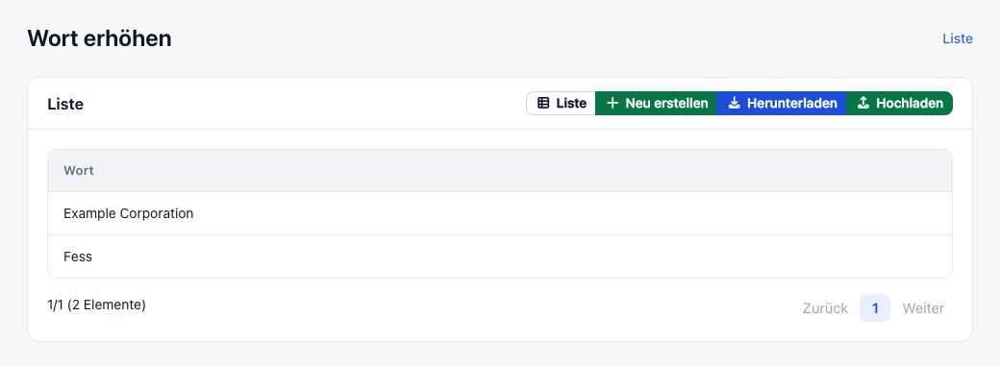
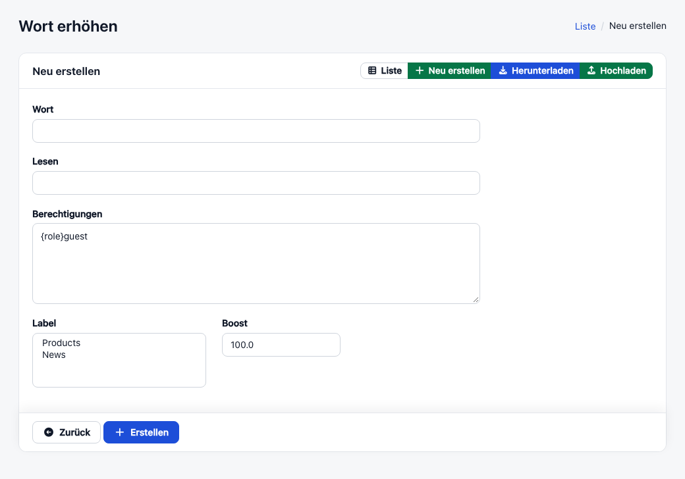
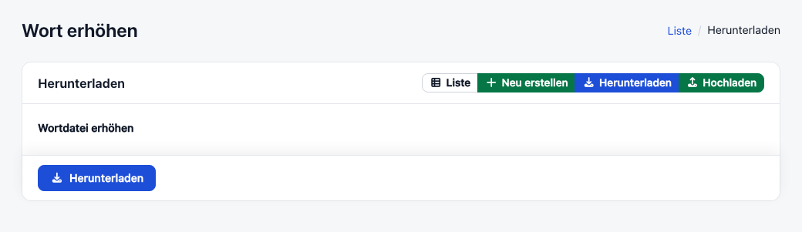
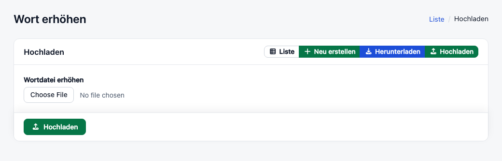

============
Wort erhöhen
============

Übersicht
=========

Hier wird die Konfiguration von „Wort erhöhen" (zusätzliche Wörter) für Vorschläge erläutert. Vorschläge werden entsprechend den Suchbegriffen angezeigt, aber Sie können zusätzliche Wörter hinzufügen.

Verwaltung
==========

Anzeige
-------

Um die Übersichtsseite für die Konfiguration von „Wort erhöhen" zu öffnen, klicken Sie im linken Menü auf [Vorschlagen > Wort erhöhen].

|image0|

Klicken Sie auf den Konfigurationsnamen, um ihn zu bearbeiten.

Konfiguration erstellen
-----------------------

Um die Konfigurationsseite für „Wort erhöhen" zu öffnen, klicken Sie auf die Schaltfläche „Neu erstellen".

|image1|

Konfigurationsparameter
-----------------------

Wort
::::

Geben Sie das Wort an, das als Vorschlagskandidat angezeigt werden soll.

Lesen
:::::

Geben Sie die Lesung des Vorschlagskandidatenworts an.

Berechtigung
::::::::::::

Legen Sie Rolleninformationen für das Wort fest.
Nur Benutzer mit der festgelegten Rolle können das Wort in den Vorschlägen sehen.
Für Benutzerebene geben Sie {user}Benutzername an, für Rollenebene {role}Rollenname und für Gruppenebene {group}Gruppenname.

Label
:::::

Legen Sie ein Label für das Wort fest.
Wenn ein anderes als das festgelegte Label ausgewählt ist, wird das Wort nicht in den Vorschlägen angezeigt.

Boost-Wert
::::::::::

Legen Sie einen Boost-Wert für das Wort fest.

.. note::
   Registrierte, bearbeitete oder gelöschte zusätzliche Wörter (auch per CSV-Upload) werden nicht sofort auf die Vorschläge angewendet. Sie werden übernommen, wenn der Job „Suggest Indexer" läuft, der den Vorschlagsindex neu aufbaut (standardmäßig täglich um 12:00 Uhr). Um sie sofort zu übernehmen, klicken Sie unter [System > Scheduler] auf „Suggest Indexer" und dann auf die Schaltfläche „Jetzt starten".

Konfiguration löschen
---------------------

Klicken Sie auf den Konfigurationsnamen auf der Übersichtsseite und dann auf die Schaltfläche „Löschen". Es wird ein Bestätigungsdialog angezeigt.
Klicken Sie auf die Schaltfläche „Löschen", um die Konfiguration zu löschen.

Download
========

Laden Sie registrierte Wörter im CSV-Format herunter.
Klicken Sie oben rechts auf der Seite auf „Herunterladen", um die Download-Seite zu öffnen, und klicken Sie dann auf die Schaltfläche „Herunterladen".

|image2|

CSV-Inhalt
----------

Zeile 1 ist die Kopfzeile.
Ab Zeile 2 werden die zusätzlichen Wörter aufgeführt.

::

"SuggestWord","Reading","Permissions","Labels","Boost"
"fess","ふぇす","{role}role1","label1","100"

Upload
======

Registrieren Sie Wörter im CSV-Format.
Klicken Sie oben rechts auf der Seite auf „Hochladen", um die Upload-Seite zu öffnen, wählen Sie die CSV-Datei unter „Wortdatei erhöhen" aus und klicken Sie auf die Schaltfläche „Hochladen".

|image3|

CSV-Inhalt
----------

Zeile 1 ist die Kopfzeile.
Ab Zeile 2 beschreiben Sie die zusätzlichen Wörter.

::

"SuggestWord","Reading","Permissions","Labels","Boost"
"fess","ふぇす","{role}role1","label1","100"

.. note::
   Geben Sie in der Spalte „Permissions" jeden Wert mit ``{role}``, ``{user}`` oder ``{group}`` an, etwa ``{role}role1`` (mehrere Werte durch Kommas trennen). Ein Wert ohne Präfix wie ``role1`` wird nicht als Rolle behandelt, und das Wort wird Benutzern mit dieser Rolle nicht vorgeschlagen.

