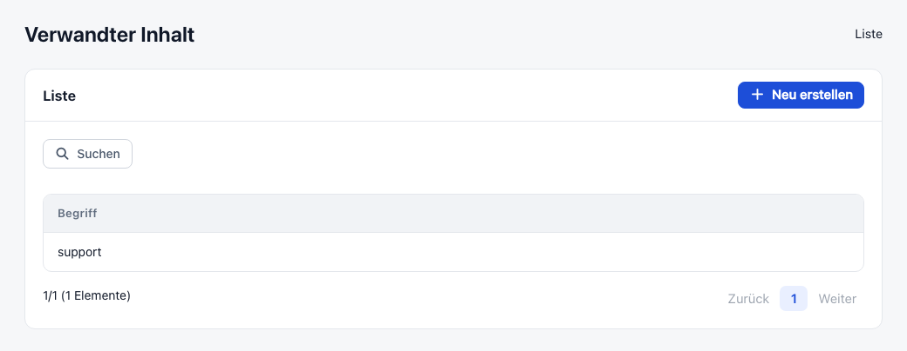
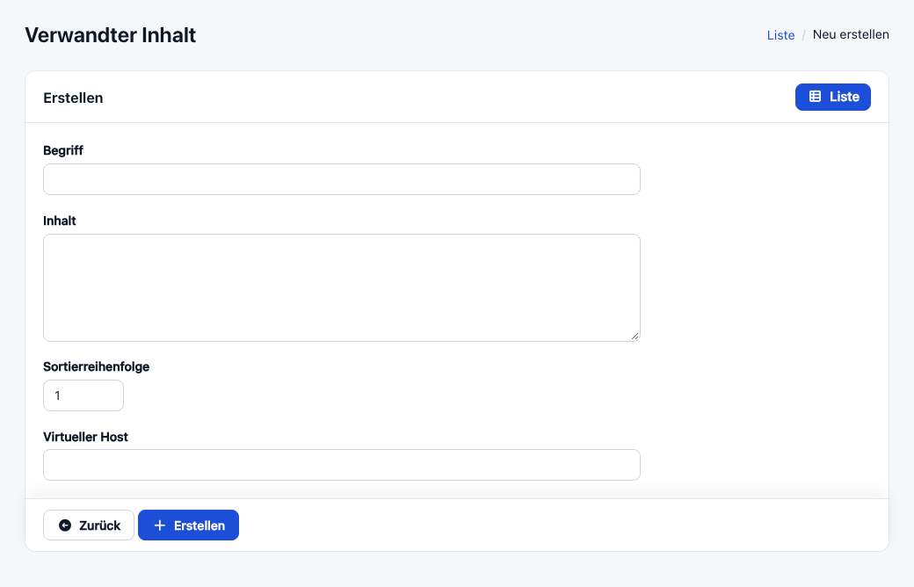

==================
Verwandte Inhalte
==================

Übersicht
=========

Hier wird die Konfiguration verwandter Inhalte erläutert.
Wenn die Suchabfrage mit dem angegebenen Suchbegriff übereinstimmt, können verwandte Inhalte oben in den Suchergebnissen angezeigt werden.

Verwaltung
==========

Anzeige
-------

Um die Übersichtsseite für die Konfiguration verwandter Inhalte zu öffnen, klicken Sie im linken Menü auf [Crawler > Verwandter Inhalt].

|image0|

Klicken Sie auf den Konfigurationsnamen, um ihn zu bearbeiten.

Konfiguration erstellen
-----------------------

Um die Konfigurationsseite für verwandte Inhalte zu öffnen, klicken Sie auf die Schaltfläche „Neu erstellen".

|image1|

Konfigurationsparameter
-----------------------

Begriff
:::::::

Geben Sie den Suchbegriff an, mit dem die Suchabfrage übereinstimmen soll.

Inhalt
::::::

Geben Sie den Inhalt an, der in den Suchergebnissen angezeigt werden soll.

Sortierreihenfolge
::::::::::::::::::

Geben Sie die Anzeigereihenfolge an, wenn mehrere verwandte Inhalte übereinstimmen. Sie werden in aufsteigender Reihenfolge angezeigt. Der Standardwert ist 1.

Virtueller Host
:::::::::::::::

Geben Sie den Hostnamen des virtuellen Hosts an.
Weitere Details finden Sie unter :doc:`Virtueller Host im Konfigurationshandbuch <../config/security-virtual-host>`.

Konfiguration löschen
---------------------

Klicken Sie auf den Konfigurationsnamen auf der Übersichtsseite und dann auf die Schaltfläche „Löschen". Es wird ein Bestätigungsdialog angezeigt.
Klicken Sie auf die Schaltfläche „Löschen", um die Konfiguration zu löschen.

