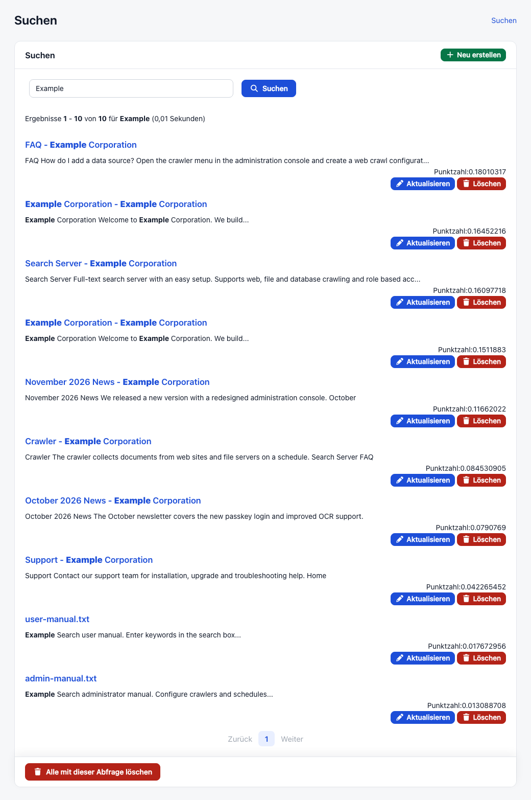
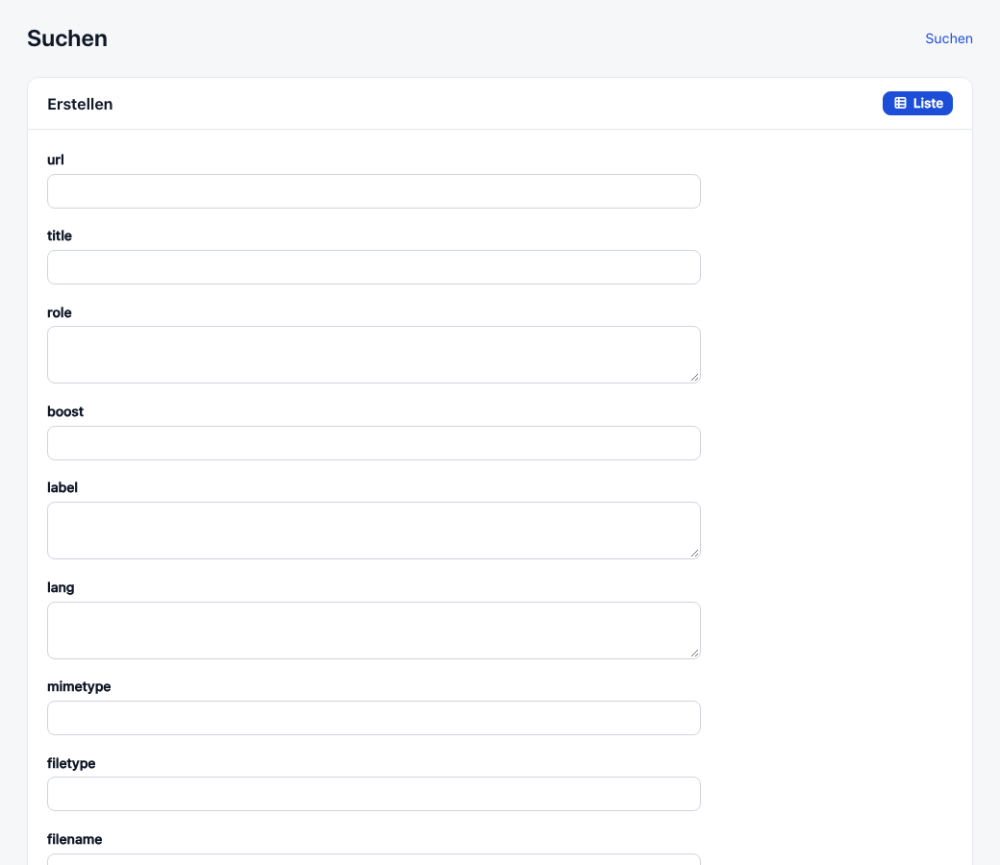

====
Suche
====

Übersicht
=========

Hier wird die Verwaltungssuche erläutert.

Verwaltung
==========

Anzeige
-------

Um die Suchseite zu öffnen, klicken Sie im linken Menü auf [Systeminformationen > Suche].

Geben Sie ein Stichwort in das Suchformular ein und klicken Sie auf die Schaltfläche „Suchen". Die Suchergebnisse werden wie unten dargestellt angezeigt.

|image0|

Um ein Dokument in den Ergebnissen zu bearbeiten, klicken Sie beim Dokument auf die Schaltfläche „Aktualisieren".
Um ein Dokument aus dem Index zu löschen, klicken Sie beim Dokument auf die Schaltfläche „Löschen" und anschließend im Bestätigungsdialog auf die Schaltfläche „Löschen".

Suchliste
---------

Sie können nach angegebenen Bedingungen suchen.
Im normalen Suchbildschirm werden Rollen- und Browser-Bedingungen implizit hinzugefügt, aber in dieser Verwaltungssuche werden sie nicht hinzugefügt.
Sie können auch bestimmte Dokumente aus dem Index aus den angezeigten Suchergebnissen löschen.

Massenlöschung
--------------

Wenn Sie alle Dokumente aus dem Index löschen möchten, können Sie dies tun, indem Sie „\*:\*" eingeben und auf die Schaltfläche „Alle mit dieser Abfrage löschen" am unteren Rand der Seite klicken. Es wird ein Bestätigungsdialog angezeigt.
Es ist auch möglich, nur Zieldokumente zu löschen, indem Sie Suchbedingungen angeben.

Dokument erstellen
------------------

Klicken Sie oben rechts auf der Seite auf die Schaltfläche „Neu erstellen", um ein Formular zum Hinzufügen eines Dokuments zum Index anzuzeigen.

|image1|

Das Formular listet die Felder des Dokuments unter ihren Feldnamen auf, etwa ``url``, ``title`` und ``role``. ``url`` und ``title`` sind Pflichtfelder.

- Ein Feld, das mehrere Werte aufnehmen kann, etwa ``role``, ``label``, ``lang`` und ``virtual_host``, ist ein Textbereich; geben Sie einen Wert pro Zeile ein.
- ``boost`` ist eine Zahl, ``content_length``, ``favorite_count`` und ``click_count`` sind Ganzzahlen.
- Ein Datumsfeld (``created``, ``timestamp``, ``last_modified`` und ``expires``) wird in der Form ``yyyy-MM-ddTHH:mm:ss.SSSZ`` eingegeben, etwa ``2026-01-01T00:00:00.000Z``.

Der Browser prüft das Format dieser Werte beim Absenden des Formulars. Klicken Sie auf die Schaltfläche „Erstellen", um das Dokument hinzuzufügen.
Das Formular zum Aktualisieren eines Dokuments enthält dieselben Felder.

