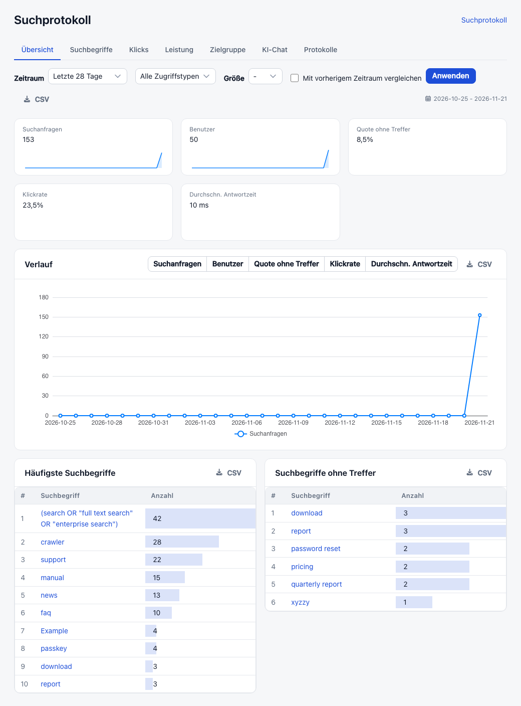
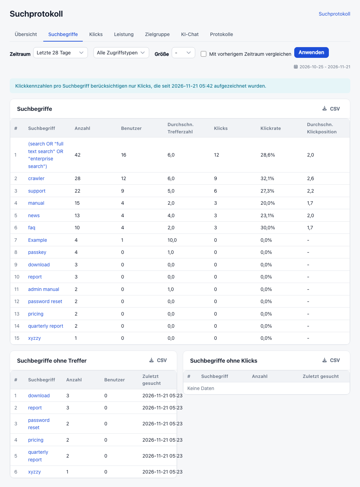
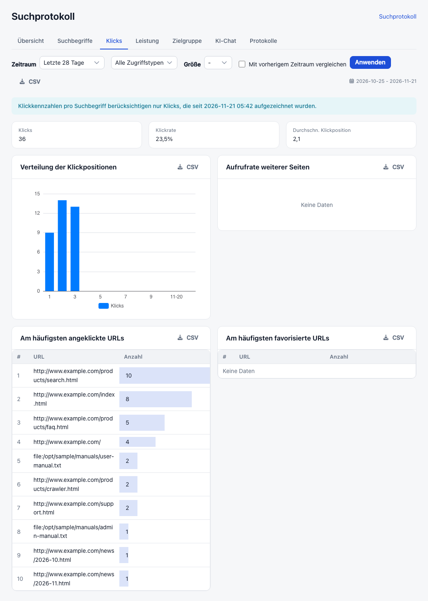
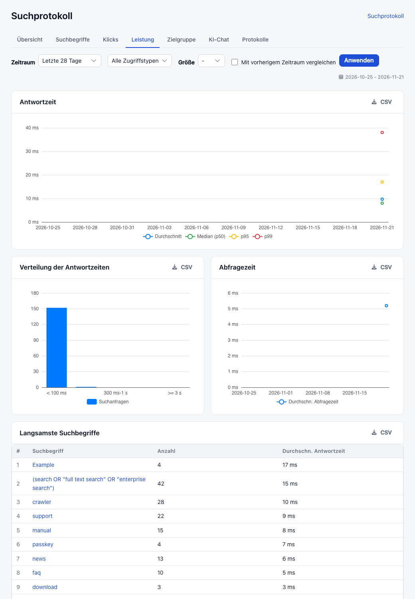
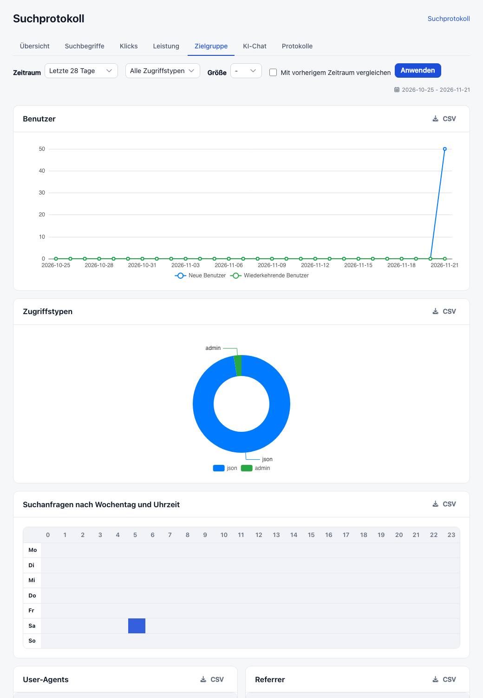
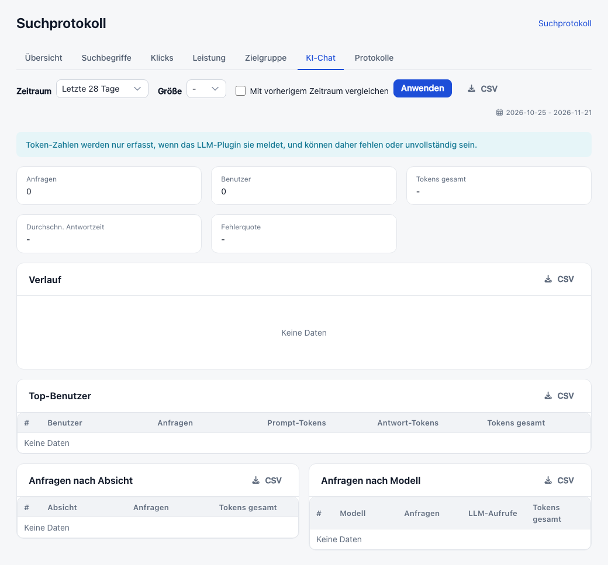
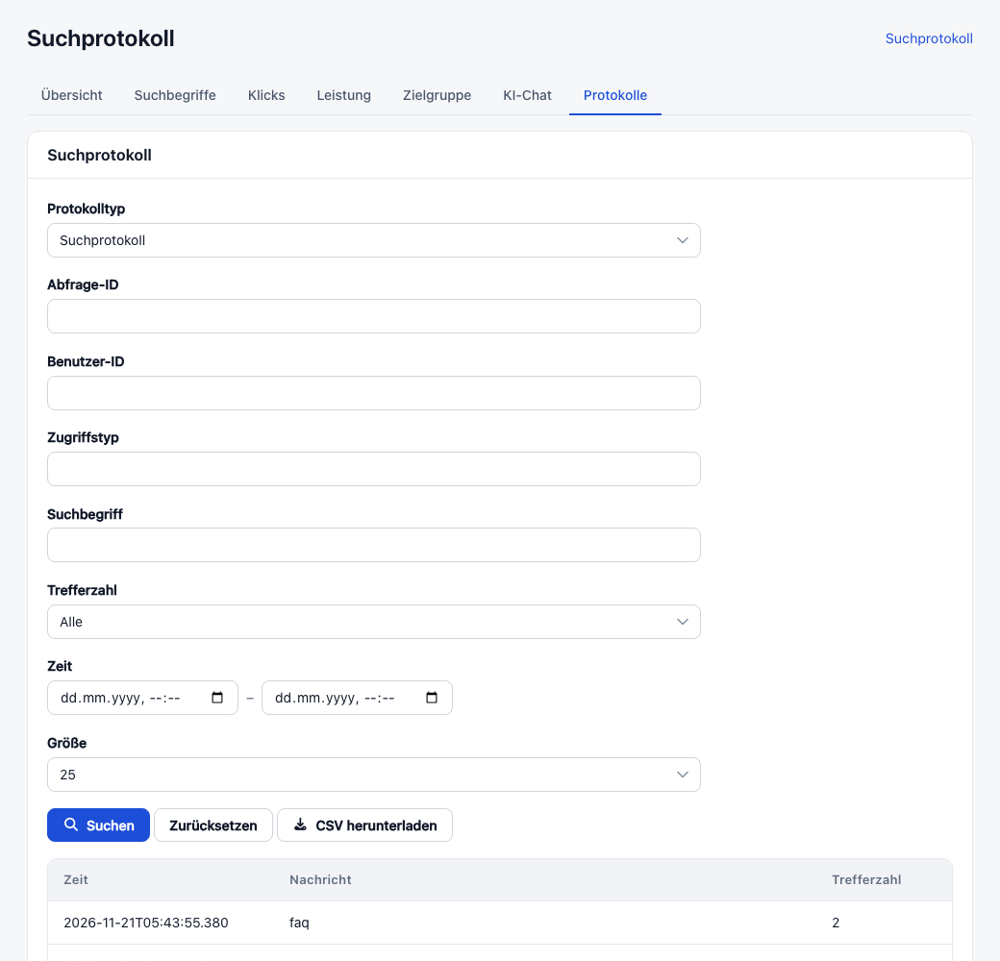
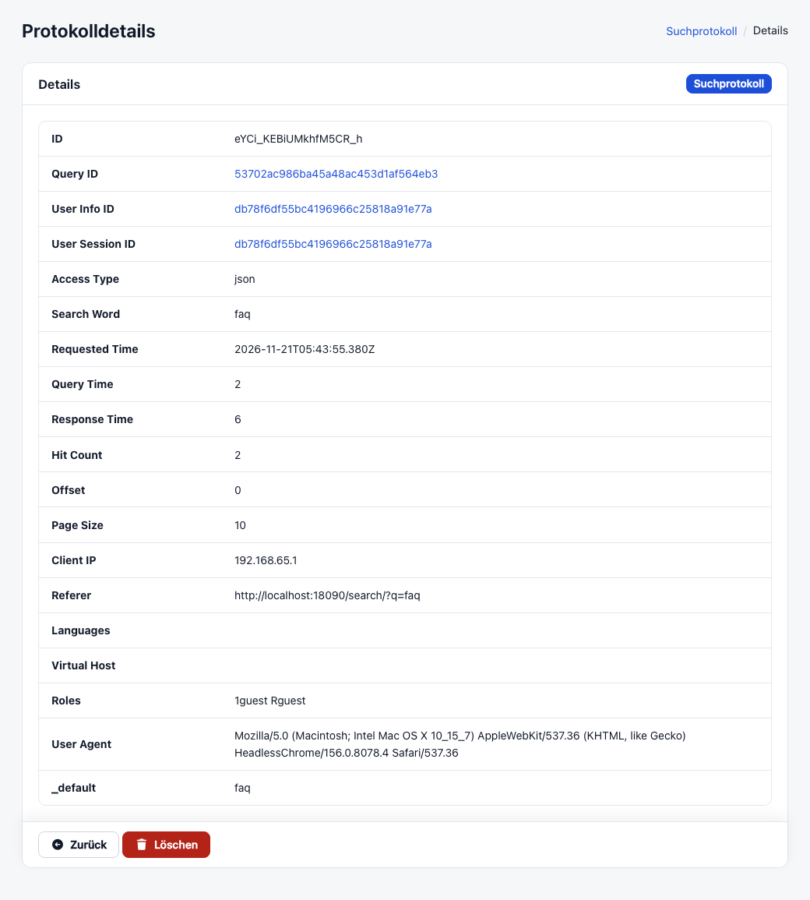

=============
Suchprotokoll
=============

Übersicht
=========

Suchen, Klicks und Favoriten werden aufgezeichnet. Die Seite Suchprotokoll zeigt Analyseberichte, die
sie zusammenfassen, sowie eine Liste der einzelnen Protokolle.

Um die Seite zu öffnen, wählen Sie im linken Menü [Systeminformationen > Suchprotokoll]. Zuerst wird
die Registerkarte „Übersicht“ angezeigt. Zum Anzeigen ist die Rolle ``admin-searchlog`` oder
``admin-searchlog-view`` erforderlich; mit ``admin-searchlog-view`` lassen sich keine Protokolle
löschen.

Analyseberichte
===============

Zeitraum und Filter
-------------------

Wählen Sie oben auf jeder Registerkarte den Zeitraum aus „Heute“, „Gestern“, „Letzte 7 Tage“,
„Letzte 28 Tage“ und „Letzte 90 Tage“, oder geben Sie mit „Benutzerdefiniert“ ein Start- und
Enddatum an (höchstens 366 Tage). Mit „Mit vorherigem Zeitraum vergleichen“ werden die Werte mit dem
gleich langen Zeitraum davor verglichen. Außerdem lassen sich die Zugriffsart und die Zeilenzahl der
Tabellen wählen. Zeiträume und Diagrammintervalle folgen den Kalendertagen der Zeitzone des Servers.

Registerkarten
--------------

- **Übersicht**: Suchanfragen, Benutzer, Quote ohne Treffer, Klickrate und durchschnittliche
  Antwortzeit, jeweils mit einem kleinen Verlaufsdiagramm und der Veränderung gegenüber dem
  vorherigen Zeitraum; ein Verlaufsdiagramm mit umschaltbarer Kennzahl (beim Vergleich wird der
  vorherige Zeitraum gestrichelt dargestellt); sowie die häufigsten Suchbegriffe und die Suchbegriffe
  ohne Treffer.

  |image0|

- **Suchbegriffe**: je Suchbegriff die Suchanfragen, Benutzer, durchschnittlichen Treffer, Klicks,
  Klickrate und durchschnittliche Klickposition. Außerdem die Suchbegriffe ohne Treffer (mit dem
  Zeitpunkt der letzten Suche) und die Suchbegriffe ohne Klicks, die Treffer hatten, deren Ergebnisse
  aber nie angeklickt wurden.

  |image1|

- **Klicks**: die am häufigsten angeklickten URLs, die am häufigsten favorisierten URLs, die
  Verteilung der Klickpositionen und der Anteil der Aufrufe ab Seite 2.

  |image2|

- **Leistung**: durchschnittliche Antwortzeit, Median (p50), p95 und p99, die Verteilung der
  Antwortzeiten, die langsamsten Suchbegriffe und die Abfragezeit.

  |image3|

- **Zielgruppe**: neue und wiederkehrende Benutzer, Zugriffsarten, Suchanfragen nach Wochentag und
  Uhrzeit sowie die häufigsten User-Agents, Referrer, Sprachen und virtuellen Hosts. „Suchanfragen
  nach Rolle und Gruppe“ zeigt für jede Rolle und Gruppe die Suchanfragen, Benutzer und die Quote ohne
  Treffer. Eine Suche zählt für jede Rolle und Gruppe des ausführenden Benutzers, daher kann die Summe
  der Zeilen über der Gesamtzahl liegen. Einzelne Benutzer werden nicht aufgeführt.

  |image4|

- **KI-Chat**: Anfragen, Benutzer, Tokens insgesamt, durchschnittliche Antwortzeit und Fehlerquote des
  KI-Suchmodus (RAG-Chat) sowie die häufigsten Benutzer und die Anfragen nach Absicht und nach
  Modell. Die Chat-Nutzung wird aufgezeichnet, solange ``rag.chat.log.enabled`` (Standard: ``true``)
  aktiviert ist. Fragen und Antworten werden nicht aufgezeichnet. Token-Zahlen werden nur
  aufgezeichnet, wenn das LLM-Plugin sie meldet.

  |image5|

- **Protokolle**: die Liste der einzelnen Protokolle; siehe „Protokollliste“ unten.

.. note::

   Klick-Kennzahlen je Suchbegriff und die Suchbegriffe ohne Klicks zählen nur Klicks, die
   aufgezeichnet wurden, seit Suchbegriffe mit den Klicks gespeichert werden (ab |Fess| 15.9). Die
   gesamten Klicks und die Klickrate enthalten auch ältere Klicks. Einige Werte, etwa die Zahl der
   Benutzer, sind Näherungswerte.

Suchbegriffe ohne Treffer untersuchen
-------------------------------------

Klicken Sie auf den Registerkarten „Übersicht“ und „Suchbegriffe“ auf einen Suchbegriff ohne Treffer,
um die Registerkarte „Protokolle“ mit den Suchprotokollen dieses Begriffs zu öffnen, gefiltert auf
„Nur ohne Treffer“. So sehen Sie, welche Suchen nichts gefunden haben, und können Dokumente,
Synonyme oder verwandte Abfragen ergänzen.

CSV herunterladen
-----------------

Jede Tabelle und jedes Diagramm der Analyseberichte hat einen CSV-Link, der die Werte für den
aktuellen Zeitraum, Vergleich, die Zugriffsart und die Größe herunterlädt. Die Filterleiste hat
außerdem einen Link auf eine CSV-Datei der Kennzahlen. Zahlen werden unverändert ausgegeben
(Anteile als 0 bis 1, Zeiten in Millisekunden). Ein verglichenes Diagramm erhält eine zusätzliche
Spalte ``<series>_previous``.

Protokollliste
==============

Die Registerkarte „Protokolle“ listet Suchprotokolle, Klickprotokolle, Favoritenprotokolle und
Benutzerprotokolle auf. Sie lassen sich nach Protokollart, Abfrage-ID, Benutzer-ID, Zugriffsart,
Suchbegriff und Zeitraum (Start- und Enddatum mit Uhrzeit) filtern, Suchprotokolle zusätzlich nach
Trefferzahl („Alle“, „Nur ohne Treffer“, „Mindestens ein Treffer“). Mit [Suchen] werden die
Bedingungen angewendet, mit [Zurücksetzen] gelöscht. Um die Details eines Protokolls anzuzeigen,
klicken Sie darauf.

|image6|

Klicken Sie auf [CSV herunterladen], um die Protokolle, die dem aktuellen Filter entsprechen, ohne
Zeilenbegrenzung und neueste zuerst als CSV herunterzuladen. Die Kopfzeile enthält die Feldnamen und
hängt daher nicht von der Sprache der Oberfläche ab.

CSV-Dateien, auch die der Analyseberichte, werden in der Kodierung von ``csv.file.encoding``
geschrieben; eine UTF-8-Datei beginnt mit einer Byte-Order-Mark. Ein Wert, der mit ``=``, ``+``,
``-``, ``@``, einem Tabulator oder einem Wagenrücklauf beginnt, erhält ein vorangestelltes ``'``,
damit eine Tabellenkalkulation ihn nicht als Formel ausführt.

Details
-------

Klicken Sie in der Liste auf ein Protokoll, um seine Details anzuzeigen. Die Felder „Query ID“, „User Info ID“ und „User Session ID“ in den Details sind Links, die die nach dieser ID gefilterte Liste öffnen. Um das Protokoll zu löschen, klicken Sie auf die Schaltfläche „Löschen“; es wird ein Bestätigungsdialog angezeigt.

|image7|

