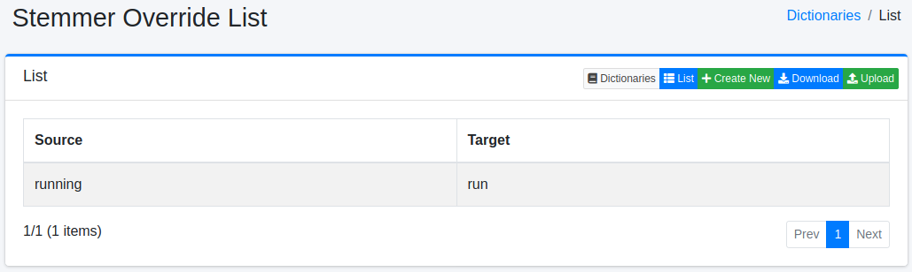
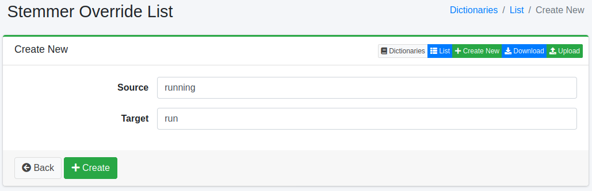

=============================
Stemmer-Überschreibungs-Wörterbuch
=============================

Übersicht
=========

Sie können den Wortstamm bestimmter Wörter durch einen von Ihnen angegebenen Stamm überschreiben. Verwenden Sie dies für Wörter, bei denen das Ergebnis des Stemmings nicht Ihren Vorstellungen entspricht.
Wenn Sie zum Beispiel den Stamm von ``mice`` auf ``mous`` festlegen, werden ``mice`` und ``mouse`` als dasselbe Wort gefunden (der englische Stemmer macht aus ``mouse`` ``mous``).

Zeichen wie Symbole, Zeichencodes oder Voll- und Halbbreite durch andere Zeichen zu ersetzen, ist nicht die Aufgabe dieses Wörterbuchs. Verwenden Sie dafür das Zeichenersetzungs-Wörterbuch (:doc:`mapping-guide`).

Die Liste zeigt je Sprache ein Wörterbuch (``en/stemmer_override.txt`` usw.). Wählen Sie das Wörterbuch aus, das zur Sprache des Wortes passt, und bearbeiten Sie es. Welches Wörterbuch auf welche Felder wirkt, steht unter :doc:`dict-guide`.
Das Speichern allein wirkt sich noch nicht auf die Suche aus. Wie Sie eine Änderung übernehmen, steht unter :ref:`dict-apply-changes`.

Verwaltung
==========

Anzeige
-------

Um die Stemmer-Überschreibungs-Konfigurationsübersichtsseite zu öffnen, wählen Sie im linken Menü [System > Wörterbuch] aus und klicken Sie dann auf stemmeroverride.

|image0|

Klicken Sie auf den Konfigurationsnamen, um ihn zu bearbeiten.

Konfigurationsmethode
---------------------

Um die Stemmer-Überschreibungs-Konfigurationsseite zu öffnen, klicken Sie auf die Schaltfläche „Neu erstellen".

|image1|

Konfigurationsparameter
-----------------------

Quelle
::::::

Geben Sie das Wort ein, dessen Stamm überschrieben werden soll. Die Analyse wandelt ein Wort in Kleinbuchstaben um, bevor sie es mit diesem Wörterbuch abgleicht; geben Sie es daher in Kleinbuchstaben ein.

Ziel
::::

Geben Sie das Wort ein, das als Stamm des in der Quelle eingegebenen Wortes verwendet werden soll.
Das Zielwort wird unverändert, ohne Stemming, indiziert. Da Suchbegriffe dem Stemming unterliegen, geben Sie, um dieselben Ergebnisse wie für das ursprüngliche Wort zu erhalten, das Ergebnis ein, das der Stemmer für das gewöhnliche Wort liefert (``mous`` für ``mouse``).
Geben Sie zum Beispiel als Quelle ``mice`` und als Ziel ``mous`` ein.

Download
========

Sie können im Stemmer-Überschreibungs-Wörterbuchformat herunterladen.

Upload
======

Sie können im Stemmer-Überschreibungs-Wörterbuchformat hochladen.

.. warning::

   Beim Hochladen wird der Inhalt des Wörterbuchs durch den Inhalt der hochgeladenen Datei ersetzt. Einträge, die nicht in der Datei stehen, werden entfernt, auch solche, die über die Oberfläche registriert wurden. Laden Sie das Wörterbuch bei Bedarf zuerst herunter und nehmen Sie dessen Inhalt in die hochzuladende Datei auf.

