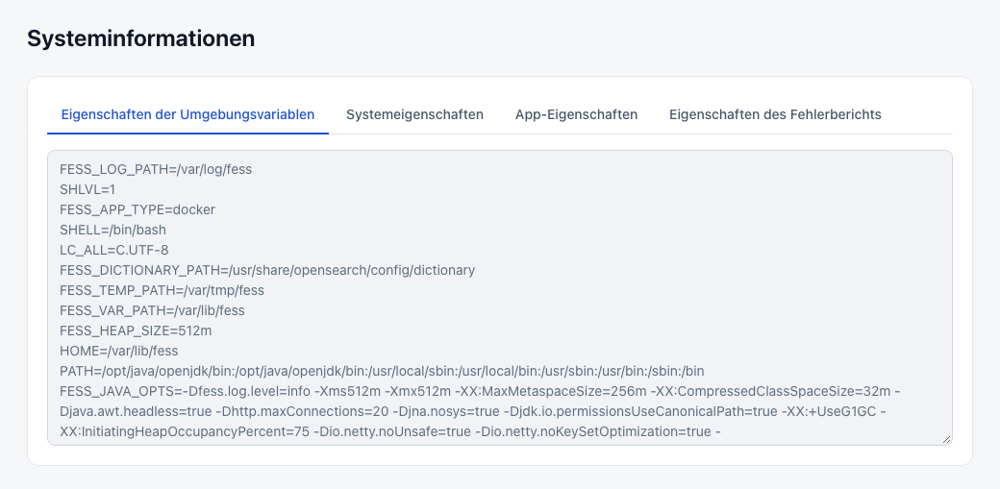
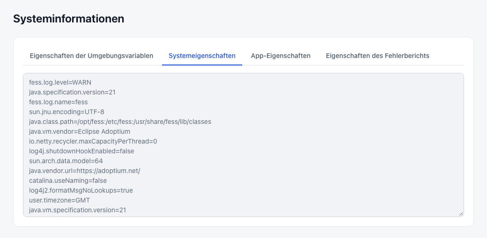
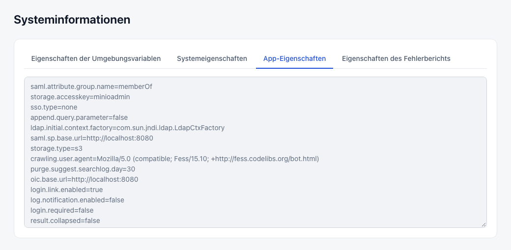
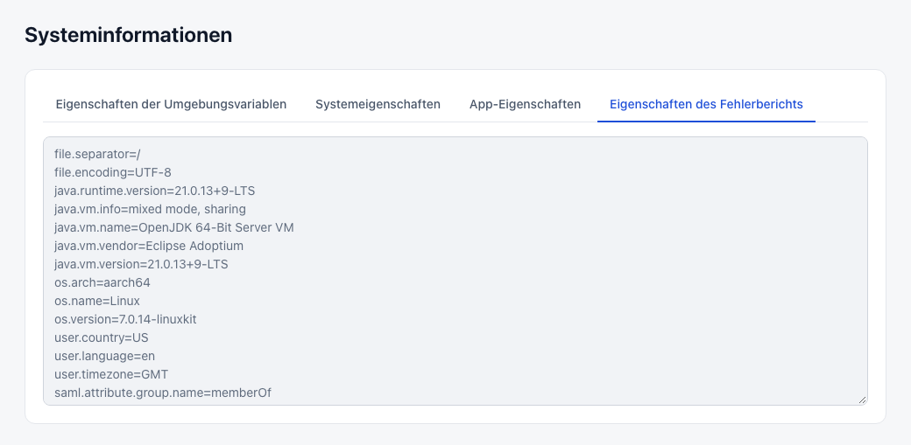

================
Systeminformationen
================

Übersicht
=========

Hier können Sie Eigenschaftsinformationen wie Umgebungsvariablen des derzeit laufenden Systems überprüfen.

Verwaltung
==========

Anzeige
-------

Um die Systeminformationsseite zu öffnen, klicken Sie im linken Menü auf [Systeminformationen > Konfigurationsinformationen].
Die Seite hat vier Registerkarten, die nachfolgend beschrieben werden.

Anzeigeelemente
---------------

Eigenschaften der Umgebungsvariablen
::::::::::::::::::::::::::::::::::::

|image0|

Sie können die Umgebungsvariablen des Servers auflisten.

Systemeigenschaften
:::::::::::::::::::

|image1|

Sie können die für |Fess| konfigurierten Systemeigenschaften auflisten.

App-Eigenschaften
:::::::::::::::::

|image2|

Sie können die Konfigurationsinformationen von |Fess| überprüfen.

Eigenschaften des Fehlerberichts
::::::::::::::::::::::::::::::::

|image3|

Dies ist eine Liste von Eigenschaften, die beim Melden von Fehlern angehängt werden sollen.
Es werden Werte extrahiert, die keine persönlichen Informationen enthalten.

