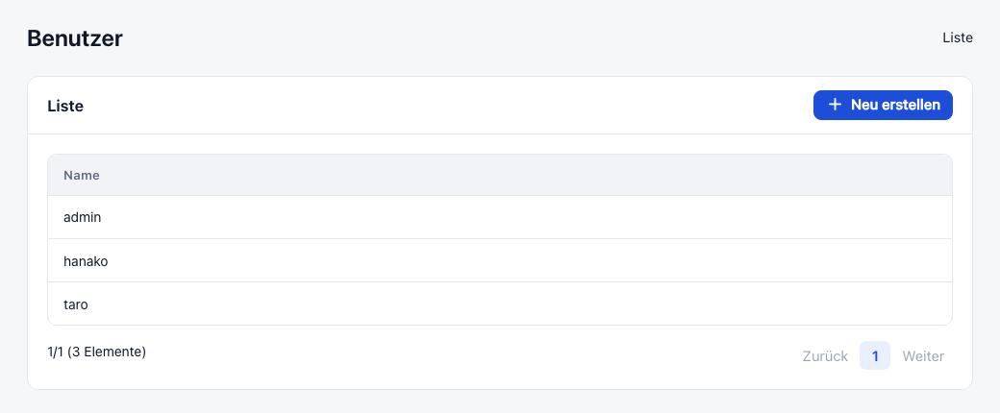
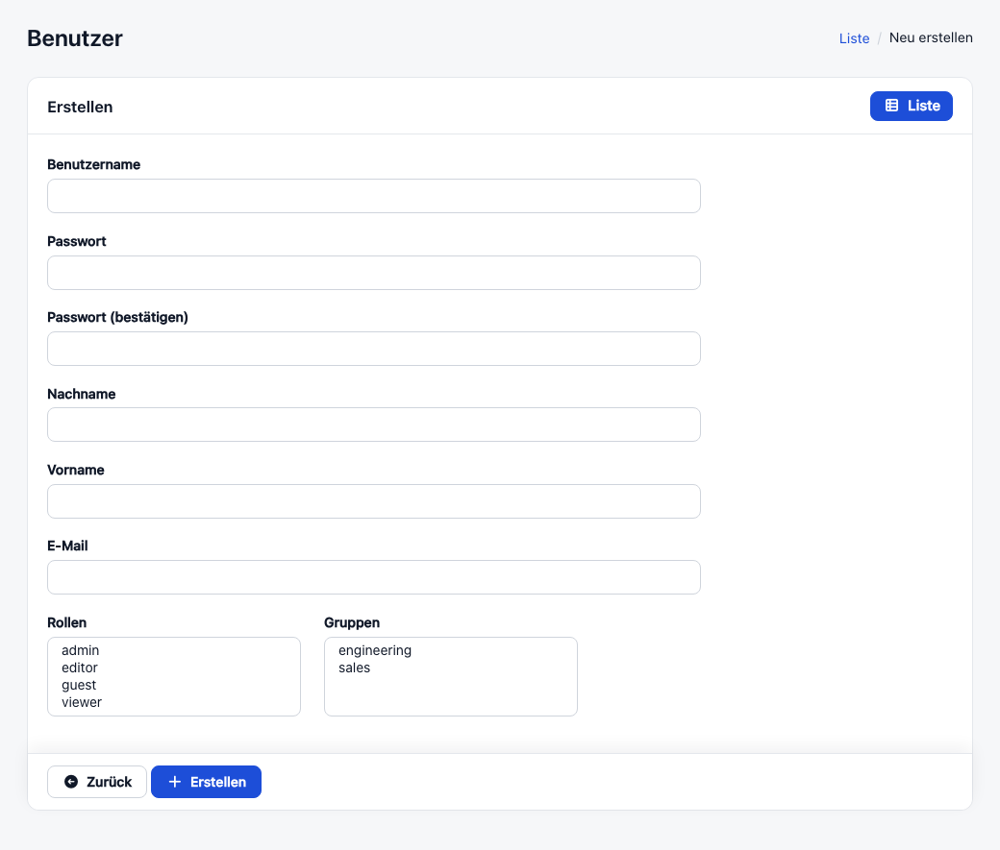

========
Benutzer
========

Übersicht
=========

Sie können Benutzer verwalten, die sich bei |Fess| anmelden.

Verwaltung
==========

Anzeige
-------

Um die Benutzer-Konfigurationsübersichtsseite zu öffnen, klicken Sie im linken Menü auf [Benutzer > Benutzer].

|image0|

Klicken Sie auf den Konfigurationsnamen, um ihn zu bearbeiten.

Konfiguration erstellen
-----------------------

Um die Benutzer-Konfigurationsseite zu öffnen, klicken Sie auf die Schaltfläche „Neu erstellen".

|image1|

Konfigurationsparameter
-----------------------

Benutzername
::::::::::::

Geben Sie den Benutzernamen des Benutzers an. Er kann nach dem Erstellen des Benutzers nicht mehr geändert werden.

Passwort, Passwort (bestätigen)
:::::::::::::::::::::::::::::::

Geben Sie das Passwort des Benutzers an und wiederholen Sie es unter „Passwort (bestätigen)". Beim Erstellen eines Benutzers ist das Passwort erforderlich. Beim Bearbeiten eines Benutzers lassen Sie beide Felder leer, um das aktuelle Passwort beizubehalten.

Nachname, Vorname, E-Mail
:::::::::::::::::::::::::

Geben Sie den Nachnamen, den Vornamen und die E-Mail-Adresse des Benutzers an. Diese Felder sind optional.

Rolle
:::::

Geben Sie die Rolle an, zu der der Benutzer gehört.

.. note::

   Ein Benutzer mit der Rolle ``admin-user`` kann jedem Benutzer eine beliebige vorhandene Rolle zuweisen, einschließlich der Administratorrolle. Behandeln Sie die ``admin-*``-Rollen wie die Administratorrolle; siehe :doc:`../install/security`.

Gruppe
::::::

Geben Sie die Gruppe an, zu der der Benutzer gehört.

Konfiguration löschen
---------------------

Klicken Sie auf den Konfigurationsnamen auf der Übersichtsseite und dann auf die Schaltfläche „Löschen". Es wird ein Bestätigungsdialog angezeigt.
Klicken Sie im Dialog auf die Schaltfläche „Löschen", um die Konfiguration zu löschen.

