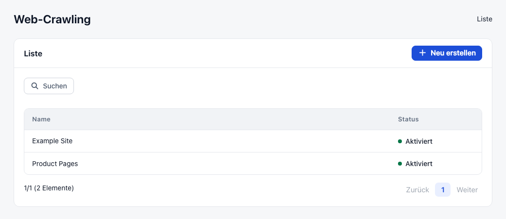
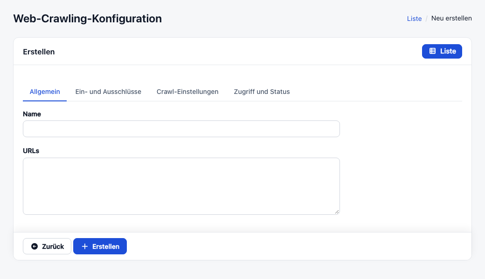
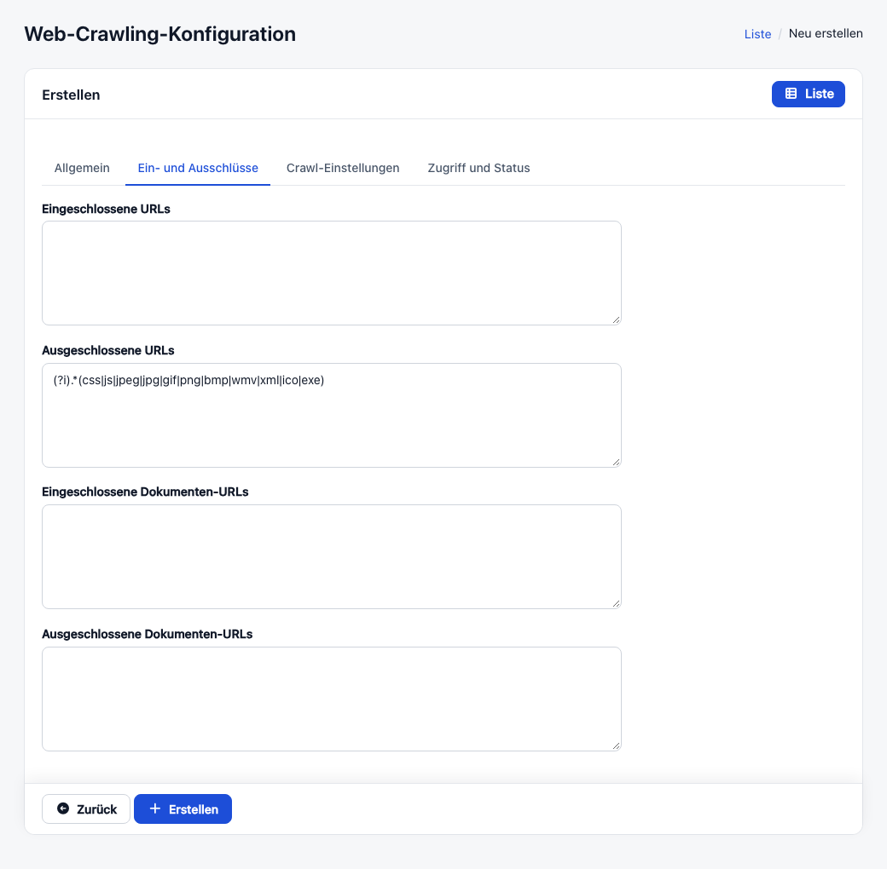
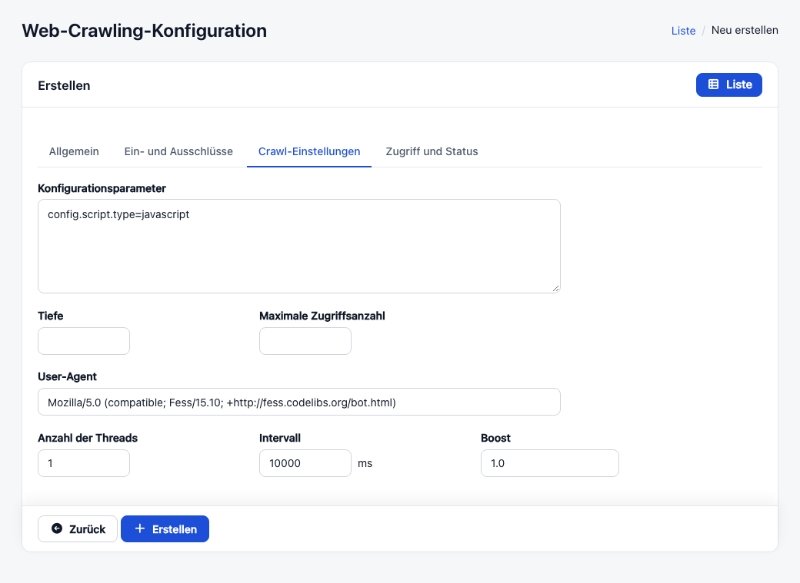
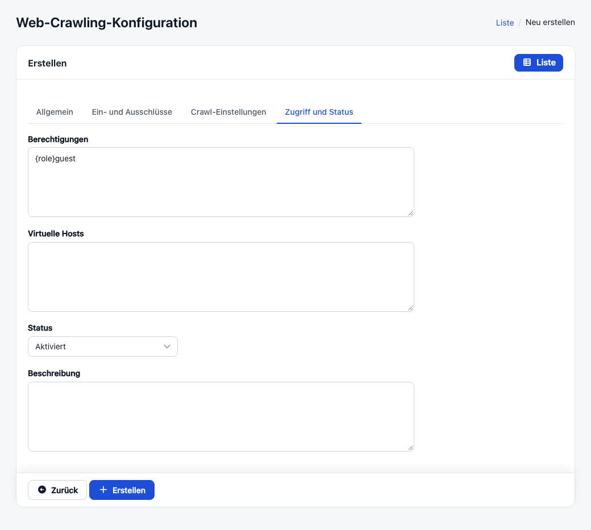

===========================
Web-Crawl (Website-Suche)
===========================

Übersicht
=========

Web-Crawl ist eine Funktion, mit der ein Web-Crawler öffentliche Websites oder Websites im Intranet durchsucht und die gesammelten Seiten in den Index von |Fess| aufnimmt, sodass sie per Volltextsuche (Website-Suche) auffindbar sind. Auch das Crawlen von Sites, die durch BASIC-, DIGEST-, NTLM- oder Formular-Authentifizierung geschützt sind, wird unterstützt.

Die Web-Crawl-Konfigurationsseite konfiguriert Web-Crawling.

Verwaltung
==========

Anzeige
-------

Um die Web-Crawl-Konfigurationsübersichtsseite zu öffnen, klicken Sie im linken Menü auf [Crawler > Web].

|image0|

Klicken Sie auf den Konfigurationsnamen, um ihn zu bearbeiten.

Konfiguration erstellen
-----------------------

Um die Web-Crawl-Konfigurationsseite zu öffnen, klicken Sie auf die Schaltfläche „Neu erstellen".
Die Seite ist in vier Registerkarten unterteilt: „Allgemein", „Ein- und Ausschlüsse", „Crawl-Einstellungen" und „Zugriff und Status". Klicken Sie auf den Namen einer Registerkarte, um zu wechseln. Enthält eine Eingabe einen Fehler, wird automatisch die Registerkarte geöffnet, die sie enthält. Die Felder der einzelnen Registerkarten werden nachfolgend beschrieben.

Registerkarte „Allgemein"
-------------------------

|image1|

Name
::::

Konfigurationsname.

URLs
::::

Die Start-URLs für das Crawling. Geben Sie eine URL pro Zeile an.

Registerkarte „Ein- und Ausschlüsse"
------------------------------------

|image2|

Zu crawlende URL
::::::::::::::::

URLs, die mit dem regulären Ausdruck (Java-Format) übereinstimmen, der in diesem Element angegeben ist, werden vom |Fess| Crawler gecrawlt.

Vom Crawlen ausgeschlossene URL
::::::::::::::::::::::::::::::::

URLs, die mit dem regulären Ausdruck (Java-Format) übereinstimmen, der in diesem Element angegeben ist, werden vom |Fess| Crawler nicht gecrawlt.

.. note::
   Im Formular zum Anlegen in der Administrationsoberfläche ist dieses Feld mit ``(?i).*(css|js|jpeg|jpg|gif|png|bmp|wmv|xml|ico|exe)`` vorbelegt.
   Das Muster wird gegen die gesamte URL geprüft und gilt auch für die Start-URLs eines Crawls.
   Der Standardwert passt auf jede URL, die auf einen Begriff wie ``css``, ``js`` oder ``xml`` endet (ohne Beachtung der Groß- und Kleinschreibung). Eine Start-URL wie ``sitemap.xml`` wird daher nicht abgerufen, und es wird nichts gecrawlt.
   Um eine solche URL zu crawlen, entfernen Sie den passenden Begriff aus dem Standardwert.
   Passt eine Start-URL auf ein Muster dieses Feldes, werden der Name der Crawl-Konfiguration, die Start-URL und das passende Muster als WARN in ``fess-crawler.log`` protokolliert.

Zu durchsuchende URL
:::::::::::::::::::::

URLs, die mit dem regulären Ausdruck (Java-Format) übereinstimmen, der in diesem Element angegeben ist, werden in die Suche einbezogen.

Von der Suche ausgeschlossene URL
::::::::::::::::::::::::::::::::::

URLs, die mit dem regulären Ausdruck (Java-Format) übereinstimmen, der in diesem Element angegeben ist, werden von der Suche ausgeschlossen.

.. note::
   Diese Angabe wirkt sich nur auf Dokumente aus, die bei späteren Crawls indexiert werden (übereinstimmende Dokumente werden nicht indexiert). Bereits indexierte Dokumente werden durch das Hinzufügen dieser Angabe nicht gelöscht und bleiben in den Suchergebnissen. Ist „Letzte Änderung prüfen" in den allgemeinen Einstellungen aktiviert (Standard), wird die Ablaufzeit nicht geänderter Dokumente bei jedem Crawl verlängert (siehe „Letzte Änderung prüfen" in :doc:`general-guide`); daher verschwinden sie nicht zwangsläufig, wenn die unter „Alte Dokumente löschen" festgelegte Frist erreicht ist. Dokumente, die sicher aus den Suchergebnissen verschwinden sollen, löschen Sie in der Suchliste (Verwaltungsoberfläche). Ein gelöschtes Dokument wird beim nächsten Crawl nicht erneut indexiert, solange es mit dieser Angabe übereinstimmt.

Registerkarte „Crawl-Einstellungen"
-----------------------------------

|image3|

Konfigurationsparameter
:::::::::::::::::::::::

Sie können Crawl-Konfigurationsinformationen angeben.

Tiefe
:::::

Sie können die Tiefe beim Verfolgen von Links angeben, die in gecrawlten Dokumenten enthalten sind.

Maximale Zugriffszahl
:::::::::::::::::::::

Die Anzahl der zu indizierenden URLs.

User-Agent
::::::::::

Der Name des |Fess| Crawlers.

Thread-Anzahl
:::::::::::::

Die Anzahl der Crawl-Threads für diese Konfiguration.

Intervall
:::::::::

Das Zeitintervall für jeden Thread beim Crawlen von URLs, in Millisekunden.

Boost
:::::

Die Gewichtung von Dokumenten, die durch diese Konfiguration indiziert werden.

Registerkarte „Zugriff und Status"
----------------------------------

|image4|

Berechtigungen
::::::::::::::

Geben Sie die Berechtigung für diese Konfiguration an.
Um beispielsweise Suchergebnisse für Benutzer anzuzeigen, die zur Gruppe „developer" gehören, geben Sie {group}developer an.
Für Benutzerebene geben Sie {user}Benutzername an, für Rollenebene {role}Rollenname und für Gruppenebene {group}Gruppenname.
Stellen Sie einem Eintrag ``(deny)`` voran, z. B. ``(deny){role}Rollenname``, um den Zugriff zu verweigern. In 15.10 werden beim Speichern folgende Einträge mit einem Fehler abgelehnt: Leerzeichen (auch ein Leerzeichen in Vollbreite oder ein geschütztes Leerzeichen) direkt nach ``(allow)`` / ``(deny)`` oder am Zeilenanfang vor ``{user}``, ``{group}`` oder ``{role}``; ``(deny)``, ``{role}`` und Ähnliches, das mit Zeichen in Vollbreite eingegeben wurde; sowie ein unsichtbares Zeichen (z. B. ein Zero-Width-Space oder eine Byte-Order-Mark) am Anfang eines Eintrags oder direkt nach ``(allow)`` / ``(deny)``. Wenn ein mit einer früheren Version gespeicherter Wert eine dieser Formen enthält, geben Sie ihn erneut ein. Einzelheiten finden Sie unter :doc:`../config/security-role`.

Virtuelle Hosts
:::::::::::::::

Geben Sie die Hostnamen der virtuellen Hosts an, einen pro Zeile.
Weitere Details finden Sie unter :doc:`../config/security-virtual-host`.

Status
::::::

Wenn aktiviert, enthält der Standard-Crawler-Zeitplanjob diese Konfiguration.

Beschreibung
::::::::::::

Sie können eine Beschreibung eingeben.

Konfiguration löschen
---------------------

Klicken Sie auf den Konfigurationsnamen auf der Übersichtsseite und dann auf die Schaltfläche „Löschen". Es wird ein Bestätigungsdialog angezeigt. Klicken Sie auf die Schaltfläche „Löschen", um die Konfiguration zu löschen.

.. note::

   Beim Löschen einer Konfiguration werden die Dokumente, die sie bereits im Index registriert hat, nicht gelöscht. Sie bleiben durchsuchbar, bis sie ablaufen. Ein Dokument läuft nach der Anzahl von Tagen ab, die unter „Alte Dokumente löschen“ in :doc:`general-guide` (``day.for.cleanup``, standardmäßig ``3``) angegeben ist, gerechnet ab dem Beginn des letzten Crawls, der es registriert oder aktualisiert hat; der Doc-Purger-Job entfernt es dann aus dem Index. Bei ``-1`` werden Dokumente, die ohne Ablaufzeit registriert wurden, auf diesem Weg nie entfernt.

   Um die Dokumente sofort zu entfernen, löschen Sie sie selbst aus dem Index. Suchen Sie auf dem Bildschirm „Suche“ (:doc:`searchlist-guide`) nach den Dokumenten der Konfiguration (zum Beispiel mit ``url:`` oder ``host:``), prüfen Sie die Treffer und klicken Sie auf die Schaltfläche „Alle mit dieser Abfrage löschen“. Dasselbe ist mit ``DELETE /api/admin/searchlist/query`` möglich (siehe :doc:`../api/admin/api-admin-searchlist`).

   Anders verhält es sich, wenn Sie die Berechtigungen einer Konfiguration ändern und erneut crawlen: Die Dokument-ID hängt von den Berechtigungen ab, und beim Registrieren eines Dokuments löscht der Crawler die Dokumente mit derselben URL und einer anderen ID, die dieselbe Konfiguration zuvor registriert hat.

Beispiele
=========

fess.codelibs.org crawlen
-------------------------

Um eine Web-Crawl-Konfiguration zu erstellen, die Seiten unter https://fess.codelibs.org/ crawlt, verwenden Sie die folgenden Konfigurationswerte:

.. tabularcolumns:: |p{4cm}|p{8cm}|
.. list-table::
   :header-rows: 1

   * - Konfigurationselement
     - Konfigurationswert
   * - Name
     - Fess
   * - URLs
     - https://fess.codelibs.org/
   * - Zu crawlende URL
     - https://fess.codelibs.org/.\*

Andere Konfigurationswerte verwenden Standardwerte.

Web-Authentifizierungs-Site crawlen
------------------------------------

Fess unterstützt das Crawlen mit BASIC-, DIGEST- und NTLM-Authentifizierung.
Weitere Details zur Web-Authentifizierung finden Sie auf der Web-Authentifizierungsseite.

Redmine
:::::::

Um eine Web-Crawl-Konfiguration zu erstellen, die passwortgeschützte Redmine-Seiten (z. B. https://<server>/) crawlt, verwenden Sie die folgenden Konfigurationswerte:

.. tabularcolumns:: |p{4cm}|p{8cm}|
.. list-table::
   :header-rows: 1

   * - Konfigurationselement
     - Konfigurationswert
   * - Name
     - Redmine
   * - URLs
     - https://<server>/my/page
   * - Zu crawlende URL
     - https://<server>/.\*
   * - Konfigurationsparameter
     - client.robotsTxtEnabled=false (Optional)

Erstellen Sie dann eine Web-Authentifizierungskonfiguration mit den folgenden Konfigurationswerten:

.. tabularcolumns:: |p{4cm}|p{8cm}|
.. list-table::
   :header-rows: 1

   * - Konfigurationselement
     - Konfigurationswert
   * - Schema
     - Form
   * - Benutzername
     - (Konto für Crawling)
   * - Passwort
     - (Passwort für das Konto)
   * - Parameter
     - | encoding=UTF-8
       | token_method=GET
       | token_url=https://<server>/login
       | token_pattern=name="authenticity_token"[^>]+value="([^"]+)"
       | token_name=authenticity_token
       | login_method=POST
       | login_url=https://<server>/login
       | login_parameters=username=${username}&password=${password}
   * - Web-Konfiguration
     - Redmine

XWiki
:::::

Um eine Web-Crawl-Konfiguration zu erstellen, die XWiki-Seiten (z. B. https://<server>/xwiki/) crawlt, verwenden Sie die folgenden Konfigurationswerte:

.. tabularcolumns:: |p{4cm}|p{8cm}|
.. list-table::
   :header-rows: 1

   * - Konfigurationselement
     - Konfigurationswert
   * - Name
     - XWiki
   * - URLs
     - https://<server>/xwiki/bin/view/Main/
   * - Zu crawlende URL
     - https://<server>/.\*
   * - Konfigurationsparameter
     - client.robotsTxtEnabled=false (Optional)

Erstellen Sie dann eine Web-Authentifizierungskonfiguration mit den folgenden Konfigurationswerten:

.. tabularcolumns:: |p{4cm}|p{8cm}|
.. list-table::
   :header-rows: 1

   * - Konfigurationselement
     - Konfigurationswert
   * - Schema
     - Form
   * - Benutzername
     - (Konto für Crawling)
   * - Passwort
     - (Passwort für das Konto)
   * - Parameter
     - | encoding=UTF-8
       | token_method=GET
       | token_url=http://<server>/xwiki/bin/login/XWiki/XWikiLogin
       | token_pattern=name="form_token" +value="([^"]+)"
       | token_name=form_token
       | login_method=POST
       | login_url=http://<server>/xwiki/bin/loginsubmit/XWiki/XWikiLogin
       | login_parameters=j_username=${username}&j_password=${password}
   * - Web-Konfiguration
     - XWiki

Verwandte Seiten
================

- :doc:`../config/crawler-basic`
- :doc:`webauth-guide`
- :doc:`fileconfig-guide`
- :doc:`../config/search-basic`

.. pdf            :height: 940 px
