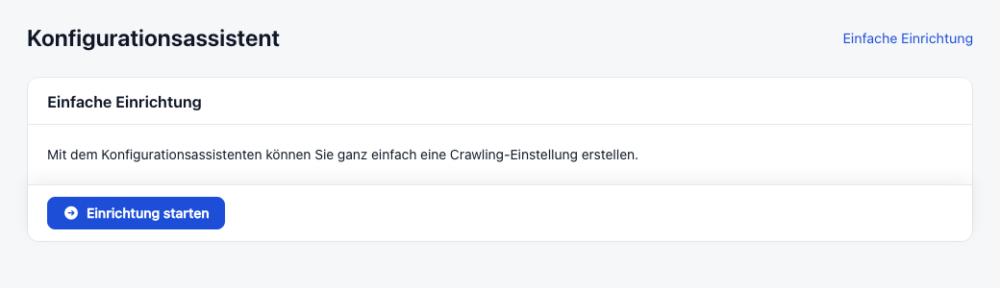
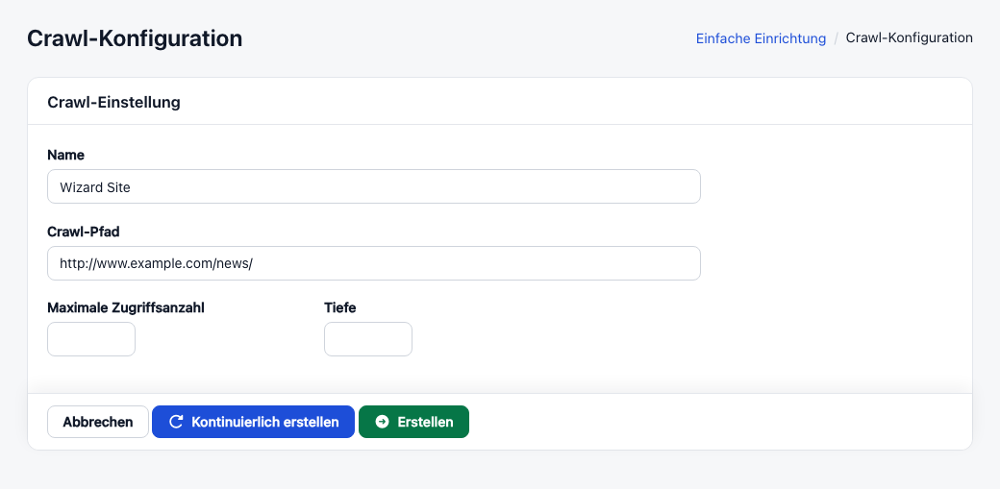
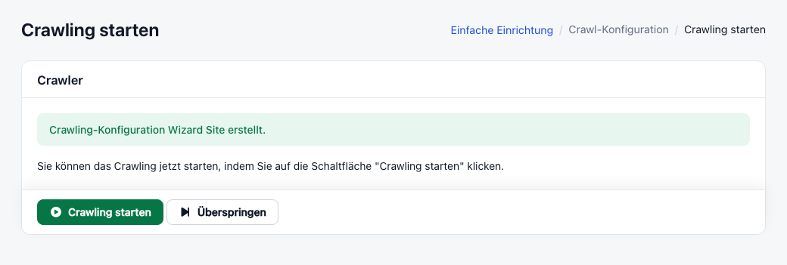

====================
Konfigurations-Assistent
====================

Übersicht
=========

Die Assistentenseite bietet ein einfaches Setup-Tool zum Registrieren von Crawl-Konfigurationen.

Einfache Einrichtung
--------------------

Diese Seite ist die Startseite zum Registrieren von Crawl-Konfigurationen. Klicken Sie auf die Schaltfläche „Einrichtung starten", um die Seite für die Crawl-Konfiguration zu öffnen.

|image0|

Crawl-Konfiguration
-------------------

Auf dieser Seite können Sie Crawl-Konfigurationen erstellen.

|image1|

Konfigurationsparameter
-----------------------

Name
::::

Geben Sie den Konfigurationsnamen an (z. B. Fess-Site).

Crawl-Pfad
::::::::::

Geben Sie die Start-URL oder den Dateipfad für das Crawling an (z. B. https://fess.codelibs.org/).

Maximale Zugriffszahl
:::::::::::::::::::::

Legen Sie die Obergrenze der zu crawlenden Seiten fest.

Tiefe
:::::

Legen Sie die Tiefe beim Verfolgen von Links fest, die in gecrawlten Dokumenten enthalten sind.

Schaltflächen
:::::::::::::

- **Erstellen**: Registriert die Crawl-Konfiguration und wechselt zur Seite „Crawling starten".
- **Kontinuierlich erstellen**: Registriert die Crawl-Konfiguration und kehrt zu diesem Formular zurück, sodass Sie eine weitere registrieren können.
- **Abbrechen**: Kehrt ohne Registrierung zur Seite „Einfache Einrichtung" zurück.

Crawler
-------

Um den |Fess| Crawler zu starten, klicken Sie auf die Schaltfläche „Crawlen starten". Wenn Sie noch nicht crawlen möchten, klicken Sie auf die Schaltfläche „Überspringen".

|image2|

