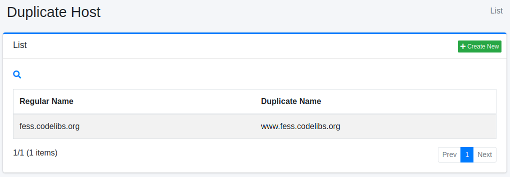
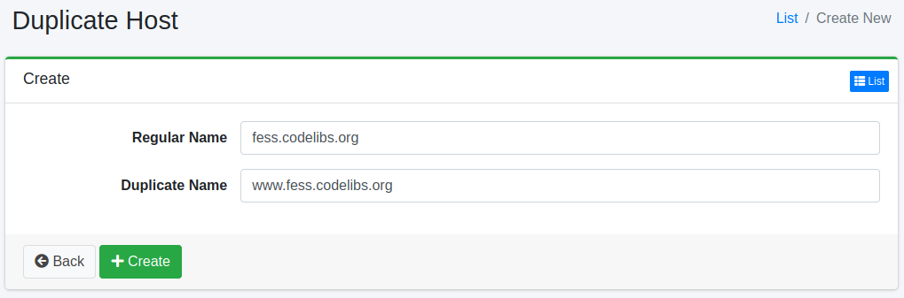

================
Duplikat-Hosts
================

Übersicht
=========

Hier wird die Konfiguration von Duplikat-Hosts erläutert.
Duplikat-Hosts werden verwendet, wenn Sie verschiedene Hostnamen beim Crawlen als identisch behandeln möchten.
Zum Beispiel können Sie dies verwenden, wenn Sie www.example.com und example.com als dieselbe Site behandeln möchten.

Verwaltung
==========

Anzeige
-------

Um die Übersichtsseite für die Duplikat-Host-Konfiguration zu öffnen, klicken Sie im linken Menü auf [Crawler > Doppelter Host].

|image0|

Klicken Sie auf den Konfigurationsnamen, um ihn zu bearbeiten.

Konfiguration erstellen
-----------------------

Um die Duplikat-Host-Konfigurationsseite zu öffnen, klicken Sie auf die Schaltfläche „Neu erstellen".

|image1|

Konfigurationsparameter
-----------------------

Regulärer Name
::::::::::::::

Geben Sie den kanonischen Hostnamen an. Duplikat-Hostnamen werden durch den kanonischen Hostnamen ersetzt.

Doppelter Name
::::::::::::::

Geben Sie den duplizierenden Hostnamen an. Geben Sie den Hostnamen an, der ersetzt werden soll.

.. note::

   Eine URL, deren Hostname einem doppelten Namen entspricht, wird vor dem Crawlen durch die URL mit dem regulären Namen ersetzt. Das gilt sowohl für die unter „URLs" (den Start-URLs) der Crawl-Konfiguration eingetragenen URLs als auch für die URLs von Links, die beim Crawlen gefunden werden.
   Daher werden „Eingeschlossene URLs" und „Ausgeschlossene URLs" der Crawl-Konfiguration anhand der URL nach der Ersetzung ausgewertet. Schreiben Sie sie mit dem Hostnamen des regulären Namens.

   Wenn der reguläre Name zum Beispiel ``example.com`` und der doppelte Name ``www.example.com`` lautet, wird bei einem Eintrag von nur ``https://www.example.com/.*`` unter „Eingeschlossene URLs" die Start-URL nach der Ersetzung (``https://example.com/``) ausgeschlossen.
   In diesem Fall wird kein einziges Dokument im Index registriert, und es erscheinen weder ein Fehler noch eine Protokollmeldung.

Konfiguration löschen
---------------------

Klicken Sie auf den Konfigurationsnamen auf der Übersichtsseite und dann auf die Schaltfläche „Löschen". Es wird ein Bestätigungsbildschirm angezeigt.
Klicken Sie auf die Schaltfläche „Löschen", um die Konfiguration zu löschen.

