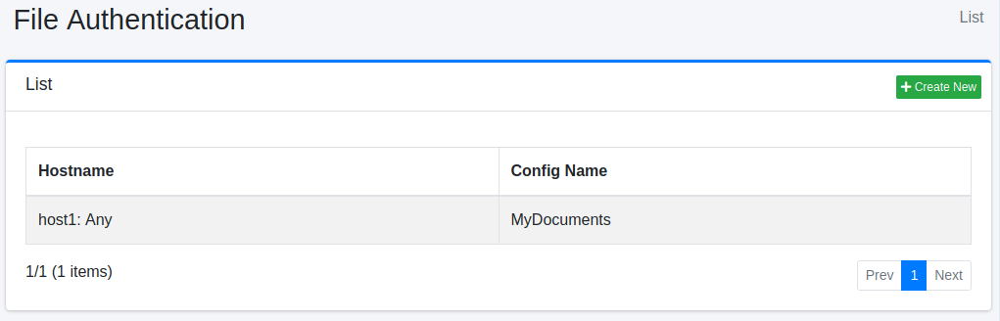
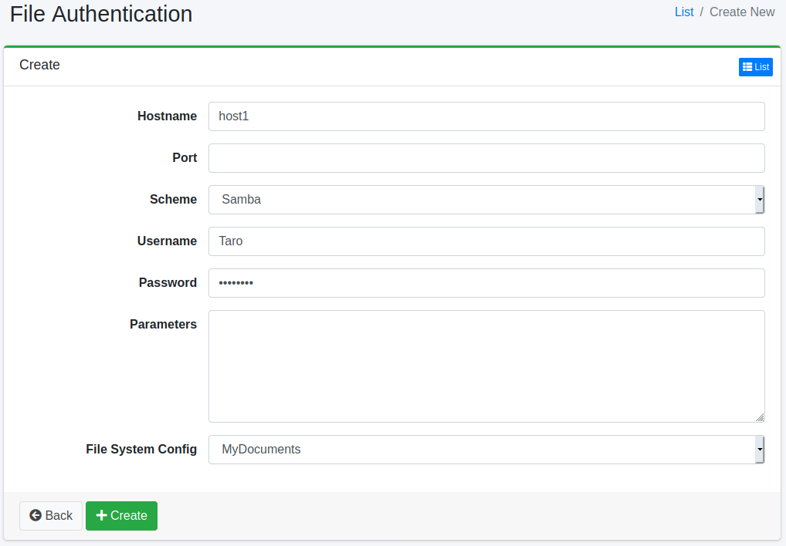

==================
Dateiauthentifizierung
==================

Übersicht
=========

Hier wird die Konfigurationsmethode erläutert, wenn Dateiauthentifizierung für das Crawlen von Dateien erforderlich ist.
|Fess| unterstützt die Authentifizierung für FTP oder Windows-Freigabeordner.

Verwaltung
==========

Anzeige
-------

Um die Übersichtsseite für die Dateiauthentifizierungskonfiguration zu öffnen, klicken Sie im linken Menü auf [Crawler > Datei-Authentifizierung].

|image0|

Klicken Sie auf den Konfigurationsnamen, um ihn zu bearbeiten.

Konfiguration erstellen
-----------------------

Um die Dateiauthentifizierungskonfigurationsseite zu öffnen, klicken Sie auf die Schaltfläche „Neu erstellen".

|image1|

Konfigurationsparameter
-----------------------

Hostname
::::::::

Geben Sie den Hostnamen der Site an, die Authentifizierung erfordert.
Verwenden Sie denselben Namen wie den Hostnamen in der zu crawlenden URL. Für eine URL mit einem anderen Namen (zum Beispiel einer IP-Adresse statt eines Alias) wird diese Authentifizierung nicht verwendet.

Port
::::

Geben Sie den Port der Site an, die Authentifizierung erfordert.
Bleibt das Feld leer, zeigt die Liste „Beliebig" an. Die Bedeutung eines leeren Ports hängt vom Schema ab.

* FTP: Wird für URLs mit beliebigem Port verwendet (eine URL ohne Port gilt als Port 21).
* SAMBA: Wird nur für URLs verwendet, die keinen Port enthalten (``smb://Server/Freigabe/``). Für eine URL mit Port, etwa ``smb://Server:445/Freigabe/``, wird sie nicht verwendet. Wenn Sie eine URL mit Port crawlen, geben Sie hier denselben Port an.

Schema
::::::

Wählen Sie die Authentifizierungsmethode aus.
Sie können FTP oder SAMBA (Windows-Freigabeordnerauthentifizierung) verwenden.

Benutzername
::::::::::::

Geben Sie den Benutzernamen für die Anmeldung bei der Authentifizierungssite an.

Passwort
::::::::

Geben Sie das Passwort für die Anmeldung bei der Authentifizierungssite an.

Parameter
:::::::::

Konfigurieren Sie dies, wenn Konfigurationswerte für die Anmeldung bei der Authentifizierungssite erforderlich sind. Für SAMBA können Sie den Domänenwert konfigurieren. Geben Sie ihn wie folgt an:

::

    domain=FUGA

Datei-Crawl-Konfiguration
:::::::::::::::::::::::::

Geben Sie die Crawl-Konfiguration an, die diese Authentifizierungskonfiguration verwenden soll.

Konfiguration löschen
---------------------

Klicken Sie auf den Konfigurationsnamen auf der Übersichtsseite und dann auf die Schaltfläche „Löschen". Es wird ein Bestätigungsbildschirm angezeigt.
Klicken Sie auf die Schaltfläche „Löschen", um die Konfiguration zu löschen.

