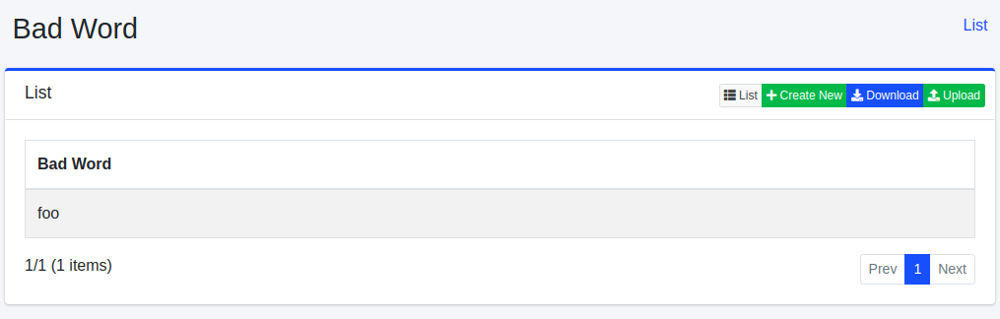
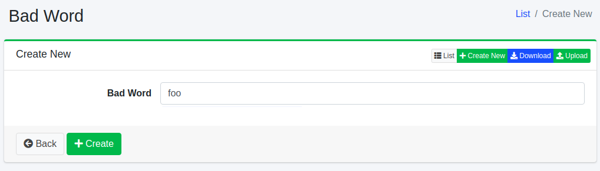
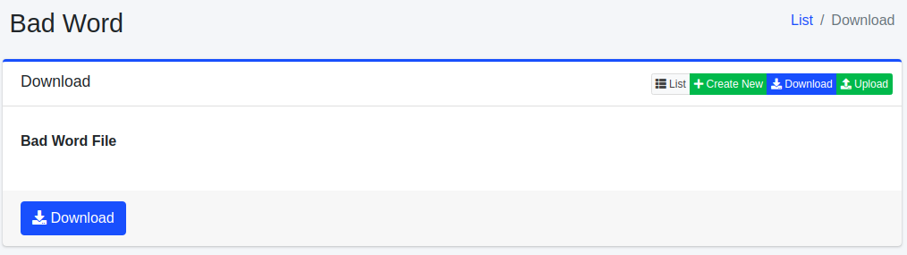
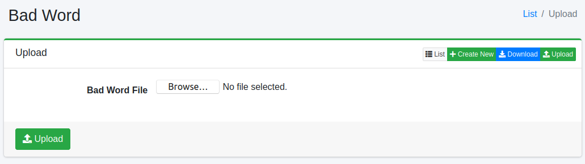

========
Bad Word
========

Overview
========

Bad Word Configuration page manages words to exclude them from suggest feature.

Management Operations
=====================

Display Configurations
----------------------

Select Suggest > Bad Word in the left menu to display a list page of Bad Word Configuration, as below.

|image0|

Click a configuration name if you want to edit it.

Create Configuration
--------------------

Click Create New button to display a form page for Bad Word configuration.

|image1|

Configurations
--------------

Bad Word
::::::::

Word to exclude it from Suggest.

.. note::
   A registered bad word is not applied to Suggest immediately. It is removed from the existing suggest candidates when the "Suggest Indexer" job, which rebuilds the suggest index, runs (by default it runs every day at 12:00). To apply it right away, click "Suggest Indexer" in [System > Scheduler] and click the Start Now button. The same applies to words registered by uploading a CSV file.

Delete Configuration
--------------------

Click a configuration on a list page, and click Delete button to display a confirmation dialog.
Click Delete button to delete the configuration.

Download
========

You can download a word list file as CSV file.

|image2|

Upload
======

You can upload CSV file containing a word list to exclude from Suggest.

|image3|

CSV File
--------

The content of downloaded/uploaded CSV file is 1 column, and contains only a word.

