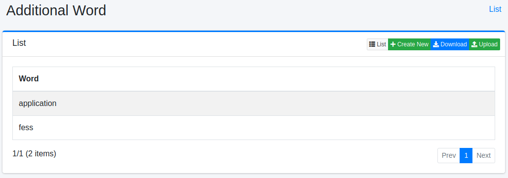
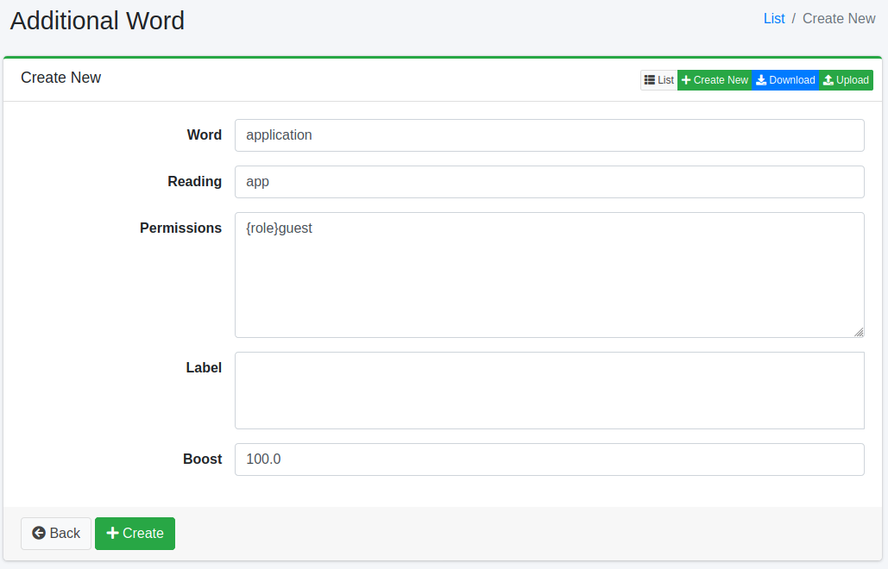
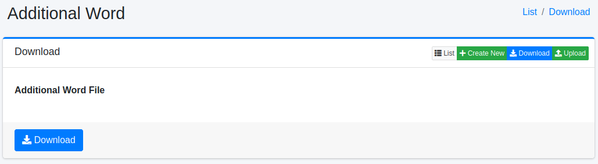
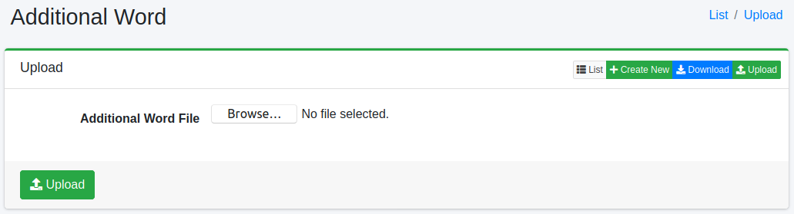

===============
Additional Word
===============

Overview
========

Additional Word page manages preferred words to display on a keyword suggest.
The keyword suggest words are generated from search queries and indexed contents automatically, and you can add words to them.

Management Operations
=====================

Display Configurations
----------------------

Select Suggest > Additional Word in the left menu to display a list page of Additional Word Configuration, as below.

|image0|

Click a configuration name if you want to edit it.

Create Configuration
--------------------

Click Create New button to display a form page for Additional Word configuration.

|image1|

Configurations
--------------

Word
::::

Displayed suggest word.

Reading
:::::::

Reading for suggest word.

Permissions
::::

Roles to restrict suggesting.
If roles are specified, suggest word is displayed in users which has roles.
User-level: {user}username, Role-level: {role}rolename, Group-level: {group}groupname.

Label
:::::

Labels to restrict suggesting.
If labels are specified, suggest word is displayed in users which has labels.

Boost
:::::

Boost value.
Higher value is displayed at the top.

.. note::
   Words that you register, edit or delete (including by uploading a CSV file) are not applied to Suggest immediately. They are applied when the "Suggest Indexer" job, which rebuilds the suggest index, runs (by default it runs every day at 12:00). To apply them right away, click "Suggest Indexer" in [System > Scheduler] and click the Start Now button.

Delete Configuration
--------------------

Click a configuration on a list page, and click Delete button to display a confirmation dialog.
Click Delete button to delete the configuration.

Download
========

You can download a word list file as CSV file.

|image2|

Upload
======

You can upload CSV file containing a word list to exclude from Suggest.

|image3|

CSV File
---------------

The content of downloaded/uploaded CSV file is 5 column.

::

    "SuggestWord","Reading","Permissions","Labels","Boost"
    "fess","ふぇす","{role}role1","label1","100"

.. note::
   In the Permissions column, specify each value with one of ``{role}``, ``{user}`` and ``{group}``, such as ``{role}role1`` (separate multiple values with commas). A value without a prefix, such as ``role1``, is not treated as a role, and the word is not suggested to users who have that role.

