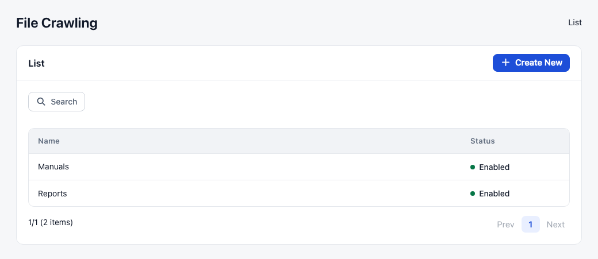
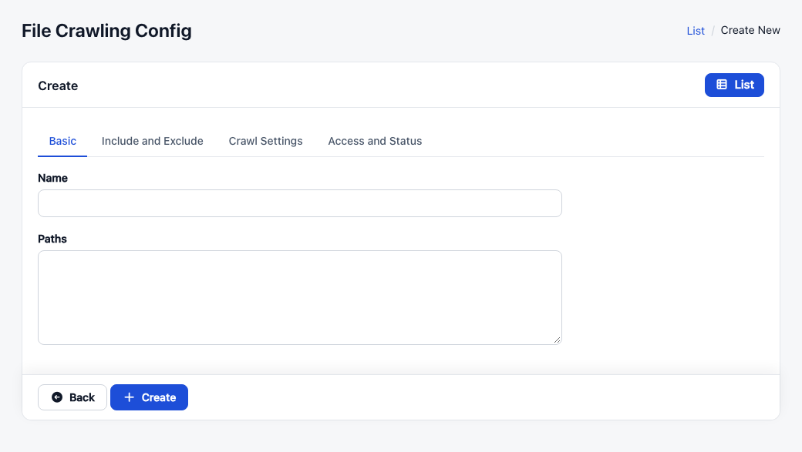
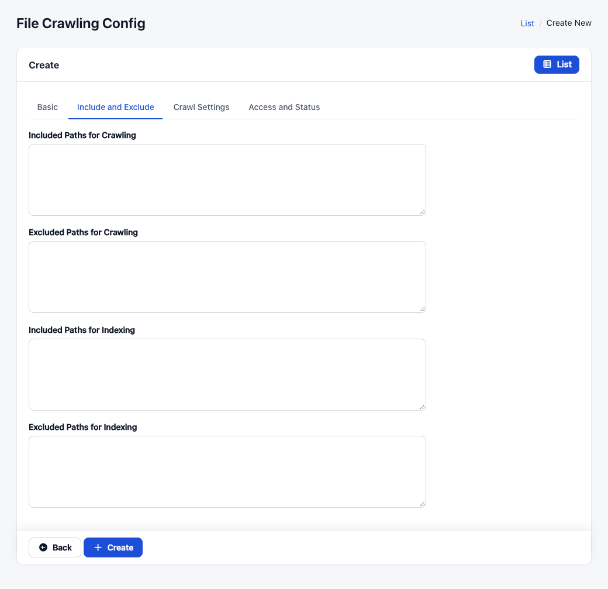
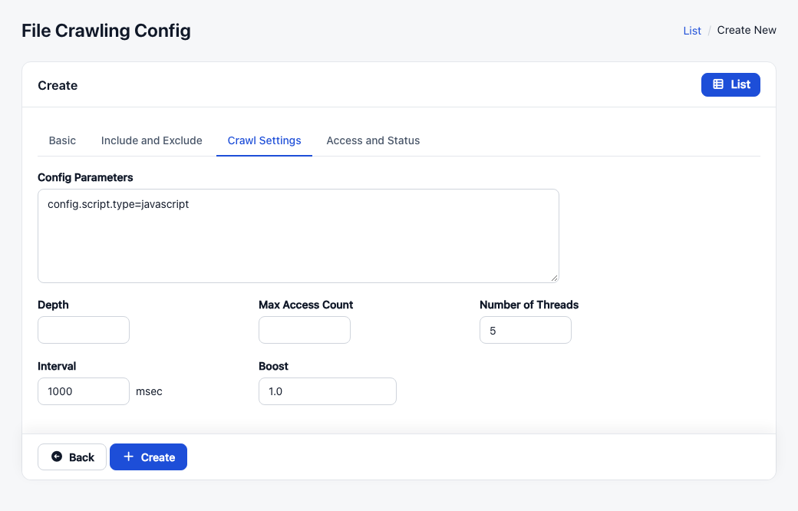
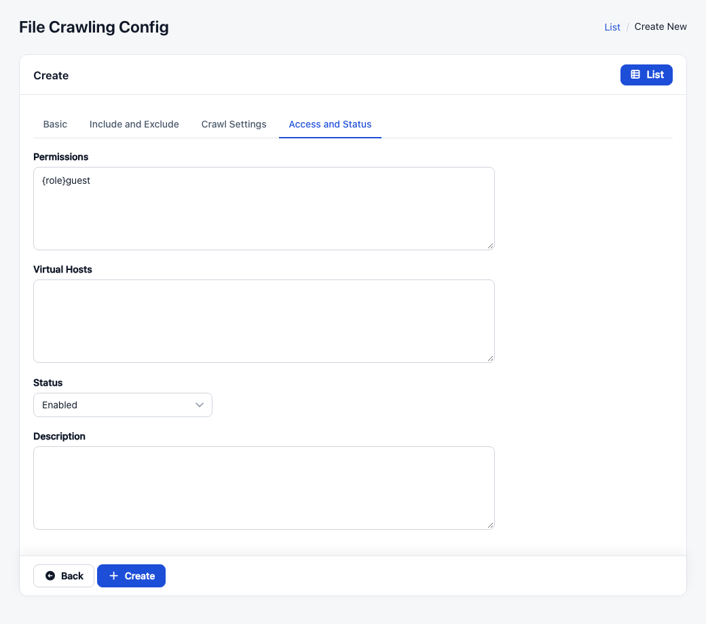

==================================
File Crawling (File Server Search)
==================================

Overview
========

File Crawling registers documents from internal file servers, Windows shared folders, and cloud storage into the |Fess| index, enabling full-text search (file server search). It supports a wide range of file formats, including Word, Excel, PowerPoint, and PDF.

The File Crawling configuration page allows you to configure settings for crawling files in the file system or shared network folders.

Crawl targets are determined by the protocol specified in the path:

- ``file:/`` … local or mounted file system
- ``smb://`` … Windows file server / shared folder (SMB/CIFS)
- ``smb1://`` … Windows file server / shared folder over the legacy SMB1 protocol
- ``ftp://`` … FTP server
- ``s3://`` … Amazon S3 bucket (requires the ``fess-storage-s3`` plugin)
- ``gcs://`` … Google Cloud Storage bucket (requires the ``fess-storage-gcs`` plugin)

Configuration Management
========================

Display Method
--------------

To open the File Crawling configuration list page, click [Crawler > File System] in the left menu.

|image0|

Click the configuration name to edit it.

Creating a Configuration
------------------------

Click the "Create New" button to open the File Crawling configuration page.
The page is divided into four tabs: "Basic", "Include and Exclude", "Crawl Settings" and "Access and Status". Click a tab name to switch tabs. If an input has an error, the tab that contains it opens automatically. The fields of each tab are described below.

Basic Tab
---------

|image1|

Name
::::

Configuration name.

Paths
:::::

These paths specify where crawling begins (e.g., file:/, smb://, s3://, gcs://). Specify one path per line.

Include and Exclude Tab
-----------------------

|image2|

Included Paths for Crawling
::::::::::::::::::::::::::::

Paths matching this regular expression (Java format) will be crawled by the |Fess| crawler.

.. note::
   The pattern is matched against the whole of every path the crawler visits, including the start path and subdirectories. If you specify only file extensions such as ``.*\.(md|rst|adoc)$``, the start path and the subdirectories do not match, the crawler cannot reach the files, and nothing is crawled. To limit the documents by extension, specify the same pattern in "Included Paths for Indexing" instead (the directories are still traversed and only the matching files become search targets). Use "Included Paths for Crawling" only with patterns that also match the start path and the subdirectories.

Excluded Paths for Crawling
::::::::::::::::::::::::::::

Paths matching this regular expression (Java format) will not be crawled by the |Fess| crawler.

Included Paths for Indexing
::::::::::::::::::::::::::::

Paths matching this regular expression (Java format) will be included in the search index.

Excluded Paths for Indexing
::::::::::::::::::::::::::::

Paths matching this regular expression (Java format) will be excluded from the search index.

.. note::
   This setting applies to documents indexed by later crawls (matching documents are not indexed). Documents that are already indexed are not deleted when you add this setting, and they remain in the search results. If "Check Last Modified" in General is enabled (the default), a document that has not been updated has its expiration extended on every crawl (see "Check Last Modified" in :doc:`general-guide`), so it is not necessarily removed when the "Delete old documents" period passes. To remove a document from the search results reliably, delete it on the Search page (System Info > Search) of the admin console. A deleted document is not indexed again by the next crawl as long as it matches this setting.

Crawl Settings Tab
------------------

|image3|

Config Parameters
:::::::::::::::::

Specifies crawl configuration information.

For crawls of paths that start with ``file:`` (the local or mounted file system), ``client.followSymlink`` specifies whether symbolic links are followed. The default is ``true`` (follow). When set to ``false``, symbolic links are skipped and the files they point to are not crawled through the link (each skipped link is logged at INFO level in ``fess-crawler.log``). Following a link registers the target file a second time under the permissions of the configuration that contains the link, so consider ``false`` when you crawl a share that more users can read than the tree its links point into.

::

    client.followSymlink=false

Depth
:::::

Specifies the depth of the file system structure to crawl.

Max Access Count
::::::::::::::::

The number of paths to index.

Number of Threads
:::::::::::::::::

The number of threads to use for this configuration.

Interval
::::::::

The time interval to wait when threads crawl each path, in milliseconds.

Boost
:::::

The boost value is the priority of documents indexed by this configuration.

Access and Status Tab
---------------------

|image4|

Permissions
:::::::::::

Specifies permissions for this configuration.
The permission format is as follows: to display search results to users in the developer group, specify {group}developer.
User-level: {user}username, Role-level: {role}rolename, Group-level: {group}groupname.

Virtual Hosts
:::::::::::::

Specifies the virtual host hostnames, one per line.
For details, see :doc:`Virtual Hosts in the Configuration Guide <../config/security-virtual-host>`.

Status
::::::

If enabled, the default crawler's scheduled job will include this configuration.

Description
:::::::::::

Enter a description.

Deleting a Configuration
------------------------

Click the configuration name on the list page, then click the "Delete" button to display a confirmation dialog. Click the "Delete" button to remove the configuration.

.. note::

   Deleting a configuration does not delete the documents that it has already registered in the index. They stay searchable until they expire. A document expires the number of days given by "Delete old documents" in :doc:`general-guide` (``day.for.cleanup``, ``3`` by default) after the start of the last crawl that registered or updated it, and the Doc Purger job then removes it from the index. With ``-1``, documents that were registered without an expiration are never removed this way.

   To remove the documents at once, delete them from the index yourself. On the Search screen (:doc:`searchlist-guide`), search for the documents of the configuration (for example by ``url:`` or ``host:``), check the hits, and click the "Delete All by this Query" button. You can do the same with ``DELETE /api/admin/searchlist/query`` (see :doc:`../api/admin/api-admin-searchlist`).

   This differs from changing the permissions of a configuration and crawling again: the document ID depends on the permissions, and when the crawler registers a document, it deletes the documents with the same URL and a different ID that the same configuration registered before.

Examples
========

Crawling Local Files
--------------------

To crawl files under /home/share, the configuration values are as follows:

.. tabularcolumns:: |p{4cm}|p{8cm}|
.. list-table::
   :header-rows: 1

   * - Configuration Item
     - Value
   * - Name
     - Share Directory
   * - Paths
     - file:/home/share

Other parameters can use default settings.

Crawling Windows Shared Folders
--------------------------------

To crawl files under \\SERVER\SharedFolder, the configuration values are as follows:

.. tabularcolumns:: |p{4cm}|p{8cm}|
.. list-table::
   :header-rows: 1

   * - Configuration Item
     - Value
   * - Name
     - Shared Folder
   * - Paths
     - smb://SERVER/SharedFolder/

If a username and password are required to access the shared folder, you need to create file authentication settings by clicking [Crawler > File Authentication] in the left menu. The configuration values are as follows:

.. tabularcolumns:: |p{4cm}|p{8cm}|
.. list-table::
   :header-rows: 1

   * - Configuration Item
     - Value
   * - Hostname
     - SERVER
   * - Scheme
     - Samba
   * - Username
     - (Please enter)
   * - Password
     - (Please enter)

Crawling Amazon S3 Buckets
--------------------------

To crawl files in the my-bucket bucket, the configuration values are as follows:

.. tabularcolumns:: |p{4cm}|p{8cm}|
.. list-table::
   :header-rows: 1

   * - Configuration Item
     - Value
   * - Name
     - S3 Bucket
   * - Paths
     - s3://my-bucket/

S3 access requires authentication credentials. Add the following to "Config Parameters":

::

    client.endpoint=https://s3.ap-northeast-1.amazonaws.com
    client.accessKey=YOUR_ACCESS_KEY
    client.secretKey=YOUR_SECRET_KEY
    client.region=ap-northeast-1

.. note::
   Amazon S3 and S3-compatible storage support comes from the ``fess-storage-s3`` plugin, which
   is not part of the distribution. Install it from the System > Plugin page in the
   administration screen, or with ``bin/fess-setup install plugin fess-storage-s3``.

Crawling Google Cloud Storage Buckets
-------------------------------------

To crawl files in the my-gcs-bucket bucket, the configuration values are as follows:

.. tabularcolumns:: |p{4cm}|p{8cm}|
.. list-table::
   :header-rows: 1

   * - Configuration Item
     - Value
   * - Name
     - GCS Bucket
   * - Paths
     - gcs://my-gcs-bucket/

GCS access requires authentication credentials. Add the following to "Config Parameters":

::

    client.projectId=your-project-id
    client.credentialsFile=/path/to/service-account.json

.. note::
   Google Cloud Storage support comes from the ``fess-storage-gcs`` plugin, which is not part of
   the distribution. Install it from the System > Plugin page in the administration screen,
   or with ``bin/fess-setup install plugin fess-storage-gcs``.

Related Pages
=============

- :doc:`../config/crawler-basic`
- :doc:`fileauth-guide`
- :doc:`../config/datastore/ds-overview`
- :doc:`../config/search-basic`
- :doc:`../user/index`

.. pdf            :height: 940 px
