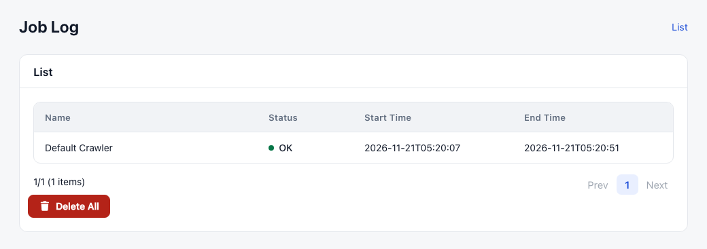
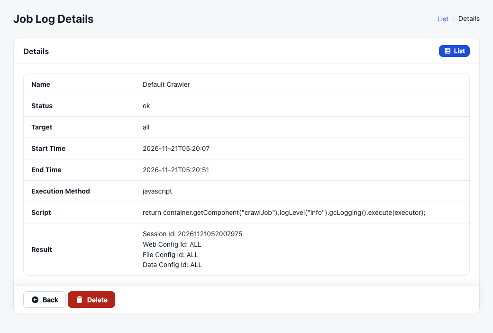

=======
Job Log
=======

Overview
========

Job Log page display results for executing jobs.

Management Operations
=====================

Display Job Logs
----------------

Select System Info > Job Log in the left menu to display job logs.

|image0|

The list displays job name, execution status, and start/end time.
Click the Delete All button below the list to delete all job logs. A confirmation dialog will appear.

Details
-------

Click a job log on the list page to display the details.

|image1|

Name
::::

The name of the executed job.

Status
::::::

The execution result of the job.

.. note::
   A crawl job with the status OK (``ok``) has not necessarily put every document in the index. The status tells whether the crawler process ended normally. A document whose write the search engine refuses is not indexed, and the job still ends with OK. Each refused document is logged in ``fess-crawler.log`` as a ``Failed to index a document`` warning. For Web and file crawls it is not recorded as a failure URL. Check the number of documents in the index as well (see "Index Document Count and Crawl Freshness" in :doc:`../config/admin-logging`).

Target
::::::

The target for job execution.

Start Time
::::::::::

Date and time when the job started.

End Time
::::::::

Date and time when the job ended.

Execution Method
::::::::::::::::

The execution environment where the job was executed.

Script
::::::

The execution content of the job.

Result
::::::

The execution result of the job.

Click the Delete button on the details page to delete the job log. A confirmation dialog will appear.

