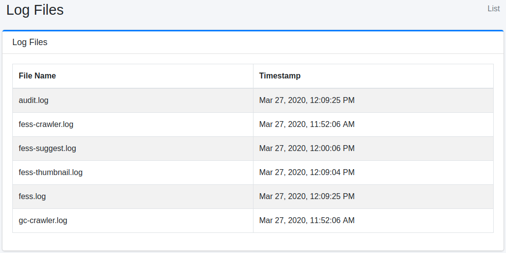

=========
Log Files
=========

Overview
========

Log Files page allows you to download log files.

Management Operations
=====================

Download Log File
-----------------

Select System Info > Log File in a left menu to display a log file list.

|image0|

audit.log
:::::::::

Audit log file.

server_?.log
::::::::::::

System log file.

fess.log
::::::::

Application log file.

fess-crawler.log
::::::::::::::::

Crawler log file.

fess-thumbnail.log
::::::::::::::::::

Thumbnail log file.

fess-suggest.log
::::::::::::::::

Suggest log file.

fess-urls.log
:::::::::::::

Crawl statistics for each URL, such as the time each processing step took.

searchlog.log
:::::::::::::

Search log file.
When "Search Log" under [System > General] is enabled, one line (JSON) is appended for each search in the default configuration.
A line contains the fields of the documents returned by that search (``logging.search.docs.fields``), so its size grows with the number of results returned (with ``num=100``, a line can be around 70 KB).
For log rotation and retention, see :doc:`../config/admin-logging`.
To leave the fields of the returned documents out of the search log, set ``logging.search.docs.enabled=false`` in ``fess_config.properties``; to stop writing to this file, set ``logging.search.use.logfile=false``.

gc-crawler.log
::::::::::::::

Garbage collection log file of the crawler process (written by the default "Default Crawler" job).

gc-fess.log
:::::::::::

Garbage collection log file of |Fess| itself. It is written only when the environment variable ``FESS_USE_GC_LOGGING`` is set to a non-empty value (see :doc:`../install/run`).

