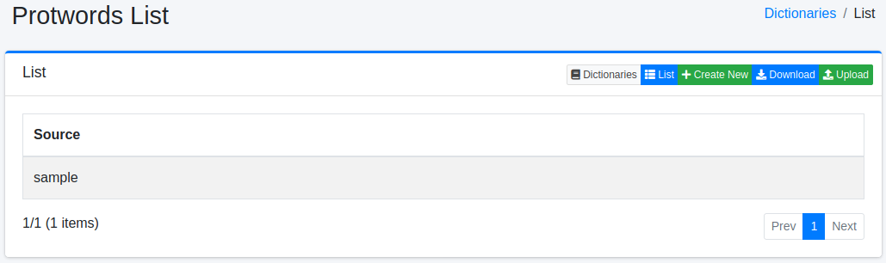
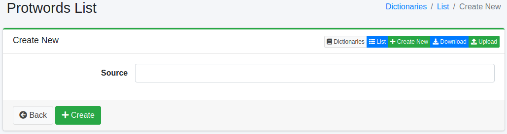

======================
Protwords Dictionary
======================

Overview
========

You can manage words to exclude from stemming processing.
Since stemming processing is fundamentally rule-based, unintended normalization may occur.
For example, the word "Maine" (the name of a U.S. state) would be normalized to "main".

To keep this word searchable as it is, register ``maine`` (write the word in lowercase; see "Configuration Items" for details).

The list shows one dictionary per language (``en/protwords.txt``, ``de/protwords.txt`` and so on). Choose and edit the dictionary that matches the language of the word. See :doc:`dict-guide` for which dictionary applies to which field.
Saving a change is not enough for it to take effect in searches. See :ref:`dict-apply-changes` for how to apply it.

Management Operations
=====================

Display Method
--------------

To open the Protwords configuration list page shown below, click [System > Dictionary] in the left menu, then click protwords.

|image0|

Click the configuration name to edit it.

Configuration Method
--------------------

To open the Protwords configuration page, click the New button.

|image1|

Configuration Items
-------------------

Word Information
::::::::::::::::

Enters words to exclude from stemming processing.

Enter words in lowercase. The analysis converts a word to lowercase before it checks the word against this dictionary, so entering ``Maine`` does not protect it. In the example in the overview, enter ``maine``.

Download
========

You can download in Protwords dictionary format.

Upload
======

You can upload in Protwords dictionary format.

.. warning::

   Uploading replaces the content of the dictionary with the content of the uploaded file. Any word that is not in the file, including words registered on the screen, is removed. If necessary, download the dictionary first and include its content in the file you upload.

