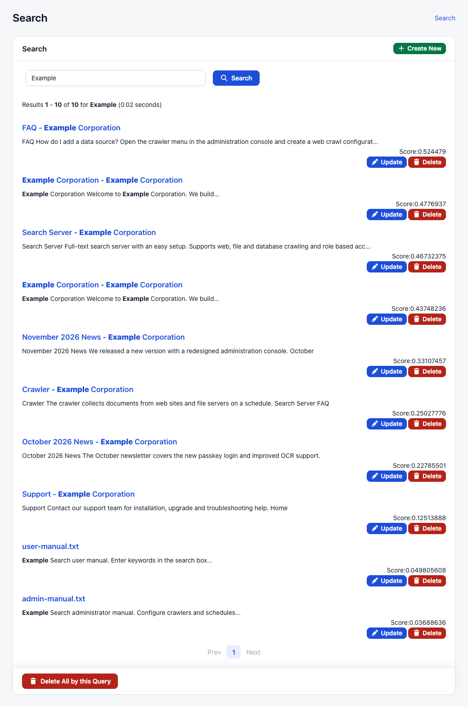
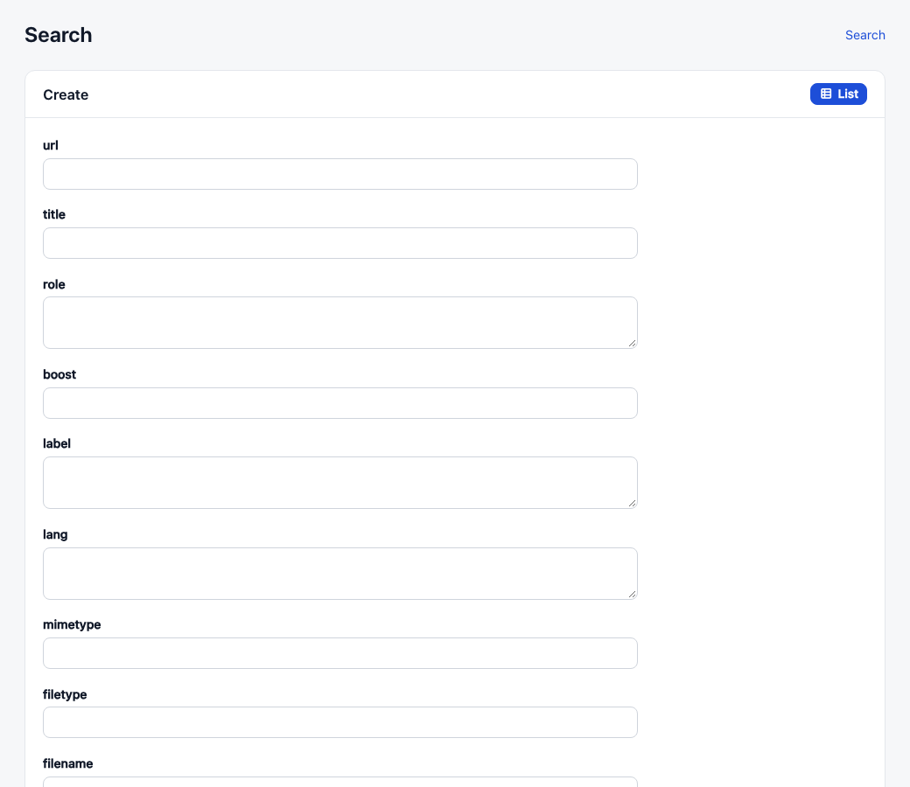

======
Search
======

Overview
========

Search page displays search results for administration.
This search results is not filtered by roles.

Management Operations
=====================

Display Search Result
---------------------

Select System Info > Search in a left menu to display a search form.

Type a keyword to search form and then click Search button. The search results are displayed as below.

|image0|

To edit a document in the results, click the Update button of the document.
To delete a document from the index, click the Delete button of the document, and then click the Delete button in the confirmation dialog.
To delete all the documents that match the query from the index, click the Delete All by this Query button at the bottom of the page. A confirmation dialog will appear. For example, searching ``*:*`` and clicking the button deletes all the documents.

Create Document
---------------

Click the Create New button at the top right of the page to display a form for adding a document to the index.

|image1|

The form lists the fields of the document by their field names, such as ``url``, ``title`` and ``role``. ``url`` and ``title`` are required.

- A field that can hold several values, such as ``role``, ``label``, ``lang`` and ``virtual_host``, is a text area; enter one value per line.
- ``boost`` is a number, and ``content_length``, ``favorite_count`` and ``click_count`` are integers.
- A date field (``created``, ``timestamp``, ``last_modified`` and ``expires``) is entered in the form ``yyyy-MM-ddTHH:mm:ss.SSSZ``, such as ``2026-01-01T00:00:00.000Z``.

The browser checks the format of these values when the form is sent. Click the Create button to add the document.
The form to update a document has the same fields.

