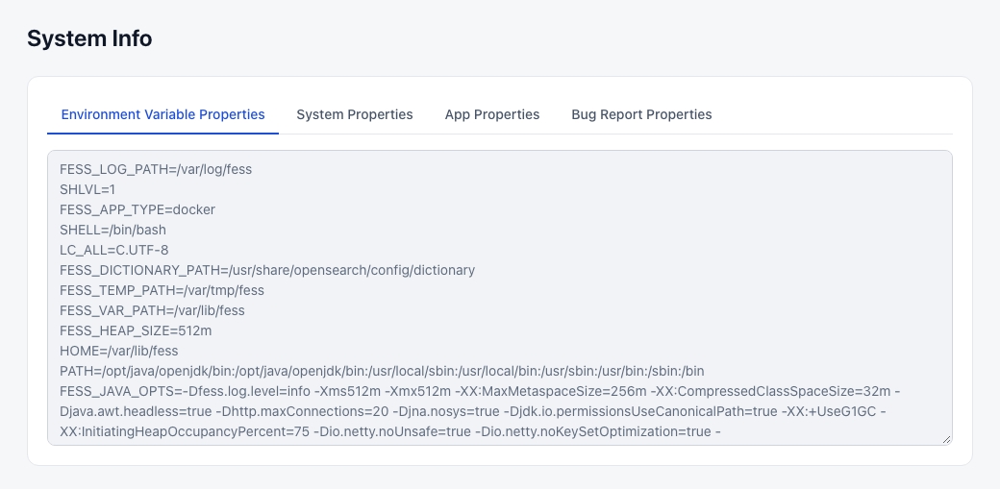
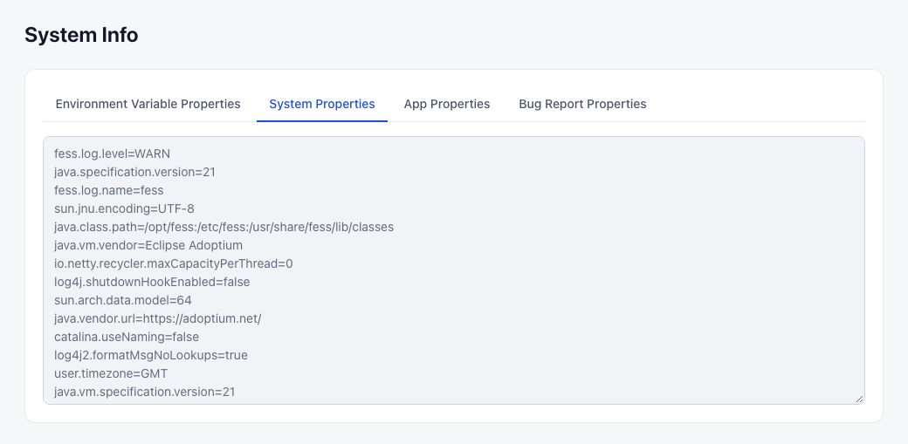
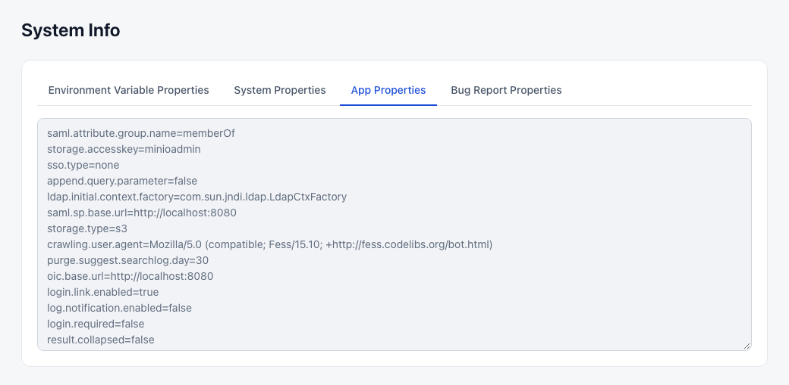
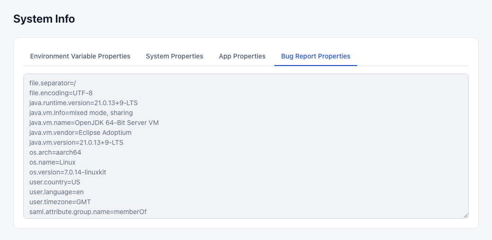

===========
System Info
===========

Overview
========

Here you can view property information, such as environment variables, about the currently running system.

Management Operations
=====================

Display System Information
--------------------------

To open the System Information page shown below, click System Info > Config Info in the left-hand menu.
The page has four tabs, described below.

Display items
-------------

Environment Variable Properties
:::::::::::::::::::::::::::::::

|image0|

Lists the server's environment variables.

System Properties
:::::::::::::::::

|image1|

Lists the system properties set for Fess.

App Properties
::::::::::::::

|image2|

Allows you to view information on the Fess settings.

Bug Report Properties
:::::::::::::::::::::

|image3|

List of properties to attach to a bug report. Values that do not contain personal information are extracted.

