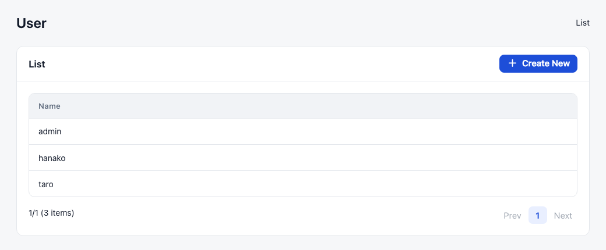
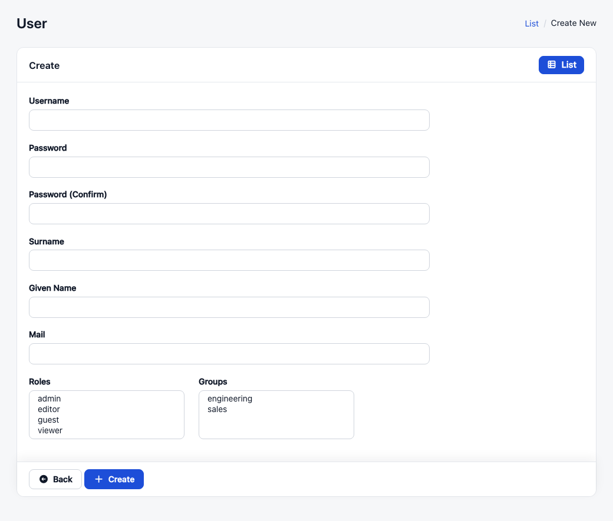

====
User
====

Overview
========

This section provides an explanation of user management in |Fess|. You can manage users who log in to the system.

Management Operations
=====================

Display Configurations
----------------------

To access the list page for user settings shown below, click on "[User > User]" in the left menu.

|image0|

To edit, click on the configuration name.

Create Configuration
--------------------

To open the User settings page, click on the "Create New" button.

|image1|

Configurations
--------------

Username
::::::::

Specify the username of the user. It cannot be changed after the user is created.

Password, Password (Confirm)
::::::::::::::::::::::::::::

Specify the password of the user, and enter it again in Password (Confirm). The password is required when creating a user. When editing a user, leave both fields blank to keep the current password.

Surname, Given Name, Mail
:::::::::::::::::::::::::

Specify the surname, given name and mail address of the user. These fields are optional.

Roles
:::::

Specify the roles to which the user belongs.

.. note::

   A user with the ``admin-user`` role can give any existing role, including the administrator role, to any user. Treat the ``admin-*`` roles as equivalent to the administrator role; see :doc:`../install/security`.

Groups
::::::

Specify the groups to which the user belongs.

Delete Configuration
--------------------

Click on the configuration name on the list page, and when the Delete button is clicked, a confirmation dialog will appear. Clicking the Delete button in the dialog will remove the configuration.

