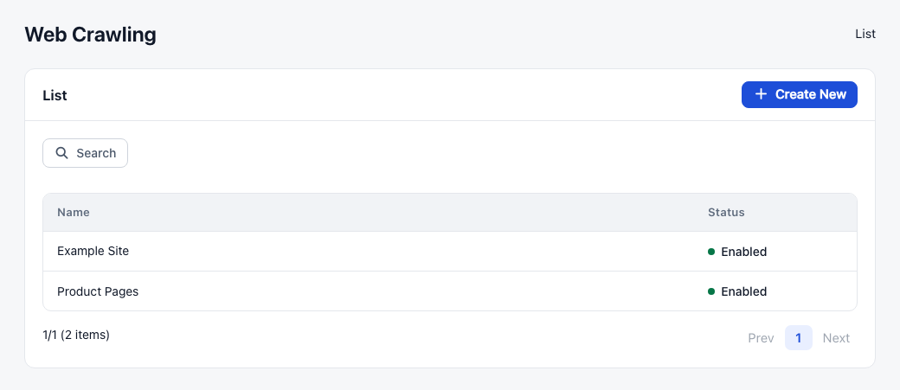
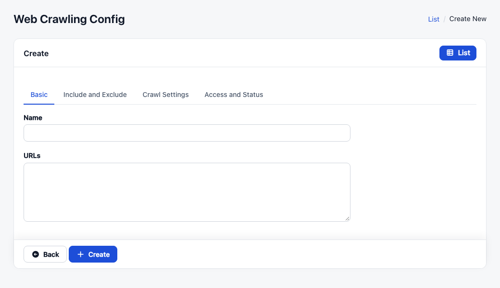
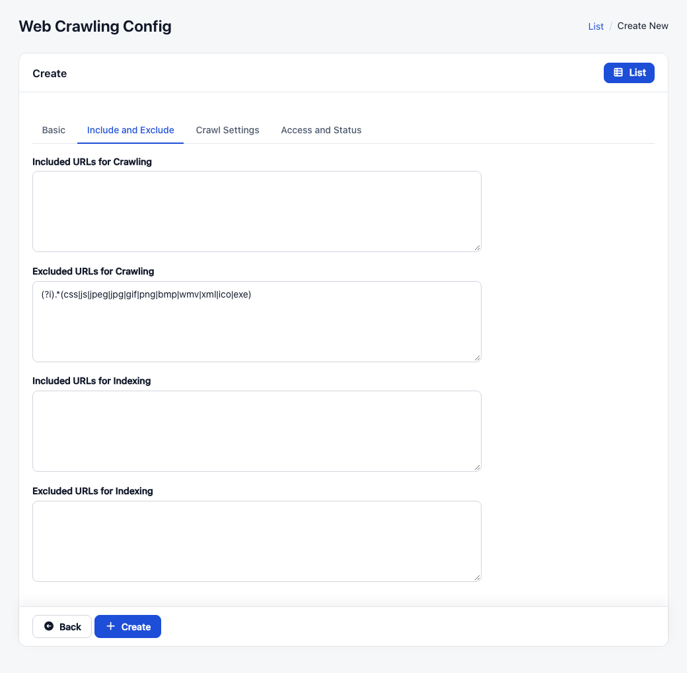
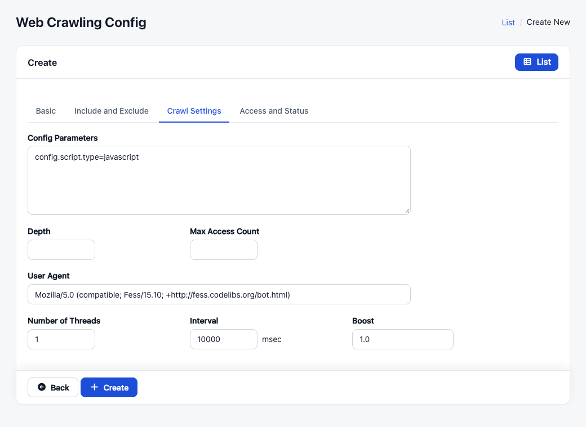
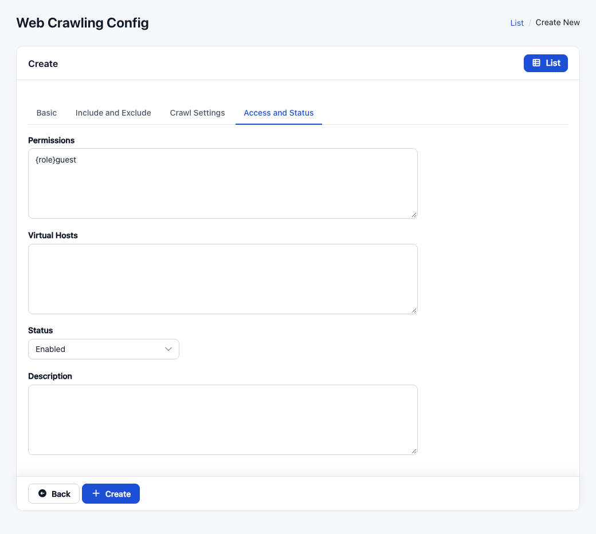

=============================
Web Crawling (Website Search)
=============================

Overview
========

Web Crawling uses a web crawler to traverse public websites and websites on your intranet, registering the collected pages in the |Fess| index so they can be found with full-text search (website search). It also supports crawling sites protected by BASIC, DIGEST, NTLM, or form authentication.

The Web Crawling configuration page allows you to configure web crawling settings.

Configuration Management
========================

Display Method
--------------

To open the Web Crawling configuration list page shown below, click [Crawler > Web] in the left menu.

|image0|

Click the configuration name to edit it.

Creating a Configuration
------------------------

Click the "Create New" button to open the Web Crawling configuration page.
The page is divided into four tabs: "Basic", "Include and Exclude", "Crawl Settings" and "Access and Status". Click a tab name to switch tabs. If an input has an error, the tab that contains it opens automatically. The fields of each tab are described below.

Basic Tab
---------

|image1|

Name
::::

Configuration name.

URLs
::::

The URLs where crawling begins. Specify one URL per line.

Include and Exclude Tab
-----------------------

|image2|

Included URLs for Crawling
::::::::::::::::::::::::::

URLs matching this regular expression (Java format) will be crawled by the |Fess| crawler.

Excluded URLs for Crawling
::::::::::::::::::::::::::

URLs matching this regular expression (Java format) will not be crawled by the |Fess| crawler.

.. note::
   On the create form of the admin console, this field is pre-filled with ``(?i).*(css|js|jpeg|jpg|gif|png|bmp|wmv|xml|ico|exe)``.
   The pattern is matched against the whole URL and also applies to the start URLs of a crawl.
   The default value matches any URL that ends with a term such as ``css``, ``js`` or ``xml`` (case-insensitive), so a start URL such as ``sitemap.xml`` is not fetched and nothing is crawled from it.
   To crawl such a URL, remove the matching term from the default value.
   When a start URL matches a pattern of this field, the name of the crawl configuration, the start URL and the matching pattern are logged as a WARN in ``fess-crawler.log``.

Included URLs for Indexing
::::::::::::::::::::::::::

URLs matching this regular expression (Java format) will be included in the search index.

Excluded URLs for Indexing
::::::::::::::::::::::::::

URLs matching this regular expression (Java format) will be excluded from the search index.

.. note::
   This setting applies to documents indexed by later crawls (matching documents are not indexed). Documents that are already indexed are not deleted when you add this setting, and they remain in the search results. If "Check Last Modified" in General is enabled (the default), a document that has not been updated has its expiration extended on every crawl (see "Check Last Modified" in :doc:`general-guide`), so it is not necessarily removed when the "Delete old documents" period passes. To remove a document from the search results reliably, delete it on the Search page (System Info > Search) of the admin console. A deleted document is not indexed again by the next crawl as long as it matches this setting.

Crawl Settings Tab
------------------

|image3|

Config Parameters
:::::::::::::::::

Specifies crawl configuration information.

Depth
:::::

Specifies the depth for following links contained in crawled documents.

Max Access Count
::::::::::::::::

The number of indexed URLs.

User Agent
::::::::::

Name of |Fess| crawler.

Number of Threads
:::::::::::::::::

The number of threads to use for crawling with this configuration.

Interval
::::::::

The time interval between URL crawls for each thread, in milliseconds.

Boost
:::::

The boost value is a weight for documents indexed by this configuration.

Access and Status Tab
---------------------

|image4|

Permissions
:::::::::::

Specifies permissions for this configuration.
The permission format is as follows: to display search results to users in the developer group, specify {group}developer.
User-level: {user}username, Role-level: {role}rolename, Group-level: {group}groupname.
Prefix an entry with ``(deny)``, for example ``(deny){role}rolename``, to deny access. In 15.10, the following entries are rejected with an error when saved: whitespace (including a full-width space) right after ``(allow)`` / ``(deny)``, or at the start of a line before ``{user}``, ``{group}`` or ``{role}``; ``(deny)``, ``{role}`` and the like typed with full-width characters; and an invisible character (such as a zero-width space or a byte order mark) at the start of an entry or right after ``(allow)`` / ``(deny)``. If a value saved by an earlier version has one of these forms, enter it again. See :doc:`../config/security-role` for details.

Virtual Hosts
:::::::::::::

Specifies the virtual host hostnames, one per line.
For details, see :doc:`../config/security-virtual-host`.

Status
::::::

If enabled, the default crawler's scheduled job will include this configuration.

Description
:::::::::::

Enter a description.

Deleting a Configuration
------------------------

Click the configuration name on the list page, then click the "Delete" button to display a confirmation dialog. Click the "Delete" button to remove the configuration.

.. note::

   Deleting a configuration does not delete the documents that it has already registered in the index. They stay searchable until they expire. A document expires the number of days given by "Delete old documents" in :doc:`general-guide` (``day.for.cleanup``, ``3`` by default) after the start of the last crawl that registered or updated it, and the Doc Purger job then removes it from the index. With ``-1``, documents that were registered without an expiration are never removed this way.

   To remove the documents at once, delete them from the index yourself. On the Search screen (:doc:`searchlist-guide`), search for the documents of the configuration (for example by ``url:`` or ``host:``), check the hits, and click the "Delete All by this Query" button. You can do the same with ``DELETE /api/admin/searchlist/query`` (see :doc:`../api/admin/api-admin-searchlist`).

   This differs from changing the permissions of a configuration and crawling again: the document ID depends on the permissions, and when the crawler registers a document, it deletes the documents with the same URL and a different ID that the same configuration registered before.

Examples
========

Crawling fess.codelibs.org
--------------------------

To create a Web Crawling configuration to crawl pages under https://fess.codelibs.org/, the configuration values are as follows:

.. tabularcolumns:: |p{4cm}|p{8cm}|
.. list-table::
   :header-rows: 1

   * - Configuration Item
     - Value
   * - Name
     - Fess
   * - URLs
     - https://fess.codelibs.org/
   * - Included URLs for Crawling
     - https://fess.codelibs.org/.\*

Other configuration values can use default settings.

Crawling Web Authentication Sites
----------------------------------

Fess supports crawling sites with BASIC, DIGEST, and NTLM authentication.
For details on web authentication, refer to the Web Authentication page.

Redmine
:::::::

To crawl Redmine pages (ex. https://<server>/) with password protection, create a setting on Web Config page as below:

.. tabularcolumns:: |p{4cm}|p{8cm}|
.. list-table::
   :header-rows: 1

   * - Configuration Item
     - Value
   * - Name
     - Redmine
   * - URLs
     - https://<server>/my/page
   * - Included URLs for Crawling
     - https://<server>/.\*
   * - Config Parameters
     - client.robotsTxtEnabled=false (Optional)

and then create the authentication setting on Web Auth page:

.. tabularcolumns:: |p{4cm}|p{8cm}|
.. list-table::
   :header-rows: 1

   * - Configuration Item
     - Value
   * - Scheme
     - Form
   * - Username
     - (Account for crawling)
   * - Password
     - (Password for the account)
   * - Parameters
     - | encoding=UTF-8
       | token_method=GET
       | token_url=https://<server>/login
       | token_pattern=name="authenticity_token"[^>]+value="([^"]+)"
       | token_name=authenticity_token
       | login_method=POST
       | login_url=https://<server>/login
       | login_parameters=username=${username}&password=${password}
   * - Web Config
     - Redmine

XWiki
:::::

To crawl XWiki pages (ex. https://<server>/xwiki/), Web Crawling setting is:

.. tabularcolumns:: |p{4cm}|p{8cm}|
.. list-table::
   :header-rows: 1

   * - Configuration Item
     - Value
   * - Name
     - XWiki
   * - URLs
     - https://<server>/xwiki/bin/view/Main/
   * - Included URLs for Crawling
     - https://<server>/.\*
   * - Config Parameters
     - client.robotsTxtEnabled=false (Optional)

and the authentication setting is:

.. tabularcolumns:: |p{4cm}|p{8cm}|
.. list-table::
   :header-rows: 1

   * - Configuration Item
     - Value
   * - Scheme
     - Form
   * - Username
     - (Account for crawling)
   * - Password
     - (Password for the account)
   * - Parameters
     - | encoding=UTF-8
       | token_method=GET
       | token_url=http://<server>/xwiki/bin/login/XWiki/XWikiLogin
       | token_pattern=name="form_token" +value="([^"]+)"
       | token_name=form_token
       | login_method=POST
       | login_url=http://<server>/xwiki/bin/loginsubmit/XWiki/XWikiLogin
       | login_parameters=j_username=${username}&j_password=${password}
   * - Web Config
     - XWiki

Related Pages
=============

- :doc:`../config/crawler-basic`
- :doc:`webauth-guide`
- :doc:`fileconfig-guide`
- :doc:`../config/search-basic`

.. pdf            :height: 940 px
