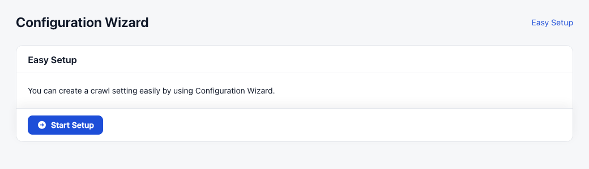
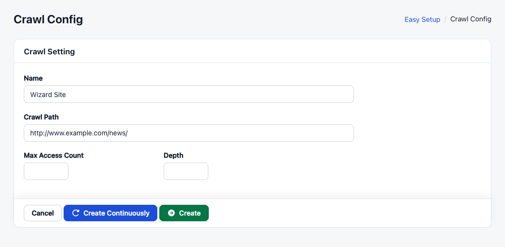
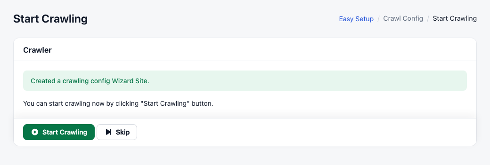

===================
Configuration Wizard
===================

Overview
========

The wizard page provides a simple setup tool for registering crawl configurations.

Easy Setup
----------

This page serves as the starting point for registering crawl configurations. Click the Start Setup button to open the crawl configuration page.

|image0|

Crawl Config
------------

This page allows you to create crawl configurations.

|image1|

Configuration Items
-------------------

Name
::::

Specifies the configuration name (e.g., Fess Site).

Crawl Path
::::::::::

Specifies the starting URL or file path for crawling (e.g., https://fess.codelibs.org/).

Max Access Count
::::::::::::::::

Sets the maximum number of pages to be crawled.

Depth
:::::

Sets the depth of links to follow when crawling documents.

Buttons
:::::::

- **Create**: Registers the crawl configuration and proceeds to the Start Crawling page.
- **Create Continuously**: Registers the crawl configuration and returns to this form so that you can register another one.
- **Cancel**: Returns to the Easy Setup page without registering.

Crawler
-------

To start the |Fess| crawler, click the Start Crawling button. To skip crawling for now, click the Skip button.

|image2|

