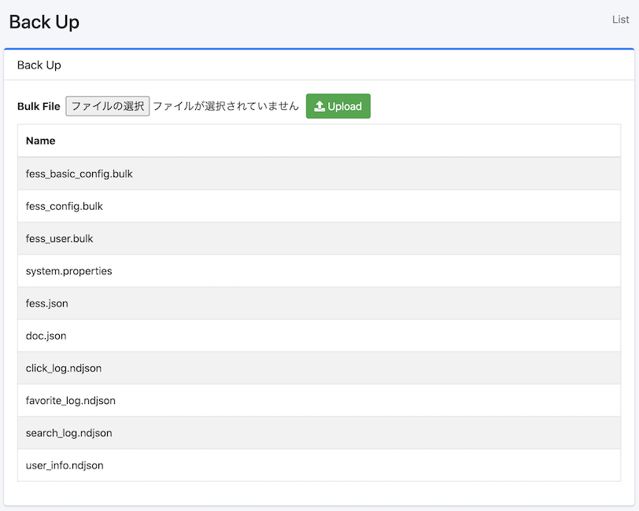

======
Backup
======

Overview
========

Backup page allows you to download and upload your configuration data for |Fess|.

Management Operations
=====================

Download Data
--------------

|Fess| manages configuration data as indices.
To download your configuration, click the index name.

|image0|

.. note::

   Dictionary files (synonyms, stop words, and so on) are not part of the backup.
   They are stored in the dictionary directory of the search engine (``FESS_DICTIONARY_PATH``),
   so copy them separately if you need them.

fess_config.bulk
::::::::::::::::

fess_config.bulk contains configuration information for Fess.

fess_basic_config.bulk
::::::::::::::::::::::

fess_basic_config.bulk contains Fess configuration information excluding crawl information, failure URLs, job logs, the thumbnail queue, user tags, and similar data.

fess_user.bulk
::::::::::::::

fess_user.bulk includes information about users, roles, and groups.

system.properties
:::::::::::::::::

system.properties contains general settings information.

fess.json
:::::::::

fess.json contains configuration information for the fess index.

doc.json
::::::::

doc.json contains mapping information for the fess index.

chat_log.ndjson
:::::::::::::::

chat_log.ndjson includes AI chat usage log information.

click_log.ndjson
::::::::::::::::

click_log.ndjson includes click log information.

favorite_log.ndjson
:::::::::::::::::::

favorite_log.ndjson contains favorite log information.

search_log.ndjson
:::::::::::::::::

search_log.ndjson includes search log information.

user_info.ndjson
::::::::::::::::

user_info.ndjson contains information about search users.

Upload
------

Configuration data can be imported by uploading a file.
The files that can be restored are as follows.

- ``*.bulk``
- ``system.properties``
- ``fess.json`` and ``doc.json``: replace the index definition files that |Fess| uses. The settings and mapping of an existing index are not changed on the spot.
- ``gsa*.xml``: a Google Search Appliance configuration file. It is imported as web crawl configuration, file crawl configuration, and labels.

``*.ndjson`` files (search logs and other logs) cannot be uploaded to restore them.

A document in a \*.bulk file that has an ``updatedTime`` is written only when the stored document
does not exist, has no ``updatedTime``, or is older. A document that is not newer is skipped and
logged at INFO level in ``fess.log``, so a restore does not roll back changes made after the backup
was taken, and the scheduled jobs bundled with the installed version (``updatedTime`` 0) are kept
as they are. Documents without an ``updatedTime`` are always written.

