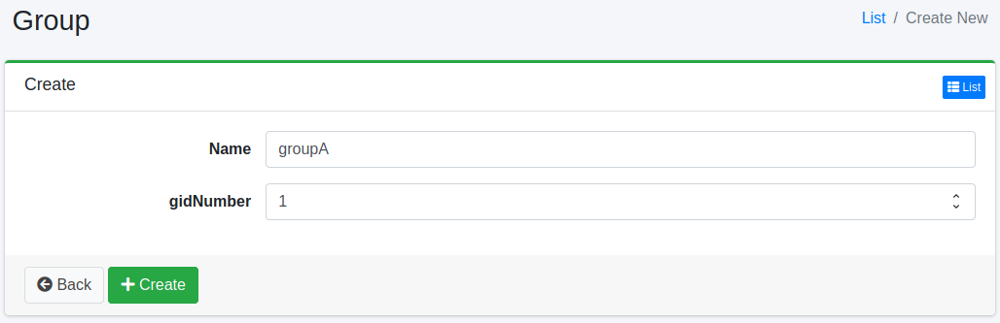

=====
Group
=====

Overview
========

You can manage the groups to which users belong. This feature can be useful, for example, when integrating with LDAP.

Management Operations
=====================

Display Configurations
----------------------

To access the list page for group settings shown below, click on "[User > Group]" in the left menu.

|image0|

To edit, click on the configuration name.

Create Configuration
--------------------

To open the Group settings page, click on the "Create New" button.

|image1|

Configurations
--------------

Name
::::

The name of the group.

gidNumber
:::::::::

The gidNumber (the POSIX group ID in LDAP) of the group, as a number. It is optional. Entering a value that is not a number results in an error.
When |Fess| is configured to manage LDAP from the administration screens (``ldap.admin.enabled=true``), it is written to the ``gidNumber`` attribute of the group entry in LDAP (the attribute name can be changed with ``ldap.attr.gidNumber``). If you do not use LDAP, you do not need to specify it.

Delete Configuration
--------------------

Click on the configuration name on the list page, and when the delete button is clicked, a confirmation screen will appear. Clicking the delete button will remove the configuration.

.. |image0| image:: ../../../resources/images/en/15.9/admin/group-1.png

