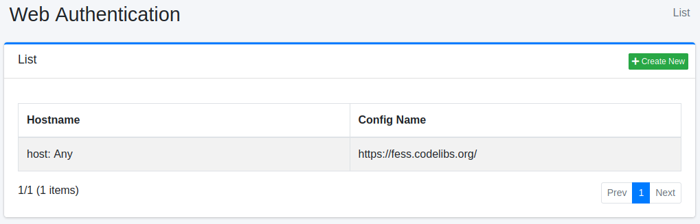
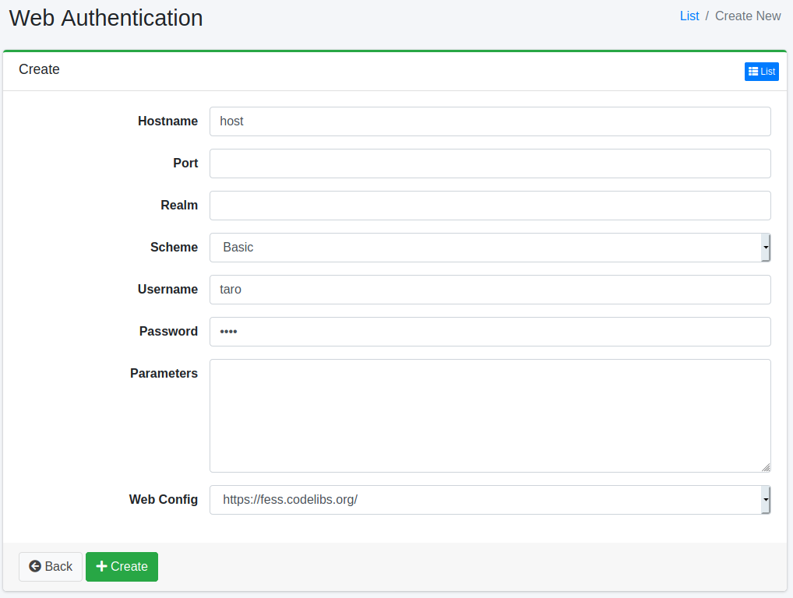

==================
Web Authentication
==================

Overview
========

Here, we will explain the configuration for web crawling that requires web authentication. |Fess| supports BASIC authentication, DIGEST authentication, NTLM authentication, and FORM authentication.

Management Operations
=====================

Display Configurations
----------------------

To open the list page for configuring Web Authentication shown below, click on "[Crawler > Web Authentication]" in the left menu.

|image0|

To edit, click on the configuration name.

Create Configuration
--------------------

To open the Web Authentication settings page, click on the "Create New" button.

|image1|

Configurations
--------------

Hostname
::::::::

Specify the hostname of the site that requires authentication.
If omitted, it will apply to any hostname in the specified web crawl configuration.

.. warning::

   If the hostname is omitted, the username and password are also sent to other hosts that the crawl reaches through links or redirects.
   Specify the hostname so that the credentials are not sent to hosts you did not intend.

Port
::::

Specify the port of the site that requires authentication.
Leave the port blank to apply to all ports. ``-1`` cannot be specified; only values of 0 or more are accepted.
In that case, it will apply to any port in the specified web crawl configuration.

Realm
:::::

Specify the realm name of the site that requires authentication.
If omitted, it will apply to any realm name in the specified web crawl configuration.
For BASIC and DIGEST authentication, the realm is compared with the realm returned by the server, and the comparison is case-sensitive. If they do not match, the credentials are not sent.
An NTLM challenge does not carry a realm, so this setting is not used for NTLM authentication (authentication succeeds even if a wrong realm is specified).

Scheme
::::::

Select the authentication method.
You can use BASIC authentication, DIGEST authentication, NTLM authentication, or FORM authentication.

.. note::

   The BASIC, DIGEST, and NTLM schemes do not restrict which authentication method the server may ask for.
   |Fess| sends the credentials with the method the server requests.
   For example, an entry saved as DIGEST is sent with BASIC if the server only requests BASIC (over HTTP the credentials are then effectively in clear text).
   An entry saved as BASIC answers with DIGEST if the server requests DIGEST.
   NTLM and BASIC/DIGEST cannot stand in for each other.
   If you select a scheme the server does not use, no credentials are sent and the documents of the site are not indexed.
   Select the authentication method the server uses, and use HTTPS where possible.

Username
::::::::

Specify the username to log in to the authentication site.
For NTLM authentication that requires a domain, do not write the username as ``DOMAIN\user``; specify the domain with the ``domain`` parameter described below.
A value such as ``DOMAIN\user`` is not split: the whole string is sent as the username with an empty domain.

Password
::::::::

Specify the password to log in to the authentication site.

Parameters
::::::::::

If there are any required settings to log in to the authentication site, specify them here.
For NTLM authentication, you can set the values for workstation and domain.
To set them, use the following format:

::

    workstation=HOGE
    domain=FUGA

``domain``
    The domain to authenticate against. Specify it when you authenticate with a domain account.
    If it is omitted, the domain is sent empty and the authentication of a domain account fails.
    A domain written in lower case is converted to upper case before it is sent.

``workstation``
    The workstation name sent in the NTLM messages.
    If it is omitted, the host name of the machine that |Fess| runs on is sent.

Web Config
::::::::::

Select the web configuration to apply the authentication settings.
You need to pre-register the web crawl configuration.

When Authentication Fails
-------------------------

If the credentials are wrong, or the hostname, port, or realm does not match the site so that no credentials are sent, the server returns 401 (Unauthorized) and the documents of the site are not indexed.
A 401 is recorded as a failure URL, so check :doc:`failureurl-guide`.
The HTTP status codes that are recorded as failure URLs can be changed with ``crawler.failure.url.status.codes`` (:doc:`../config/crawler-advanced`).
Note that a 401 does not delete documents that are already in the index.

Delete Configuration
--------------------

Click on the configuration name on the list page, and when the delete button is clicked, a confirmation screen will appear. Clicking the delete button will remove the configuration.

