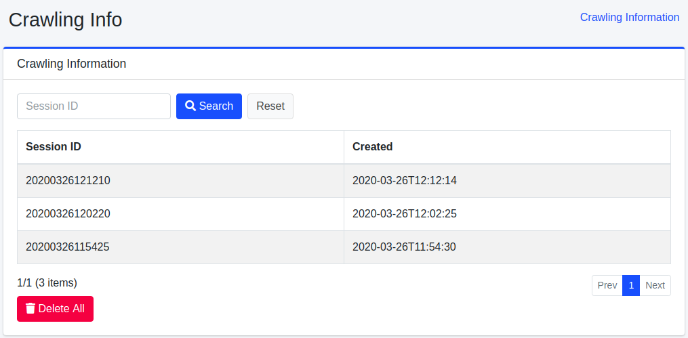
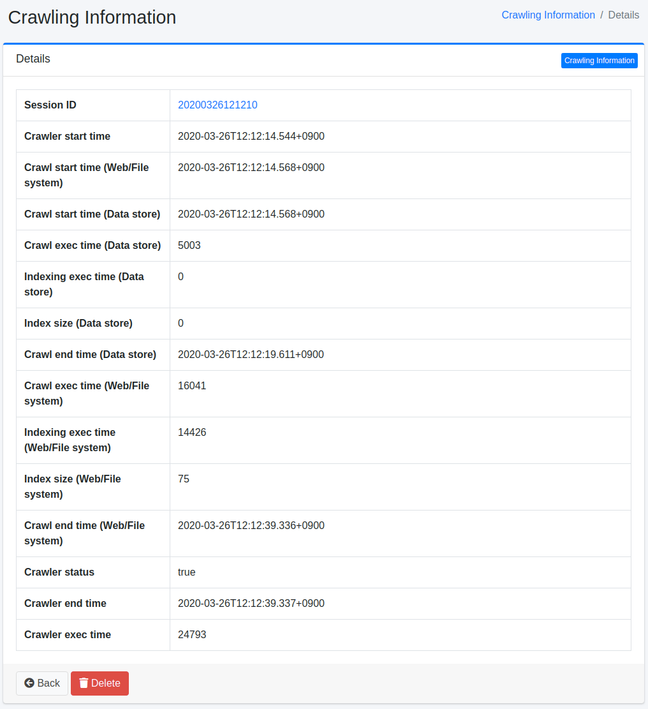

=======================
Información de Rastreo
=======================

Descripción general
===================

Los resultados de ejecución del rastreo se registran y la información de rastreo se puede verificar en esta pantalla de administración.

Método de gestión
==================

Lista
=====

Cada vez que se ejecuta un rastreo, se registra como información de rastreo.
En la lista puede verificar el nombre de sesión del rastreo ejecutado y la hora de ejecución.
Si desea verificar los detalles de la información de rastreo, haga clic en la información de rastreo objetivo.

|image0|

Rastreos en ejecución
=====================

Mientras hay rastreos en ejecución, "Rastreos en ejecución" se muestra encima de la lista. Tiene una fila por cada configuración de rastreo (web, sistema de archivos o almacén de datos) con los siguientes elementos.

- Configuración de rastreo: el nombre de la configuración de rastreo.
- Documentos procesados: el número de documentos que el rastreo en ejecución ha procesado hasta ahora. En los rastreos web y de sistema de archivos es el número de resultados de acceso; en los rastreos de almacenes de datos es el número de documentos indexados para la configuración de rastreo.
- Progreso: los documentos procesados como porcentaje del número de documentos del último rastreo completado. No supera el 99 % hasta que el rastreo termina. Si no hay un rastreo completado anterior (por ejemplo, en el primer rastreo), no se puede calcular el porcentaje; se muestra ``-`` y solo se indica el recuento.

Notas:

- El bloque muestra el estado en el momento de abrir la página. Recargue la página para ver los valores más recientes.
- Un rastreo terminado ya no aparece en el bloque la próxima vez que se abre la página. Un rastreo detenido, o que el rastreador interrumpe sin registrarlo (por ejemplo, porque se mata el proceso), desaparece en unos 30 segundos (de forma predeterminada) tras su última actualización, por lo que puede seguir mostrándose un breve tiempo después de detenerlo. Un rastreo detenido o fallido deja sin cambios el número de documentos del último rastreo completado, igual que un rastreo que termina sin procesar ningún documento.
- El sistema guarda el estado del progreso en el campo ``metadata`` de la configuración de rastreo. No se puede editar en la interfaz de administración ni en la API de administración.
- La misma información está disponible en la API de administración (consulte :doc:`../api/admin/api-admin-crawlinginfo`).

Detalles
========

Al hacer clic en el ID de sesión de la información de rastreo en la lista, se muestran los detalles de la información de rastreo objetivo.

|image1|

Lista de elementos
------------------

ID de sesión
::::::::::::

ID de sesión en el momento de la ejecución del rastreo.

Hora de inicio del rastreador
::::::::::::::::::::::::::::::

Hora en la que comenzó todo el rastreo.

Hora de inicio del rastreo (Web/Archivo)
:::::::::::::::::::::::::::::::::::::::::

Hora en la que comenzó el rastreo web y del sistema de archivos.

Hora de inicio del rastreo (Almacén de datos)
::::::::::::::::::::::::::::::::::::::::::::::

Hora en la que comenzó el rastreo del almacén de datos.

Hora de finalización del rastreo (Web/Archivo)
:::::::::::::::::::::::::::::::::::::::::::::::

Hora en la que finalizó el rastreo web y del sistema de archivos.

Tiempo de ejecución del rastreo (Almacén de datos)
:::::::::::::::::::::::::::::::::::::::::::::::::::

Tiempo de ejecución del rastreo del almacén de datos (milisegundos).

Tiempo de ejecución de indexación (Almacén de datos)
:::::::::::::::::::::::::::::::::::::::::::::::::::::

Tiempo que se tardó en indexar los resultados del rastreo web y del sistema de archivos (milisegundos).

Tamaño del índice (Almacén de datos)
:::::::::::::::::::::::::::::::::::::

Número de documentos indexados.

Hora de finalización del rastreo (Almacén de datos)
::::::::::::::::::::::::::::::::::::::::::::::::::::

Hora en la que finalizó el rastreo del almacén de datos.

Estado del rastreador
:::::::::::::::::::::

Si el rastreo tuvo éxito o no.

Hora de finalización del rastreador
::::::::::::::::::::::::::::::::::::

Hora en la que finalizó todo el rastreo.

Tiempo de ejecución del rastreador
:::::::::::::::::::::::::::::::::::

Tiempo de ejecución de todo el rastreo (milisegundos).

