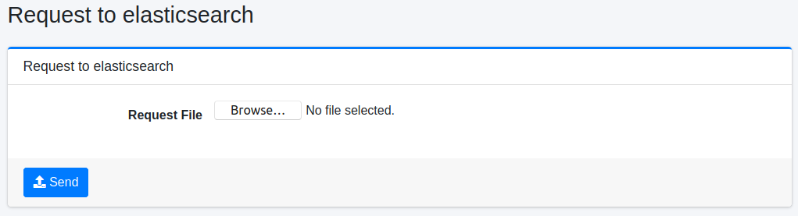

========================
Solicitud a OpenSearch
========================

Descripción general
===================

Esta página envía a OpenSearch una solicitud escrita en un archivo JSON.

|image0|

Esta página no aparece en el menú.
Para mostrarla, inicie sesión como administrador e ingrese ``/admin/sereq/`` como la ruta de la URL.
Para enviar una solicitud se necesita el rol ``admin`` (administradores) o el rol ``admin-sereq``.

Método de operación
===================

Envío de solicitud
------------------

Cree como archivo JSON la solicitud que desea enviar a OpenSearch, seleccione ese archivo como "Archivo de solicitud" y haga clic en el botón "Enviar" para enviar la solicitud a OpenSearch.
La respuesta se descarga como un archivo.

Parámetros de configuración
---------------------------

Archivo de solicitud
::::::::::::::::::::

Especifique el archivo que contiene la solicitud.

Escriba en la primera línea ``<método> <ruta>``, separados por un único espacio, y en las líneas siguientes el cuerpo de la solicitud (por ejemplo, un DSL de consulta).
El método puede ser GET, POST, PUT o DELETE. La ruta es la ruta en OpenSearch y se puede omitir la ``/`` inicial.
Por ejemplo, el contenido del archivo sería el siguiente.

::

    POST /_search
    {
      "query": {
        "match_all": {}
      }
    }

Los saltos de línea del cuerpo se eliminan y las líneas se unen antes de enviar la solicitud. Por ello no se puede enviar una solicitud cuyo cuerpo tenga un documento JSON por línea, como ``_bulk``.

.. warning::

   Una solicitud con el método PUT o DELETE también se envía a OpenSearch tal cual.
   Según el contenido del archivo, puede modificar o eliminar los índices que utiliza |Fess| y provocar pérdida de datos. Compruebe el contenido con atención antes de enviarlo.

