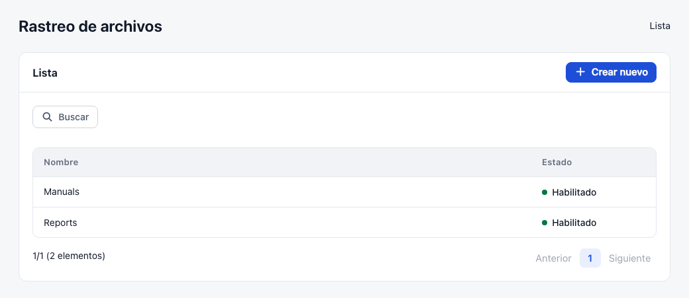
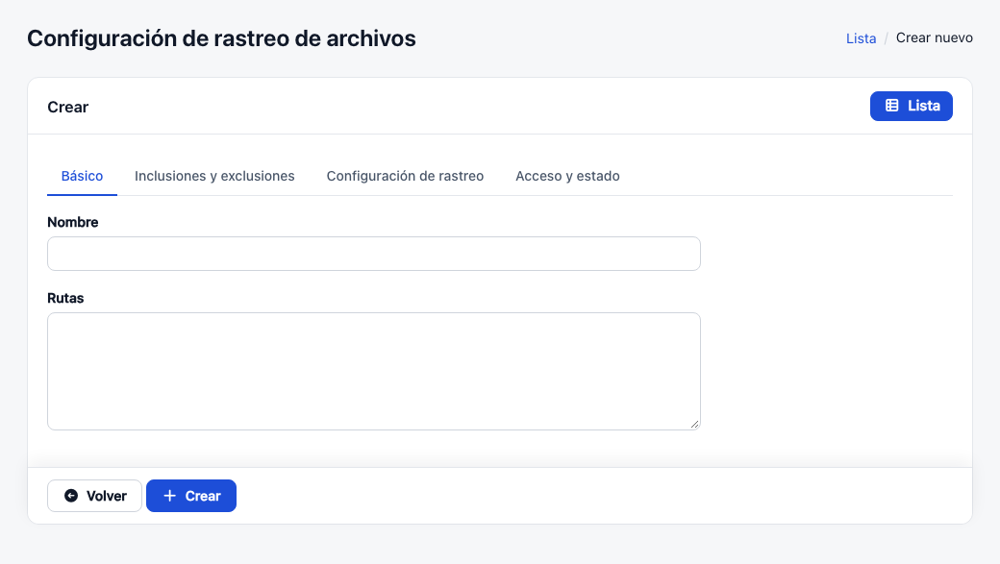
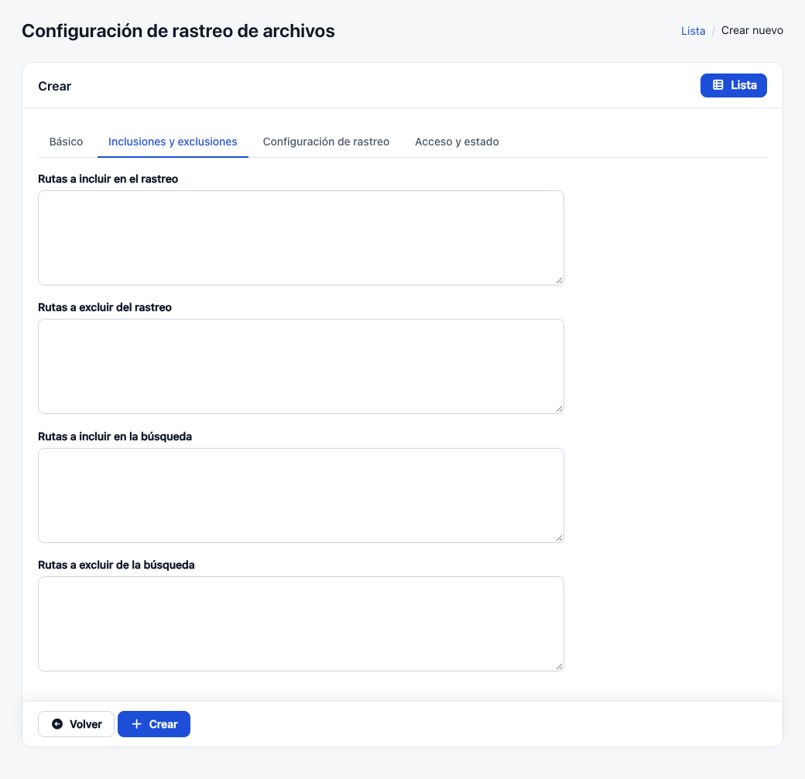
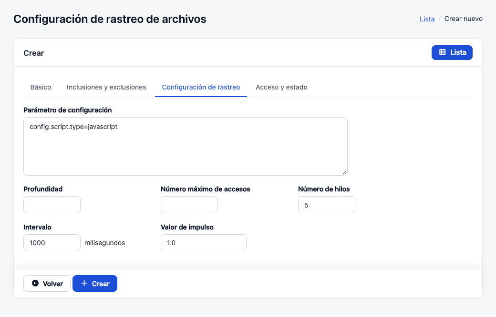
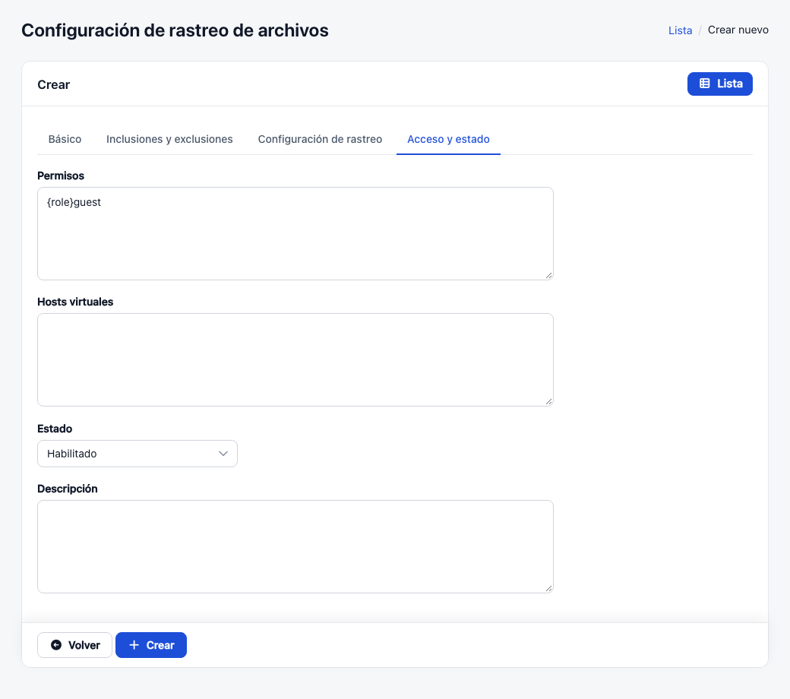

===================================================================
Rastreo de Sistema de Archivos (Búsqueda en Servidores de Archivos)
===================================================================

Descripción general
===================

El rastreo de archivos (Rastreo de Sistema de Archivos) permite registrar en el índice de |Fess| los documentos almacenados en servidores de archivos corporativos, carpetas compartidas de Windows o almacenamiento en la nube, para que puedan localizarse mediante búsqueda de texto completo (búsqueda en servidores de archivos). Es compatible con numerosos formatos de archivo, como Word, Excel, PowerPoint y PDF.

La página de configuración de rastreo de archivos le permite administrar la configuración para rastrear archivos en el sistema de archivos o en carpetas compartidas en la red.

El objetivo del rastreo se determina según el protocolo especificado en la «Ruta»:

- ``file:/`` … sistema de archivos local o unidad montada
- ``smb://`` … servidor de archivos o carpeta compartida de Windows (SMB/CIFS)
- ``smb1://`` … servidor de archivos o carpeta compartida de Windows mediante el antiguo protocolo SMB1
- ``ftp://`` … servidor FTP
- ``s3://`` … bucket de Amazon S3 (requiere el plugin ``fess-storage-s3``)
- ``gcs://`` … bucket de Google Cloud Storage (requiere el plugin ``fess-storage-gcs``)

Método de gestión
==================

Método de visualización
-----------------------

Para abrir la página de lista para configurar el rastreo de archivos que se muestra a continuación, haga clic en [Rastreador > Sistema de archivos] en el menú izquierdo.

|image0|

Para editar, haga clic en el nombre de la configuración.

Crear configuración
-------------------

Para abrir la página de configuración de rastreo de archivos, haga clic en el botón "Crear nuevo".
La página se divide en cuatro pestañas: "Básico", "Inclusiones y exclusiones", "Configuración de rastreo" y "Acceso y estado". Haga clic en el nombre de una pestaña para cambiar de pestaña. Si una entrada tiene un error, se abre automáticamente la pestaña que la contiene. Los campos de cada pestaña se describen a continuación.

Pestaña Básico
--------------

|image1|

Nombre
::::::

Es el nombre de la configuración.

Rutas
:::::

Estas rutas especifican dónde comenzar el rastreo (ejemplo: file:/, smb://, s3://, gcs://). Especifique una ruta por línea.

Pestaña Inclusiones y exclusiones
---------------------------------

|image2|

Rutas a rastrear
::::::::::::::::

Las rutas que coincidan con la expresión regular (formato Java) especificada en este elemento serán objeto del rastreador de |Fess|.

.. note::
   El patrón se aplica a la ruta completa de cada ruta que visita el rastreador, incluidas la ruta de inicio y los subdirectorios. Si especifica solo extensiones de archivo como ``.*\.(md|rst|adoc)$``, la ruta de inicio y los subdirectorios no coinciden con el patrón, el rastreador no llega a los archivos y no se rastrea nada. Para limitar los documentos por extensión, especifique el mismo patrón en "Rutas a buscar" (los directorios se siguen recorriendo y solo los archivos que coinciden son objeto de búsqueda). Use "Rutas a rastrear" únicamente con patrones que también coincidan con la ruta de inicio y los subdirectorios.

Rutas excluidas del rastreo
::::::::::::::::::::::::::::

Las rutas que coincidan con la expresión regular (formato Java) especificada en este elemento no serán objeto del rastreador de |Fess|.

Rutas a buscar
::::::::::::::

Las rutas que coincidan con la expresión regular (formato Java) especificada en este elemento serán objeto de búsqueda.

Rutas excluidas de la búsqueda
:::::::::::::::::::::::::::::::

Las rutas que coincidan con la expresión regular (formato Java) especificada en este elemento no serán objeto de búsqueda.

.. note::
   Esta configuración solo afecta a los documentos que se indexen en rastreos posteriores (los documentos que coinciden no se indexan). Los documentos que ya están indexados no se eliminan al añadir esta configuración y siguen apareciendo en los resultados de búsqueda. Si «Comprobar fecha de última modificación» de la configuración general está habilitado (valor predeterminado), la fecha de caducidad de un documento sin cambios se prolonga en cada rastreo (consulte «Comprobar fecha de última modificación» en :doc:`general-guide`), por lo que el documento no siempre desaparece cuando vence el plazo de «Eliminar documentos anteriores». Para quitar con seguridad un documento de los resultados de búsqueda, elimínelo en la lista de búsqueda (pantalla de administración). Mientras coincida con esta configuración, un documento eliminado no se vuelve a indexar en el siguiente rastreo.

Pestaña Configuración de rastreo
--------------------------------

|image3|

Parámetro de configuración
::::::::::::::::::::::::::

Puede especificar información de configuración de rastreo.

En el rastreo de rutas que comienzan con ``file:`` (sistema de archivos local o montado), ``client.followSymlink`` especifica si se siguen los enlaces simbólicos. El valor predeterminado es ``true`` (se siguen). Con ``false``, los enlaces simbólicos se omiten y los archivos a los que apuntan no se rastrean a través del enlace (cada enlace omitido se registra con nivel INFO en ``fess-crawler.log``). Al seguir un enlace, el archivo de destino se registra por segunda vez con los permisos de la configuración que contiene el enlace; por ello, considere ``false`` si rastrea un recurso compartido que pueden leer más usuarios que el árbol al que apuntan sus enlaces.

::

    client.followSymlink=false

Profundidad
:::::::::::

Especifique la profundidad de la estructura del sistema de archivos a rastrear.

Número máximo de accesos
:::::::::::::::::::::::::

Especifique el número de rutas a indexar.

Número de hilos
:::::::::::::::

Especifique el número de hilos a utilizar para esta configuración.

Intervalo
:::::::::

Especifique el tiempo de espera cada vez que un hilo rastrea una ruta, en milisegundos.

Valor de impulso
::::::::::::::::

El valor de impulso es la prioridad de los documentos indexados por esta configuración.

Pestaña Acceso y estado
-----------------------

|image4|

Permisos
::::::::

Especifique el permiso para esta configuración.
La forma de especificar permisos es, por ejemplo, para mostrar resultados de búsqueda a usuarios que pertenecen al grupo developer, especifique {group}developer.
La especificación por usuario es {user}nombre_usuario, la especificación por rol es {role}nombre_rol, y la especificación por grupo es {group}nombre_grupo.

Hosts virtuales
:::::::::::::::

Especifique los nombres de host de los hosts virtuales, uno por línea.
Para más detalles, consulte :doc:`Host virtual en la guía de configuración <../config/security-virtual-host>`.

Estado
::::::

Cuando esta configuración está habilitada, el trabajo del rastreador predeterminado realizará el rastreo incluyendo esta configuración.

Descripción
:::::::::::

Puede ingresar una descripción.

Eliminar configuración
----------------------

Haga clic en el nombre de la configuración en la página de lista y haga clic en el botón de eliminar para que aparezca un cuadro de diálogo de confirmación. Al presionar el botón de eliminar, se eliminará la configuración.

.. note::

   Al eliminar una configuración no se eliminan los documentos que ya ha registrado en el índice. Siguen siendo localizables hasta que caducan. Un documento caduca al cabo del número de días indicado en «Eliminar documentos anteriores» de :doc:`general-guide` (``day.for.cleanup``, ``3`` de forma predeterminada), contados desde el inicio del último rastreo que lo registró o actualizó, y entonces el trabajo Doc Purger lo elimina del índice. Con ``-1``, los documentos registrados sin caducidad nunca se eliminan de esta forma.

   Para eliminar los documentos de inmediato, elimínelos usted mismo del índice. En la pantalla Búsqueda (:doc:`searchlist-guide`), busque los documentos de la configuración (por ejemplo con ``url:`` o ``host:``), compruebe los resultados y haga clic en el botón «Eliminar todo con esta consulta». También puede hacerlo con ``DELETE /api/admin/searchlist/query`` (consulte :doc:`../api/admin/api-admin-searchlist`).

   Es distinto cuando se cambian los permisos de una configuración y se vuelve a rastrear: el ID del documento depende de los permisos y, al registrar un documento, el rastreador elimina los documentos con la misma URL y un ID distinto que la misma configuración registró antes.

Ejemplo
=======

Rastrear archivos locales
--------------------------

Para rastrear archivos bajo /home/share, la configuración sería la siguiente.

.. tabularcolumns:: |p{4cm}|p{8cm}|
.. list-table::
   :header-rows: 1

   * - Nombre
     - Valor
   * - Nombre
     - Directorio compartido
   * - Rutas
     - file:/home/share

Los otros parámetros pueden usar la configuración predeterminada.

Rastrear carpeta compartida de Windows
---------------------------------------

Para rastrear archivos bajo \\SERVER\SharedFolder, la configuración sería la siguiente.

.. tabularcolumns:: |p{4cm}|p{8cm}|
.. list-table::
   :header-rows: 1

   * - Nombre
     - Valor
   * - Nombre
     - Carpeta compartida
   * - Rutas
     - smb://SERVER/SharedFolder/

Si se requiere nombre de usuario/contraseña para acceder a la carpeta compartida, es necesario crear una configuración de autenticación de archivos desde [Rastreador > Autenticación de archivos] en el menú izquierdo.
En ese caso, la configuración sería la siguiente.

.. tabularcolumns:: |p{4cm}|p{8cm}|
.. list-table::
   :header-rows: 1

   * - Nombre
     - Valor
   * - Nombre de host
     - SERVER
   * - Esquema
     - Samba
   * - Nombre de usuario
     - (Ingrese)
   * - Contraseña
     - (Ingrese)

Rastrear buckets de Amazon S3
-----------------------------

Para rastrear archivos en el bucket my-bucket, la configuración sería la siguiente.

.. tabularcolumns:: |p{4cm}|p{8cm}|
.. list-table::
   :header-rows: 1

   * - Nombre
     - Valor
   * - Nombre
     - Bucket S3
   * - Rutas
     - s3://my-bucket/

El acceso a S3 requiere credenciales de autenticación. Agregue lo siguiente en "Parámetro de configuración":

::

    client.endpoint=https://s3.ap-northeast-1.amazonaws.com
    client.accessKey=SU_CLAVE_DE_ACCESO
    client.secretKey=SU_CLAVE_SECRETA
    client.region=ap-northeast-1

.. note::
   La compatibilidad con Amazon S3 y el almacenamiento compatible con S3 proviene del plugin
   ``fess-storage-s3``, que no forma parte de la distribución. Instálelo desde la página
   **Sistema > Plugin** de la pantalla de administración o con
   ``bin/fess-setup install plugin fess-storage-s3``.

Rastrear buckets de Google Cloud Storage
-----------------------------------------

Para rastrear archivos en el bucket my-gcs-bucket, la configuración sería la siguiente.

.. tabularcolumns:: |p{4cm}|p{8cm}|
.. list-table::
   :header-rows: 1

   * - Nombre
     - Valor
   * - Nombre
     - Bucket GCS
   * - Rutas
     - gcs://my-gcs-bucket/

El acceso a GCS requiere credenciales de autenticación. Agregue lo siguiente en "Parámetro de configuración":

::

    client.projectId=su-id-de-proyecto
    client.credentialsFile=/ruta/a/service-account.json

.. note::
   La compatibilidad con Google Cloud Storage proviene del plugin ``fess-storage-gcs``, que no
   forma parte de la distribución. Instálelo desde la página **Sistema > Plugin** de la
   pantalla de administración o con ``bin/fess-setup install plugin fess-storage-gcs``.

Páginas Relacionadas
====================

- :doc:`../config/crawler-basic`
- :doc:`fileauth-guide`
- :doc:`../config/datastore/ds-overview`
- :doc:`../config/search-basic`
- :doc:`../user/index`

.. pdf            :height: 940 px
