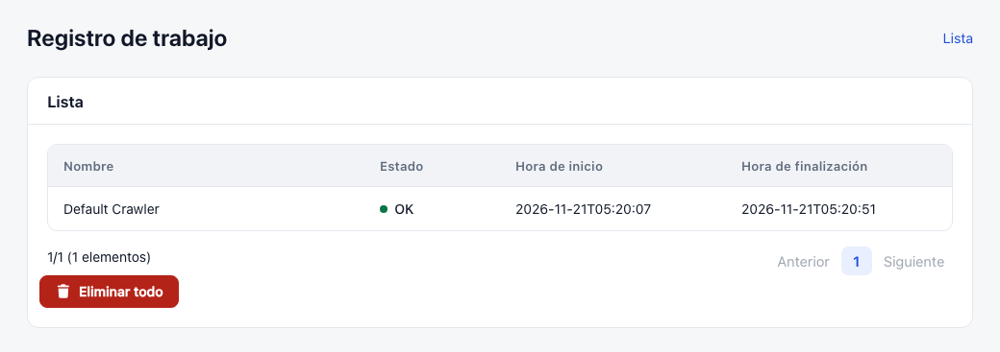
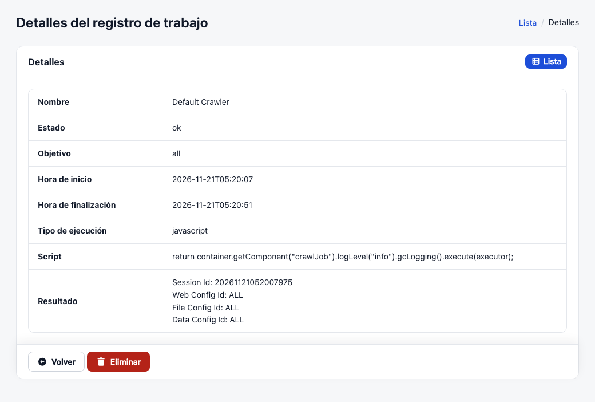

==================
Registro de Trabajos
==================

Descripción general
===================

Muestra como lista los resultados de los trabajos ejecutados.

Método de gestión
==================

Método de visualización
-----------------------

Para abrir la página de verificación de registro de trabajos que se muestra a continuación, haga clic en [Información del sistema > Registro de trabajo] en el menú izquierdo.

|image0|

La lista muestra el nombre del trabajo, el estado de ejecución y la hora de inicio/finalización.
Haga clic en el botón Eliminar todo situado debajo de la lista para eliminar todos los registros de trabajos. Aparecerá un cuadro de diálogo de confirmación.

Detalles del registro de trabajos
----------------------------------

Puede verificar el contenido del registro del trabajo. Muestra el nombre del trabajo, estado, hora de inicio/finalización, resultados, etc.

|image1|

Nombre
::::::

Nombre del trabajo ejecutado.

Estado
::::::

Resultado de la ejecución del trabajo.

.. note::
   Un trabajo de rastreo con el estado OK (``ok``) no ha incorporado necesariamente todos los documentos al índice. El estado indica si el proceso del rastreador terminó con normalidad. Un documento cuya escritura rechaza el motor de búsqueda no se indexa, y aun así el trabajo termina con OK. Cada documento rechazado se registra en ``fess-crawler.log`` como una advertencia ``Failed to index a document``. En los rastreos web y de archivos no se registra como URL de fallo. Compruebe también el número de documentos del índice (consulte "Número de documentos del índice y actualidad del rastreo" en :doc:`../config/admin-logging`).

Objetivo
::::::::

Objetivo en el que se ejecuta el trabajo.

Hora de inicio
::::::::::::::

Fecha y hora en que comenzó el trabajo.

Hora de finalización
::::::::::::::::::::

Fecha y hora en que finalizó el trabajo.

Tipo de ejecución
:::::::::::::::::

Entorno de ejecución en el que se ejecutó el trabajo.

Script
::::::

Contenido de ejecución del trabajo.

Resultado
:::::::::

Resultado de la ejecución del trabajo.

Haga clic en el botón Eliminar de la página de detalles para eliminar el registro de trabajo. Aparecerá un cuadro de diálogo de confirmación.

