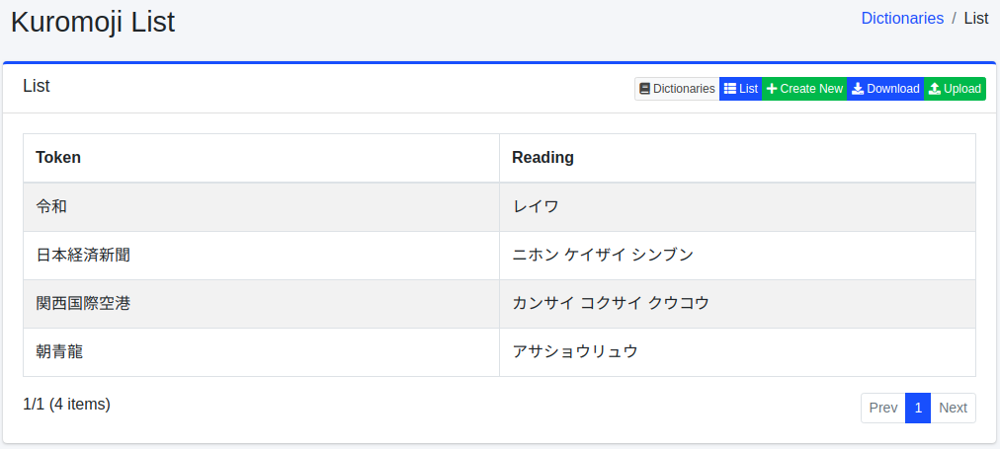

=====================
Diccionario Kuromoji
=====================

Descripción general
===================

Puede registrar nombres de personas, nombres propios, términos especializados, etc. para el análisis morfológico.

Este diccionario es para japonés (``ja/kuromoji.txt``) y solo se utiliza en el análisis de los campos ``_ja``, como ``content_ja``.
Guardar un cambio no basta para que surta efecto en las búsquedas. Consulte :ref:`dict-apply-changes` para saber cómo aplicarlo. Como este diccionario actúa en el momento de la indexación, los documentos que ya están en el índice no se ven afectados hasta que se vuelvan a rastrear.

Método de gestión
==================

Método de visualización
-----------------------

Para abrir la página de lista de configuración de Kuromoji que se muestra a continuación, seleccione [Sistema > Diccionario] en el menú izquierdo y luego haga clic en kuromoji.

|image0|

Para editar, haga clic en el nombre de la configuración.

Método de configuración
-----------------------

Para abrir la página de configuración de Kuromoji, haga clic en el botón de nueva creación.

|image1|

Parámetros de configuración
----------------------------

Token
:::::

Ingrese la palabra a procesar en el análisis morfológico.

Segmentación
::::::::::::

Si una palabra está compuesta de una palabra compuesta, puede hacer que se encuentre incluso cuando se busca con la palabra segmentada.
Por ejemplo, al ingresar "全文検索エンジン" como "全文 検索 エンジン", puede permitir que se busque también con palabras segmentadas.

Lectura
:::::::

Ingrese la lectura de la palabra ingresada como token en katakana.
Si se realizó segmentación, ingrésela segmentada.
Por ejemplo, ingrese "ゼンブン ケンサク エンジン".

Parte del discurso
::::::::::::::::::

Ingrese la parte del discurso de la palabra ingresada.

Descarga
========

Puede descargar en el formato de diccionario de Kuromoji.

Carga
=====

Puede cargar en el formato de diccionario de Kuromoji.
El formato de diccionario de Kuromoji está separado por comas (,) como "token,token segmentado,lectura del token segmentado,parte del discurso".
Los tokens segmentados se separan con espacios.
Si no es necesario segmentar, el token y el token segmentado serán iguales.
Por ejemplo, sería como sigue:

::

    朝青龍,朝青龍,アサショウリュウ,カスタム名詞
    関西国際空港,関西 国際 空港,カンサイ コクサイ クウコウ,カスタム名詞

.. warning::

   Al cargar un archivo, el contenido del diccionario se sustituye por el contenido del archivo cargado. Se eliminan las palabras que no estén en el archivo, incluidas las registradas desde la pantalla. Si es necesario, descargue primero el diccionario e incluya su contenido en el archivo que va a cargar.

.. note::

   El diccionario incluido ya contiene los dos ejemplos anteriores ("朝青龍" y "関西国際空港").
   En el análisis de ``content_ja``, los caracteres se sustituyen mediante el diccionario de sustitución de caracteres ``ja/mapping.txt`` antes del análisis morfológico (consulte :doc:`mapping-guide`). El ``ja/mapping.txt`` incluido contiene ``龍 => 竜``, por lo que "朝青龍" se sustituye por ``朝青竜`` antes del análisis; no coincide con "朝青龍" del diccionario y se divide en ``朝 青 竜``.
   Para comprobar el efecto de un registro, utilice una palabra que no esté en el diccionario y que no contenga ningún carácter sustituido por ``ja/mapping.txt``.

.. |image1| image:: ../../../resources/images/en/15.10/admin/kuromoji-2.png
