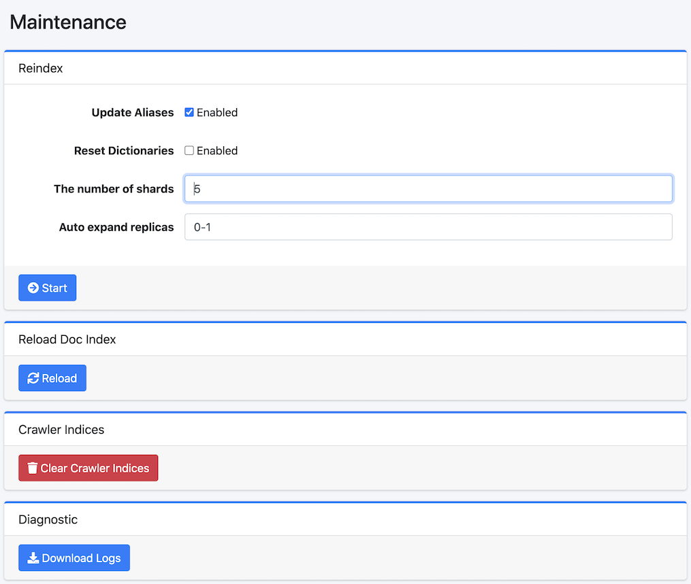

===============
Mantenimiento
===============

Descripción general
===================

La página de mantenimiento se utiliza al ejecutar operaciones de datos del sistema.

|image0|

Método de operación
===================

Reindexación
------------

Puede recrear un nuevo índice a partir del índice fess existente.
Se ejecuta cuando desea cambiar el mapeo del índice, etc.

Parámetros de configuración
----------------------------

Actualizar alias
::::::::::::::::

Al habilitarlo, después de que se complete la reindexación, puede reasignar los alias fess.search y fess.update asignados al índice existente al nuevo índice.

Inicializar diccionarios
:::::::::::::::::::::::::

Al habilitarlo, puede inicializar la configuración de los diccionarios.

Si ``search_engine.type`` es ``vanilla`` o ``aws``, este elemento no se muestra.

Número de fragmentos
:::::::::::::::::::::

Puede especificar el número de fragmentos de OpenSearch (index.number_of_shards).

Número máximo de réplicas
::::::::::::::::::::::::::

Puede especificar el número máximo de réplicas de OpenSearch (index.auto_expand_replicas).

Reconstruir índice de configuración
-------------------------------------

Puede reconstruir los índices de configuración (fess_config, fess_user, fess_log) con los mapeos más recientes.
Esta operación se ejecuta en segundo plano. Realice una copia de seguridad de la configuración antes de ejecutar.

Índices de destino
::::::::::::::::::

Seleccione los índices a reconstruir. Puede elegir entre fess_config, fess_user y fess_log.

Cargar datos predeterminados
::::::::::::::::::::::::::::

Al habilitarlo, se cargarán los datos predeterminados durante la reconstrucción. Los documentos existentes no se sobrescribirán.

Recargar índice de documentos
------------------------------

Puede recargar el índice de documentos para reflejar la configuración del índice.
También es la forma de aplicar a las búsquedas los cambios de diccionario: los diccionarios
guardados se escriben en sus archivos de OpenSearch y, a continuación, se cierra y se abre el
índice al que apunta el alias ``fess.update``. Mientras el índice está cerrado no se puede buscar
en él. Consulte :ref:`dict-apply-changes`.

Si ``search_engine.type`` es ``vanilla`` o ``aws``, esta función no se muestra.

Índice de Rastreador
--------------------

Puede eliminar el índice fess_crawler (información de rastreo).
No lo ejecute mientras el rastreador esté en ejecución.

Diagnóstico
-----------

Puede descargar un archivo zip de diagnóstico. El zip contiene los siguientes archivos en el directorio ``log<yyyyMMddHHmm>/``.

- Los archivos ``*.log`` y ``*.log.gz`` del directorio de registros (``fess.log``, ``fess-crawler.log``, ``audit.log``, ``searchlog.log``, etc.)
- ``system.properties`` (configuración del sistema) y ``fess_config.properties`` (configuración de la aplicación)
- ``fess_basic_config.bulk`` (contenido de los índices de configuración, como la configuración de rastreo, la de autenticación y las etiquetas; no incluye los tokens de acceso de la API de administración)
- ``es_cat_*.txt`` y ``es_*.json`` (salida de las API ``_cat`` de OpenSearch y estado del clúster, los nodos y las tareas)

En ``system.properties`` y ``fess_config.properties``, los valores secretos se sustituyen por ``XXXXXXXX`` con la misma regla que usa la pantalla Información del Sistema. Esto incluye, por ejemplo, la clave secreta del almacenamiento, las URL de webhook (Slack y Google Chat), los secretos de cliente de SSO, las claves de API de LLM y de embedding, y la clave de cifrado de la aplicación (``app.cipher.key``). Las claves se conservan, por lo que sigue siendo posible ver qué ajustes existen.

.. note::

   Los archivos de registro y el contenido de ``fess_basic_config.bulk`` no se enmascaran. Revise el contenido antes de enviar el zip fuera de su organización.

