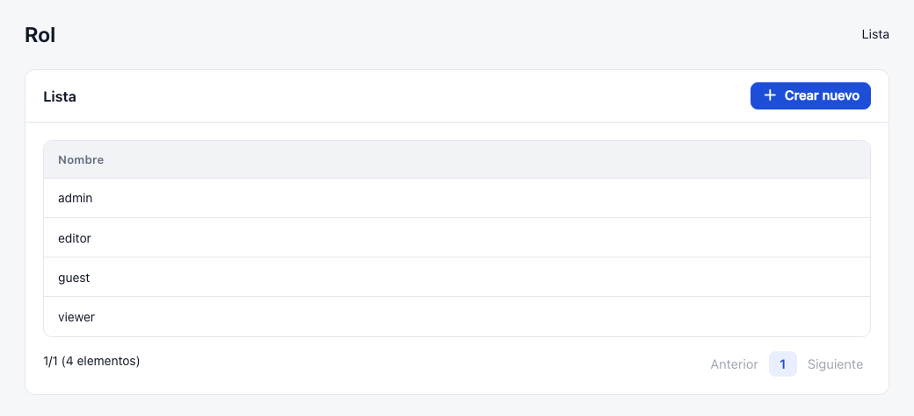
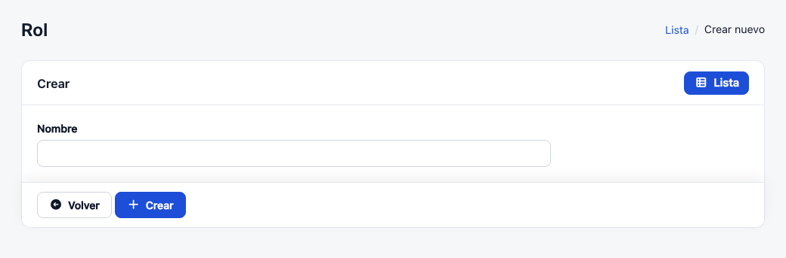

======
Rol
======

Descripción general
===================

Puede administrar los roles a los que pertenecen los usuarios.
Se puede utilizar en casos como la integración con LDAP.

Método de gestión
==================

Método de visualización
-----------------------

Para abrir la página de lista de configuración de roles que se muestra a continuación, haga clic en [Usuario > Rol] en el menú izquierdo.

|image0|

Para editar, haga clic en el nombre de la configuración.

Crear configuración
-------------------

Para abrir la página de configuración de rol, haga clic en el botón "Crear nuevo".

|image1|

Parámetros de configuración
----------------------------

Nombre
::::::

Nombre del rol.

Eliminar configuración
----------------------

Haga clic en el nombre de la configuración en la página de lista y haga clic en el botón de eliminar para que aparezca un cuadro de diálogo de confirmación.
Al presionar el botón de eliminar del cuadro de diálogo, se eliminará la configuración.

