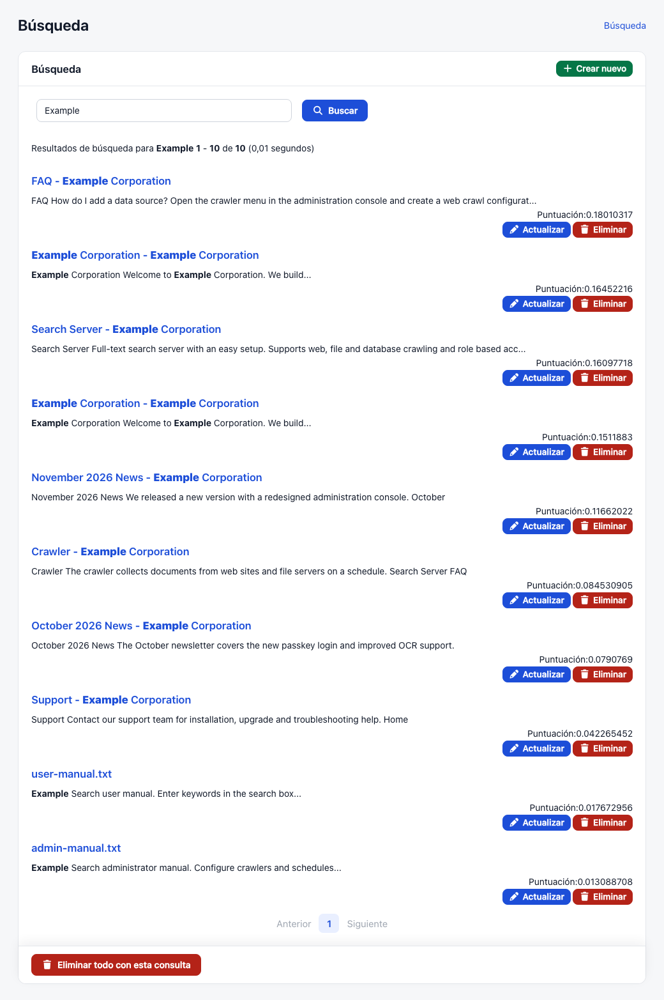
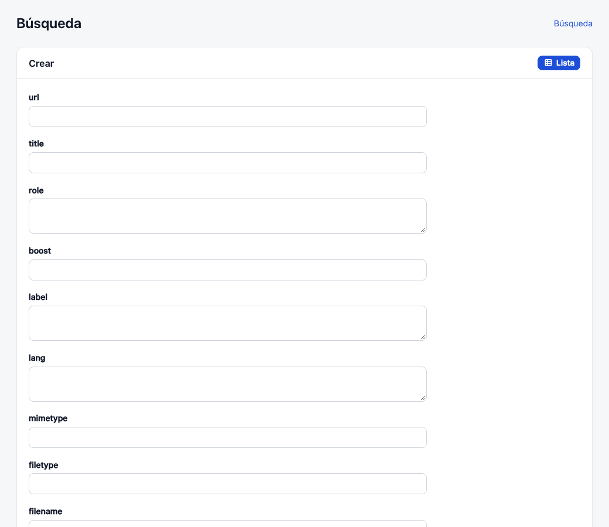

=========
Búsqueda
=========

Descripción general
===================

Aquí se explica la búsqueda administrativa.

Método de gestión
==================

Método de visualización
-----------------------

Para abrir la página de búsqueda que se muestra a continuación, haga clic en [Información del sistema > Búsqueda] en el menú izquierdo.

Escriba una palabra clave en el formulario de búsqueda y haga clic en el botón Buscar. Los resultados de búsqueda se muestran como a continuación.

|image0|

Lista de búsqueda
-----------------

Puede buscar con las condiciones especificadas.
En la pantalla de búsqueda normal, las condiciones de roles y navegador se agregan implícitamente, pero en esta búsqueda administrativa no se agregan.
También puede eliminar documentos específicos del índice de los resultados de búsqueda mostrados.

Para editar un documento de los resultados, haga clic en el botón Actualizar del documento.
Para eliminar un documento del índice, haga clic en el botón Eliminar del documento y, a continuación, haga clic en el botón Eliminar del cuadro de diálogo de confirmación.

Eliminación masiva
------------------

Para eliminar del índice todos los documentos que coinciden con la consulta, haga clic en el botón "Eliminar todo con esta consulta" situado en la parte inferior de la página. Aparecerá un cuadro de diálogo de confirmación. Por ejemplo, si busca "\*:\*" y hace clic en el botón, se eliminan todos los documentos.
También es posible especificar condiciones de búsqueda y eliminar solo los documentos objetivo.

Crear documento
---------------

Haga clic en el botón Crear nuevo situado en la parte superior derecha de la página para mostrar un formulario que permite agregar un documento al índice.

|image1|

El formulario muestra los campos del documento por su nombre de campo, como ``url``, ``title`` y ``role``. ``url`` y ``title`` son obligatorios.

- Un campo que puede contener varios valores, como ``role``, ``label``, ``lang`` y ``virtual_host``, es un área de texto; introduzca un valor por línea.
- ``boost`` es un número, y ``content_length``, ``favorite_count`` y ``click_count`` son enteros.
- Un campo de fecha (``created``, ``timestamp``, ``last_modified`` y ``expires``) se introduce con el formato ``yyyy-MM-ddTHH:mm:ss.SSSZ``, como ``2026-01-01T00:00:00.000Z``.

El navegador comprueba el formato de estos valores al enviar el formulario. Haga clic en el botón Crear para agregar el documento.
El formulario para actualizar un documento tiene los mismos campos.

