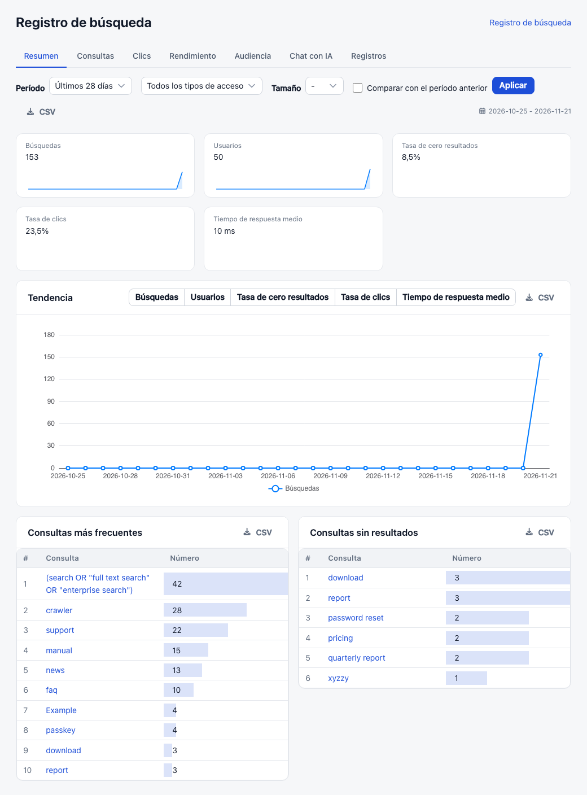
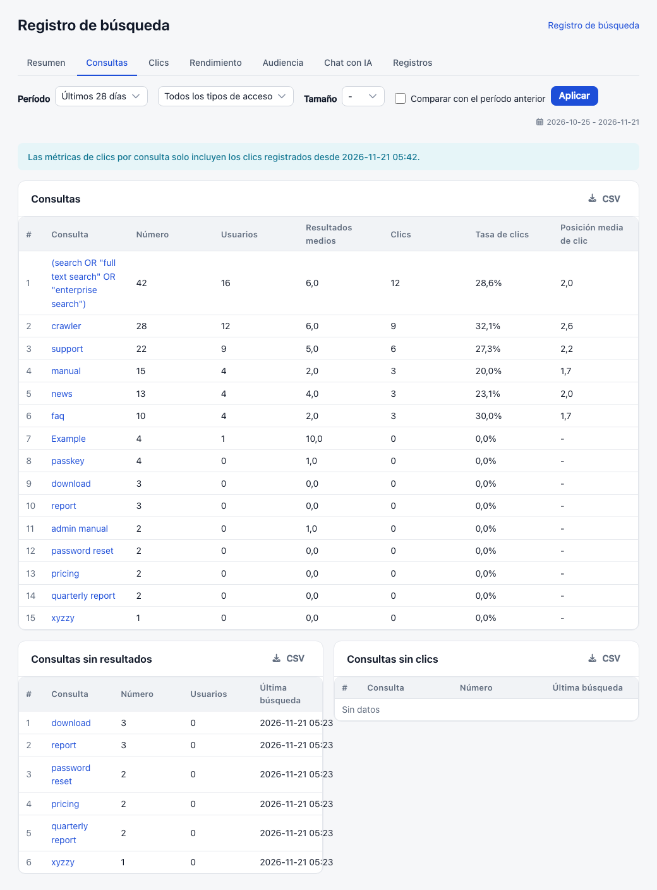
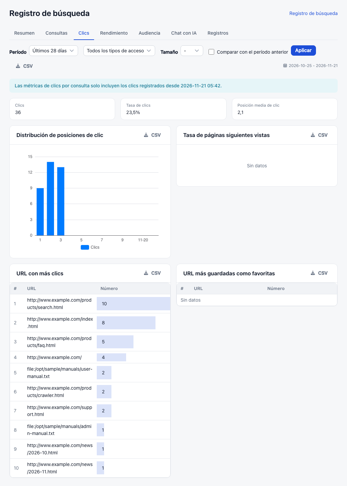
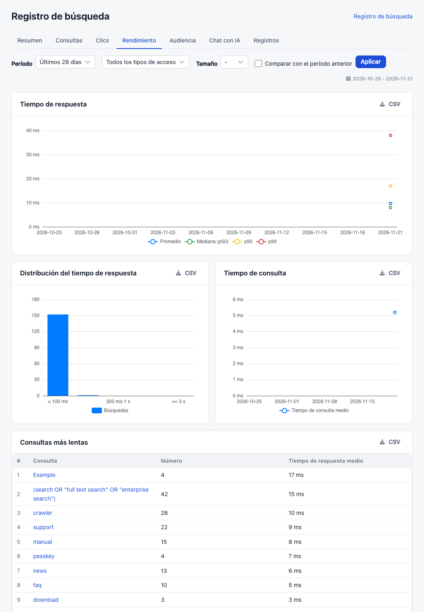
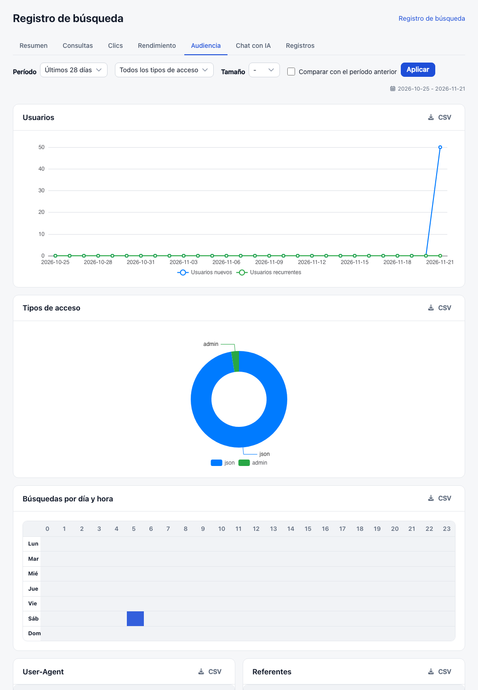
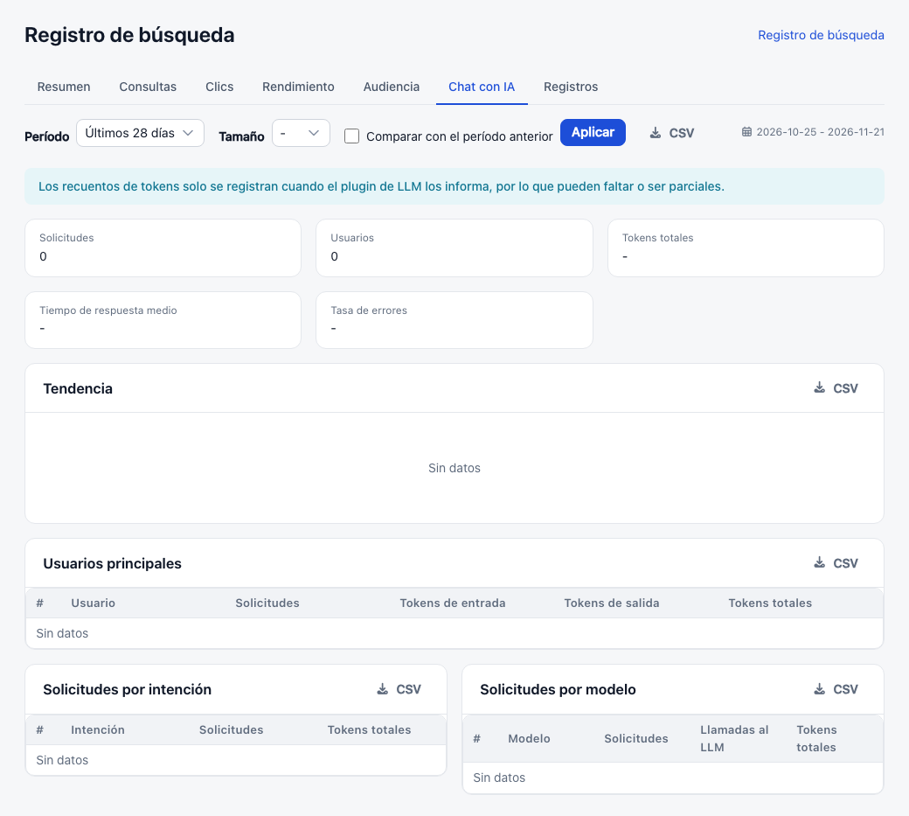
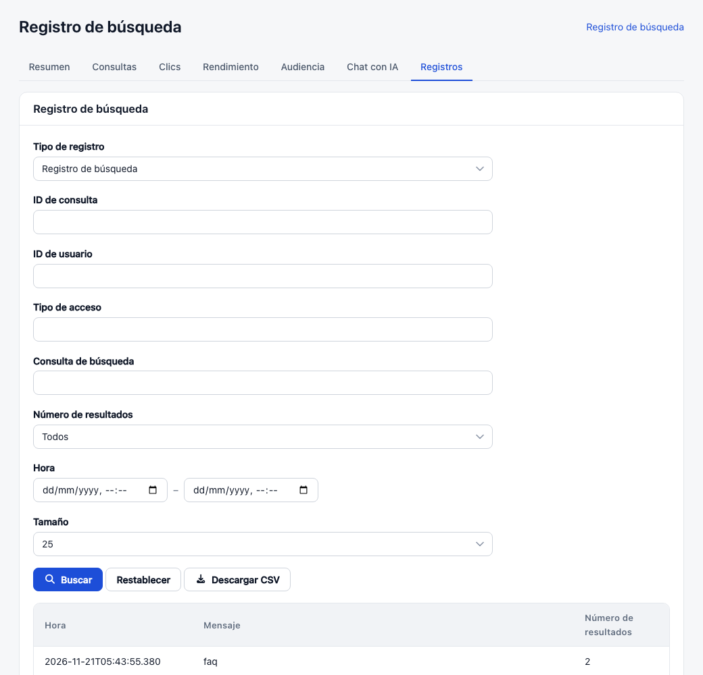
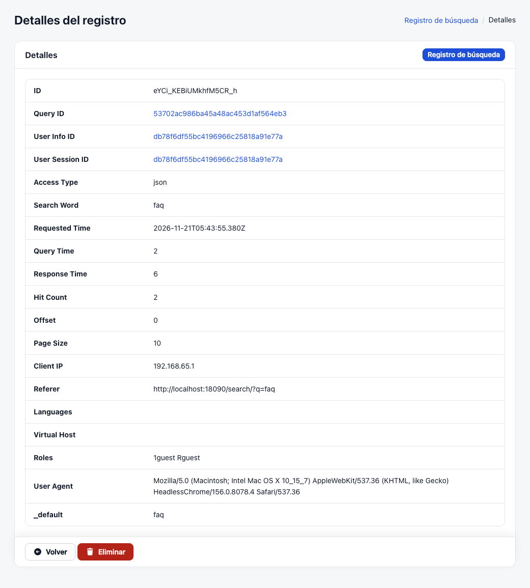

====================
Registro de búsqueda
====================

Descripción general
===================

Las búsquedas, los clics y los favoritos se registran. La página Registro de búsqueda muestra
informes de análisis que los agregan y una lista de los registros individuales.

Para abrir la página, seleccione [Información del sistema > Registro de búsqueda] en el menú
izquierdo. Primero se muestra la pestaña "Resumen". Para verla se necesita el rol
``admin-searchlog`` o ``admin-searchlog-view``; con ``admin-searchlog-view`` no se pueden eliminar
registros.

Informes de análisis
====================

Período y filtros
-----------------

En la parte superior de cada pestaña, elija el período que se agrega entre "Hoy", "Ayer", "Últimos
7 días", "Últimos 28 días" y "Últimos 90 días", o indique una fecha de inicio y de fin con
"Personalizado" (hasta 366 días). Con "Comparar con el período anterior", los valores se comparan con
el período de la misma duración inmediatamente anterior. También puede elegir el tipo de acceso y el
número de filas de las tablas. Los períodos y los intervalos de los gráficos siguen los días
naturales de la zona horaria del servidor.

Pestañas
--------

- **Resumen**: las búsquedas, los usuarios, la tasa de cero resultados, la tasa de clics y el tiempo
  de respuesta medio, cada uno con un pequeño gráfico de tendencia y su variación respecto al período
  anterior; un gráfico de tendencia con selector de métrica (al comparar, el período anterior se
  dibuja con líneas discontinuas); y las consultas más frecuentes y las consultas sin resultados.

  |image0|

- **Consultas**: por consulta, las búsquedas, los usuarios, los resultados medios, los clics, la tasa
  de clics y la posición media de clic. También muestra las consultas sin resultados (con la fecha de
  la última búsqueda) y las consultas sin clics, que tuvieron resultados que nunca se abrieron.

  |image1|

- **Clics**: las URL más pulsadas, las URL más añadidas a favoritos, la distribución de la posición de
  clic y la proporción de visitas a la página 2 y siguientes.

  |image2|

- **Rendimiento**: el tiempo de respuesta medio, la mediana (p50), p95 y p99, la distribución del
  tiempo de respuesta, las consultas más lentas y el tiempo de consulta.

  |image3|

- **Audiencia**: usuarios nuevos y recurrentes, tipos de acceso, búsquedas por día y hora,
  y los agentes de usuario, referentes, idiomas y hosts virtuales más frecuentes. "Búsquedas por rol y
  grupo" muestra las búsquedas, los usuarios y la tasa de cero resultados de cada rol y grupo. Una
  búsqueda cuenta para todos los roles y grupos del usuario que la hizo, por lo que la suma de las
  filas puede superar el total. No se muestran usuarios individuales.

  |image4|

- **Chat con IA**: las solicitudes, los usuarios, el total de tokens, el tiempo de respuesta medio y la
  tasa de errores del modo de búsqueda con IA (chat RAG), con los usuarios más activos y las
  solicitudes por intención y por modelo. El uso del chat se registra mientras
  ``rag.chat.log.enabled`` (predeterminado: ``true``) está activado. Las preguntas y las respuestas no
  se registran. El número de tokens solo se registra cuando el plugin de LLM lo informa.

  |image5|

- **Registros**: la lista de registros individuales; consulte "Lista de registros" más abajo.

.. note::

   Las métricas de clics por consulta y las consultas sin clics solo cuentan los clics registrados
   desde que la palabra de búsqueda se guarda con los clics (|Fess| 15.9 y posteriores). El total de
   clics y la tasa de clics incluyen los clics anteriores. Algunos valores, como el número de
   usuarios, son aproximados.

Revisar las consultas sin resultados
------------------------------------

En las pestañas "Resumen" y "Consultas", haga clic en una consulta sin resultados para abrir la
pestaña "Registros" con los registros de búsqueda de esa consulta, filtrados por "Solo sin
resultados". Así puede ver qué búsquedas no encontraron nada y añadir documentos, sinónimos o
consultas relacionadas.

Descargar CSV
-------------

Cada tabla y gráfico de los informes de análisis tiene un enlace CSV que descarga lo que agrega para
el período, la comparación, el tipo de acceso y el tamaño actuales. La barra de filtros también
tiene un enlace a un CSV de las métricas. Los números se escriben tal cual (proporciones de 0 a 1,
tiempos en milisegundos). Un gráfico comparado incluye una columna adicional ``<series>_previous``.

Lista de registros
==================

La pestaña "Registros" muestra los registros de búsqueda, de clics, de favoritos y de usuario. Puede
filtrarlos por tipo de registro, ID de consulta, ID de usuario, tipo de acceso, palabra de búsqueda e
intervalo de tiempo (una fecha y hora de inicio y de fin), y los registros de búsqueda también por número
de resultados ("Todos", "Solo sin resultados", "Uno o más resultados"). Haga clic en [Buscar] para aplicar
las condiciones y en [Restablecer] para borrarlas. Para ver los detalles de un registro, haga clic en él.

|image6|

Haga clic en [Descargar CSV] para descargar como CSV los registros que coinciden con el filtro
actual, del más reciente al más antiguo y sin límite de filas. La fila de encabezado contiene los
nombres de los campos, por lo que no depende del idioma de la interfaz.

Los archivos CSV, incluidos los de los informes de análisis, se escriben con la codificación de
``csv.file.encoding``; un archivo UTF-8 empieza con una marca de orden de bytes. Un valor que empieza
por ``=``, ``+``, ``-``, ``@``, un tabulador o un retorno de carro recibe un ``'`` inicial para que una
hoja de cálculo no lo ejecute como fórmula.

Detalles
--------

Haga clic en un registro de la lista para mostrar sus detalles. Los campos Query ID, User Info ID y User Session ID
de los detalles (que se muestran en inglés en la pantalla) son enlaces que abren la lista filtrada por ese ID.
Para eliminar el registro, haga clic en el botón Eliminar; aparecerá un cuadro de diálogo de confirmación.

|image7|

