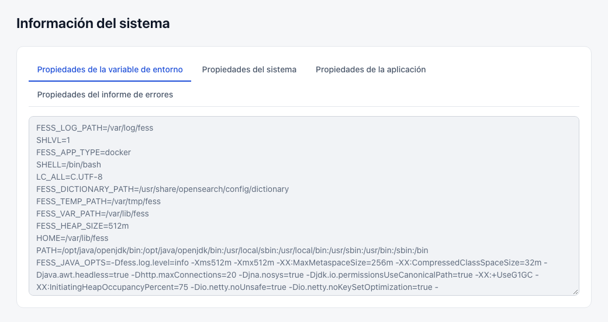
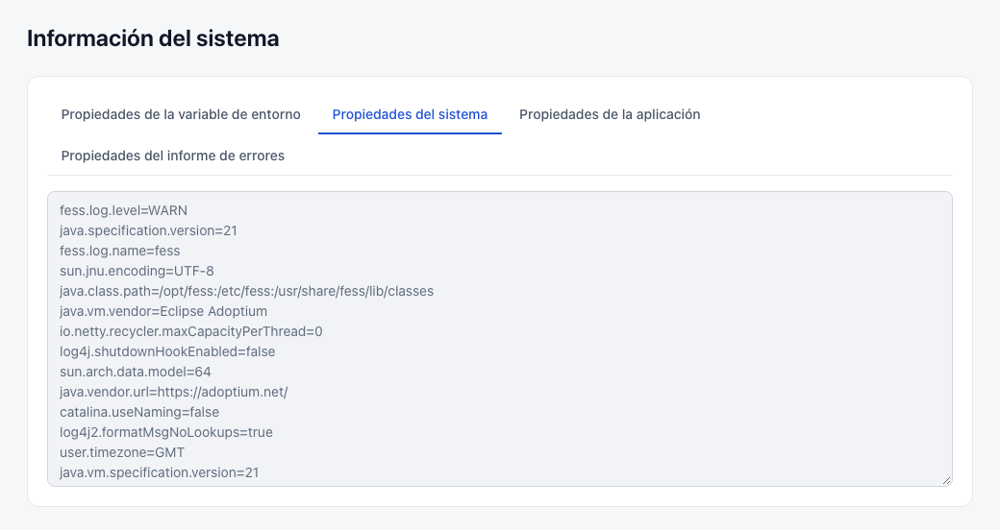
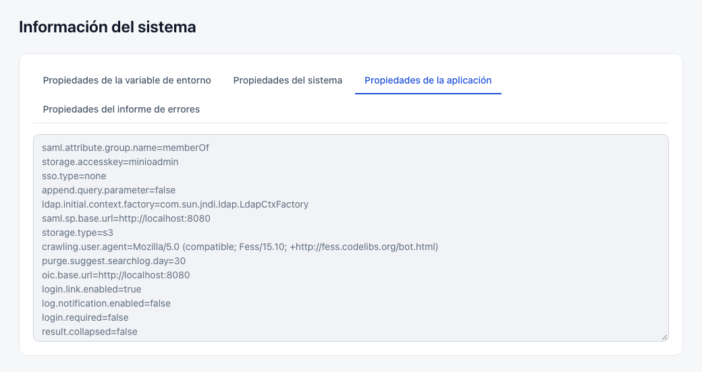
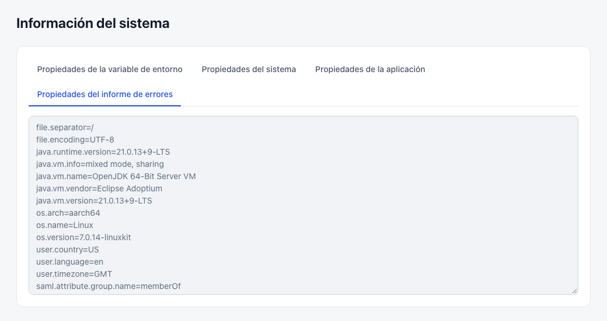

=====================
Información del Sistema
=====================

Descripción general
===================

Aquí puede verificar la información de propiedades, como las variables de entorno del sistema actualmente en funcionamiento.

Método de gestión
==================

Método de visualización
-----------------------

Para abrir la página de información del sistema que se muestra a continuación, haga clic en [Información del sistema > Información de configuración] en el menú izquierdo.
La página tiene cuatro pestañas, que se describen a continuación.

Elementos mostrados
-------------------

Propiedades de variables de entorno
::::::::::::::::::::::::::::::::::::

|image0|

Puede listar las variables de entorno del servidor.

Propiedades del sistema
:::::::::::::::::::::::

|image1|

Puede listar las propiedades del sistema configuradas en |Fess|.

Propiedades de la aplicación
:::::::::::::::::::::::::::::

|image2|

Puede verificar la información de configuración de |Fess|.

Propiedades del informe de errores
:::::::::::::::::::::::::::::::::::

|image3|

Es una lista de propiedades para adjuntar al informar un error.
Extrae valores que no contienen información personal.

