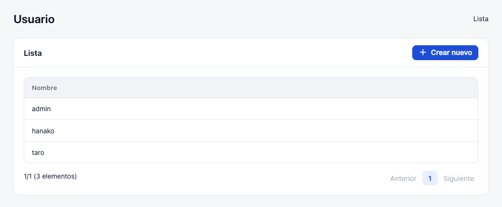
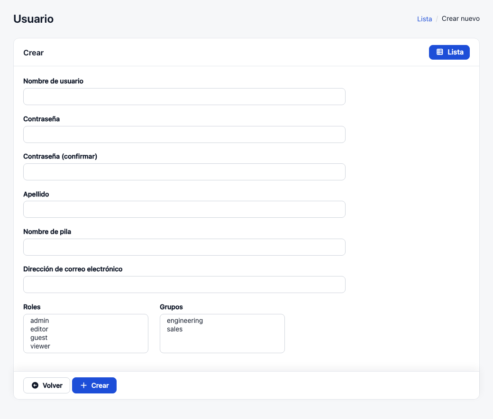

==========
Usuario
==========

Descripción general
===================

Puede administrar los usuarios que inician sesión en |Fess|.

Método de gestión
==================

Método de visualización
-----------------------

Para abrir la página de lista de configuración de usuarios que se muestra a continuación, haga clic en [Usuario > Usuario] en el menú izquierdo.

|image0|

Para editar, haga clic en el nombre de la configuración.

Crear configuración
-------------------

Para abrir la página de configuración de usuario, haga clic en el botón "Crear nuevo".

|image1|

Parámetros de configuración
----------------------------

Nombre de usuario
:::::::::::::::::

Nombre de usuario. No se puede cambiar después de crear el usuario.

Contraseña, Contraseña (confirmar)
::::::::::::::::::::::::::::::::::

Especifique la contraseña del usuario y vuelva a introducirla en Contraseña (confirmar). La contraseña es obligatoria al crear un usuario. Al editar un usuario, deje ambos campos en blanco para mantener la contraseña actual.

Apellido, Nombre de pila, Dirección de correo electrónico
:::::::::::::::::::::::::::::::::::::::::::::::::::::::::

Especifique el apellido, el nombre de pila y la dirección de correo electrónico del usuario. Estos campos son opcionales.

Rol
:::

Especifique los roles a los que pertenece el usuario.

.. note::

   Un usuario con el rol ``admin-user`` puede asignar cualquier rol existente, incluido el rol de administrador, a cualquier usuario. Trate los roles ``admin-*`` como equivalentes al rol de administrador; consulte :doc:`../install/security`.

Grupo
:::::

Especifique los grupos a los que pertenece el usuario.

Eliminar configuración
----------------------

Haga clic en el nombre de la configuración en la página de lista y haga clic en el botón de eliminar para que aparezca un cuadro de diálogo de confirmación.
Al presionar el botón de eliminar del cuadro de diálogo, se eliminará la configuración.

