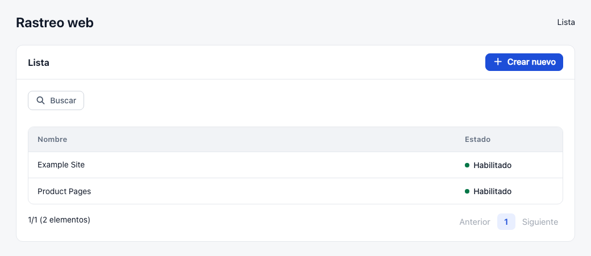
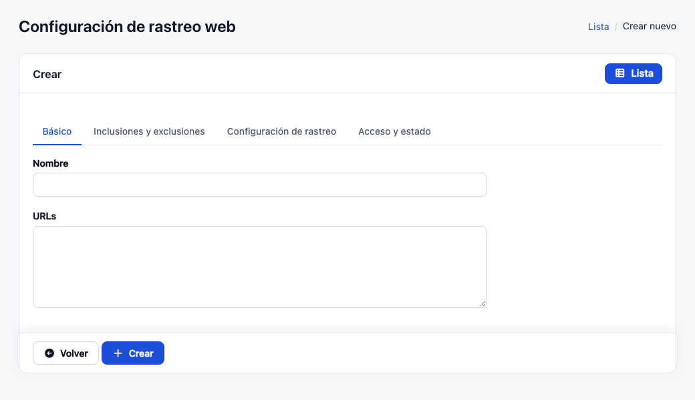
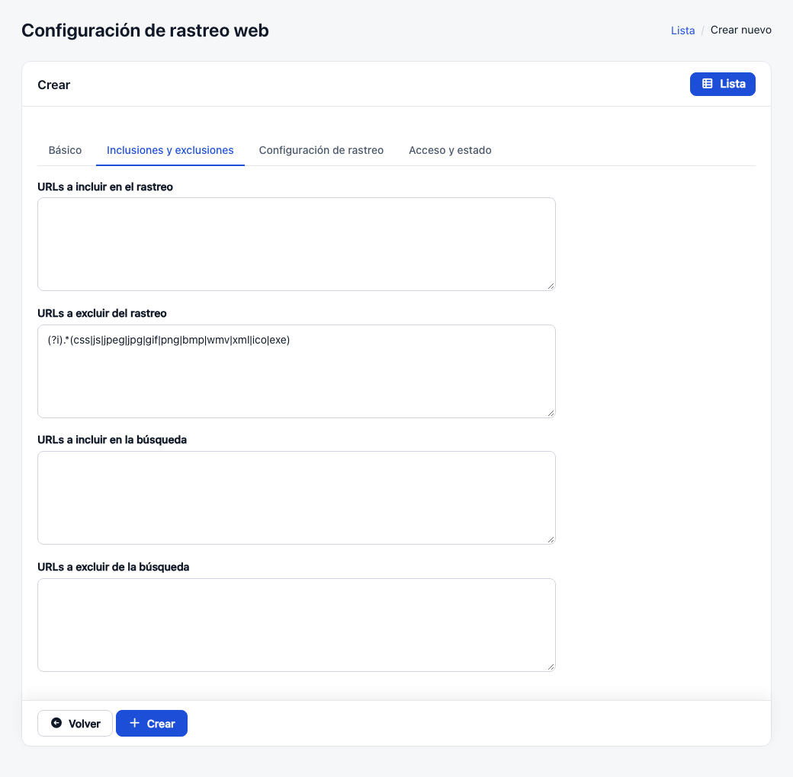
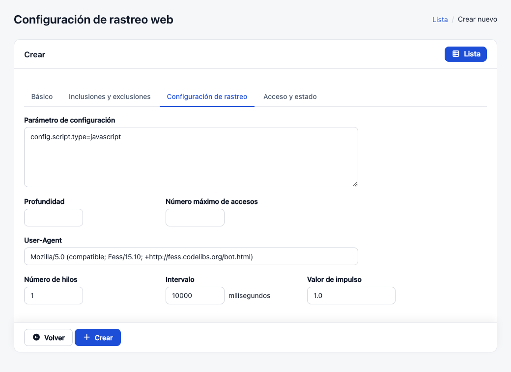
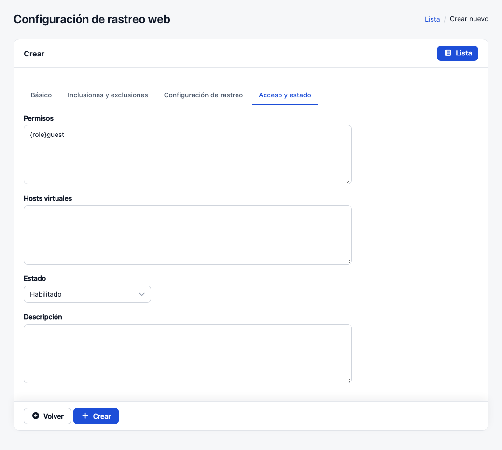

====================================
Rastreo Web (Búsqueda en Sitios Web)
====================================

Descripción general
===================

El rastreo web recorre sitios web públicos o de intranet mediante un rastreador web y registra las páginas recopiladas en el índice de |Fess|, permitiendo su localización mediante búsqueda de texto completo (búsqueda en sitios web). También admite el rastreo de sitios protegidos con autenticación BASIC, DIGEST, NTLM o de formulario.

La página de configuración de rastreo web configura el rastreo web.

Método de gestión
==================

Método de visualización
-----------------------

Para abrir la página de lista de configuración de rastreo web que se muestra a continuación, haga clic en [Rastreador > Web] en el menú izquierdo.

|image0|

Para editar, haga clic en el nombre de la configuración.

Crear configuración
-------------------

Para abrir la página de configuración de rastreo web, haga clic en el botón "Crear nuevo".
La página se divide en cuatro pestañas: "Básico", "Inclusiones y exclusiones", "Configuración de rastreo" y "Acceso y estado". Haga clic en el nombre de una pestaña para cambiar de pestaña. Si una entrada tiene un error, se abre automáticamente la pestaña que la contiene. Los campos de cada pestaña se describen a continuación.

Pestaña Básico
--------------

|image1|

Nombre
::::::

Nombre de la configuración.

URLs
::::

Las URL que serán el punto de inicio del rastreo. Especifique una URL por línea.

Pestaña Inclusiones y exclusiones
---------------------------------

|image2|

URL a rastrear
::::::::::::::

Las URL que coincidan con la expresión regular (formato Java) especificada en este elemento serán objeto del rastreador de |Fess|.

URL excluidas del rastreo
::::::::::::::::::::::::::

Las URL que coincidan con la expresión regular (formato Java) especificada en este elemento no serán objeto del rastreador de |Fess|.

URL a buscar
::::::::::::

Las URL que coincidan con la expresión regular (formato Java) especificada en este elemento serán objeto de búsqueda.

URL excluidas de la búsqueda
:::::::::::::::::::::::::::::

Las URL que coincidan con la expresión regular (formato Java) especificada en este elemento no serán objeto de búsqueda.

.. note::
   Esta configuración solo afecta a los documentos que se indexen en rastreos posteriores (los documentos que coinciden no se indexan). Los documentos que ya están indexados no se eliminan al añadir esta configuración y siguen apareciendo en los resultados de búsqueda. Si «Comprobar fecha de última modificación» de la configuración general está habilitado (valor predeterminado), la fecha de caducidad de un documento sin cambios se prolonga en cada rastreo (consulte «Comprobar fecha de última modificación» en :doc:`general-guide`), por lo que el documento no siempre desaparece cuando vence el plazo de «Eliminar documentos anteriores». Para quitar con seguridad un documento de los resultados de búsqueda, elimínelo en la lista de búsqueda (pantalla de administración). Mientras coincida con esta configuración, un documento eliminado no se vuelve a indexar en el siguiente rastreo.

Pestaña Configuración de rastreo
--------------------------------

|image3|

Parámetro de configuración
::::::::::::::::::::::::::

Puede especificar información de configuración de rastreo.

Profundidad
:::::::::::

Puede especificar la profundidad al seguir enlaces contenidos en documentos rastreados.

Número máximo de accesos
:::::::::::::::::::::::::

Número de URLs que se indexarán.

User-Agent
::::::::::

Nombre del rastreador de |Fess|.

Número de hilos
:::::::::::::::

Número de hilos de rastreo en esta configuración.

Intervalo
:::::::::

Intervalo de tiempo en cada hilo al rastrear URLs, en milisegundos.

Valor de impulso
::::::::::::::::

Peso de los documentos indexados en esta configuración.

Pestaña Acceso y estado
-----------------------

|image4|

Permisos
::::::::

Especifique el permiso para esta configuración.
La forma de especificar permisos es, por ejemplo, para mostrar resultados de búsqueda a usuarios que pertenecen al grupo developer, especifique {group}developer.
La especificación por usuario es {user}nombre_usuario, la especificación por rol es {role}nombre_rol, y la especificación por grupo es {group}nombre_grupo.
Prefije una entrada con ``(deny)``, por ejemplo ``(deny){role}nombre_rol``, para denegar el acceso. En 15.10, las siguientes entradas se rechazan con un error al guardar: un espacio en blanco (incluido un espacio de ancho completo) justo después de ``(allow)`` / ``(deny)``, o al inicio de una línea antes de ``{user}``, ``{group}`` o ``{role}``; ``(deny)``, ``{role}`` y similares escritos con caracteres de ancho completo; y un carácter invisible (como un espacio de ancho cero o una marca de orden de bytes) al inicio de una entrada o justo después de ``(allow)`` / ``(deny)``. Si un valor guardado por una versión anterior tiene alguna de estas formas, vuelva a introducirlo. Consulte :doc:`../config/security-role` para más detalles.

Hosts virtuales
:::::::::::::::

Especifique los nombres de host de los hosts virtuales, uno por línea.
Para más detalles, consulte :doc:`../config/security-virtual-host`.

Estado
::::::

Si está habilitado, el trabajo programado del rastreador predeterminado incluirá esta configuración.

Descripción
:::::::::::

Puede ingresar una descripción.

Eliminar configuración
----------------------

Haga clic en el nombre de la configuración en la página de lista y haga clic en el botón de eliminar para que aparezca un cuadro de diálogo de confirmación. Al presionar el botón de eliminar, se eliminará la configuración.

.. note::

   Al eliminar una configuración no se eliminan los documentos que ya ha registrado en el índice. Siguen siendo localizables hasta que caducan. Un documento caduca al cabo del número de días indicado en «Eliminar documentos anteriores» de :doc:`general-guide` (``day.for.cleanup``, ``3`` de forma predeterminada), contados desde el inicio del último rastreo que lo registró o actualizó, y entonces el trabajo Doc Purger lo elimina del índice. Con ``-1``, los documentos registrados sin caducidad nunca se eliminan de esta forma.

   Para eliminar los documentos de inmediato, elimínelos usted mismo del índice. En la pantalla Búsqueda (:doc:`searchlist-guide`), busque los documentos de la configuración (por ejemplo con ``url:`` o ``host:``), compruebe los resultados y haga clic en el botón «Eliminar todo con esta consulta». También puede hacerlo con ``DELETE /api/admin/searchlist/query`` (consulte :doc:`../api/admin/api-admin-searchlist`).

   Es distinto cuando se cambian los permisos de una configuración y se vuelve a rastrear: el ID del documento depende de los permisos y, al registrar un documento, el rastreador elimina los documentos con la misma URL y un ID distinto que la misma configuración registró antes.

Ejemplo
=======

Rastrear fess.codelibs.org
--------------------------

Para crear una configuración de rastreo web que rastree páginas debajo de https://fess.codelibs.org/, use los siguientes valores de configuración.

.. tabularcolumns:: |p{4cm}|p{8cm}|
.. list-table::
   :header-rows: 1

   * - Elemento de configuración
     - Valor de configuración
   * - Nombre
     - Fess
   * - URLs
     - https://fess.codelibs.org/
   * - URL a rastrear
     - https://fess.codelibs.org/.\*

Use los valores predeterminados para los otros valores de configuración.

Rastreo web de sitios con autenticación web
--------------------------------------------

Fess admite el rastreo de autenticación BASIC, autenticación DIGEST y autenticación NTLM.
Para obtener más detalles sobre la autenticación web, consulte la página de autenticación web.

Redmine
:::::::

Para crear una configuración de rastreo web que rastree páginas de Redmine protegidas con contraseña (ej. https://<server>/), use los siguientes valores de configuración.

.. tabularcolumns:: |p{4cm}|p{8cm}|
.. list-table::
   :header-rows: 1

   * - Elemento de configuración
     - Valor de configuración
   * - Nombre
     - Redmine
   * - URLs
     - https://<server>/my/page
   * - URL a rastrear
     - https://<server>/.\*
   * - Parámetro de configuración
     - client.robotsTxtEnabled=false (Opcional)

Después de eso, cree la configuración de autenticación web con los siguientes valores de configuración.

.. tabularcolumns:: |p{4cm}|p{8cm}|
.. list-table::
   :header-rows: 1

   * - Elemento de configuración
     - Valor de configuración
   * - Esquema
     - Form
   * - Nombre de usuario
     - (Cuenta para rastreo)
   * - Contraseña
     - (Contraseña para la cuenta)
   * - Parámetros
     - | encoding=UTF-8
       | token_method=GET
       | token_url=https://<server>/login
       | token_pattern=name="authenticity_token"[^>]+value="([^"]+)"
       | token_name=authenticity_token
       | login_method=POST
       | login_url=https://<server>/login
       | login_parameters=username=${username}&password=${password}
   * - Configuración web
     - Redmine

XWiki
:::::

Para crear una configuración de rastreo web que rastree páginas de XWiki (ej. https://<server>/xwiki/), use los siguientes valores de configuración.

.. tabularcolumns:: |p{4cm}|p{8cm}|
.. list-table::
   :header-rows: 1

   * - Elemento de configuración
     - Valor de configuración
   * - Nombre
     - XWiki
   * - URLs
     - https://<server>/xwiki/bin/view/Main/
   * - URL a rastrear
     - https://<server>/.\*
   * - Parámetro de configuración
     - client.robotsTxtEnabled=false (Opcional)

Después de eso, cree la configuración de autenticación web con los siguientes valores de configuración.

.. tabularcolumns:: |p{4cm}|p{8cm}|
.. list-table::
   :header-rows: 1

   * - Elemento de configuración
     - Valor de configuración
   * - Esquema
     - Form
   * - Nombre de usuario
     - (Cuenta para rastreo)
   * - Contraseña
     - (Contraseña para la cuenta)
   * - Parámetros
     - | encoding=UTF-8
       | token_method=GET
       | token_url=http://<server>/xwiki/bin/login/XWiki/XWikiLogin
       | token_pattern=name="form_token" +value="([^"]+)"
       | token_name=form_token
       | login_method=POST
       | login_url=http://<server>/xwiki/bin/loginsubmit/XWiki/XWikiLogin
       | login_parameters=j_username=${username}&j_password=${password}
   * - Configuración web
     - XWiki

Páginas Relacionadas
====================

- :doc:`../config/crawler-basic`
- :doc:`webauth-guide`
- :doc:`fileconfig-guide`
- :doc:`../config/search-basic`

.. pdf            :height: 940 px
