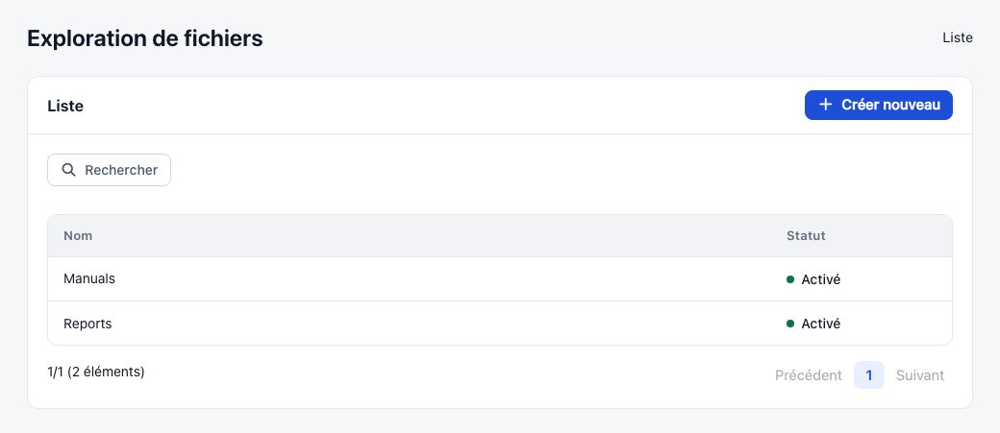
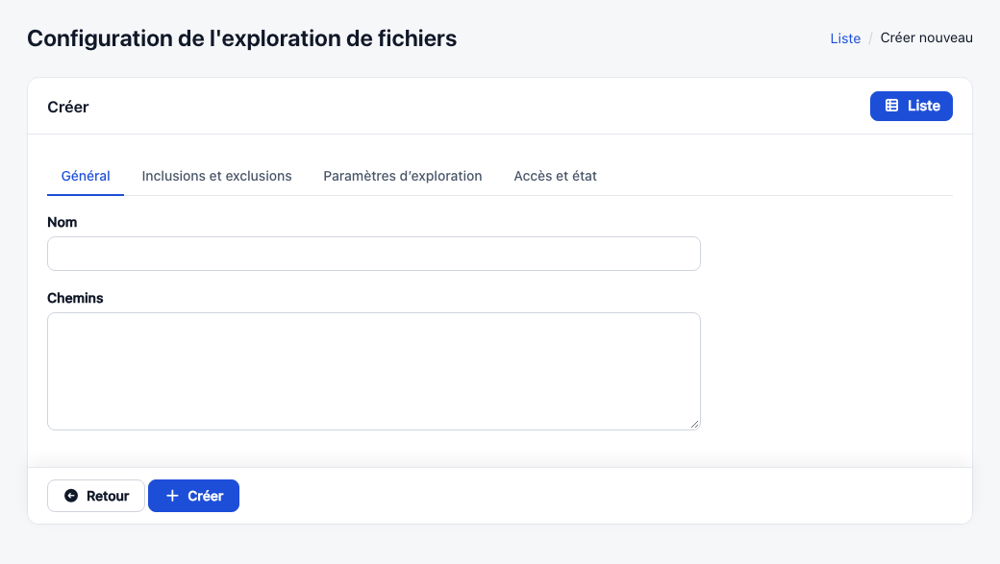
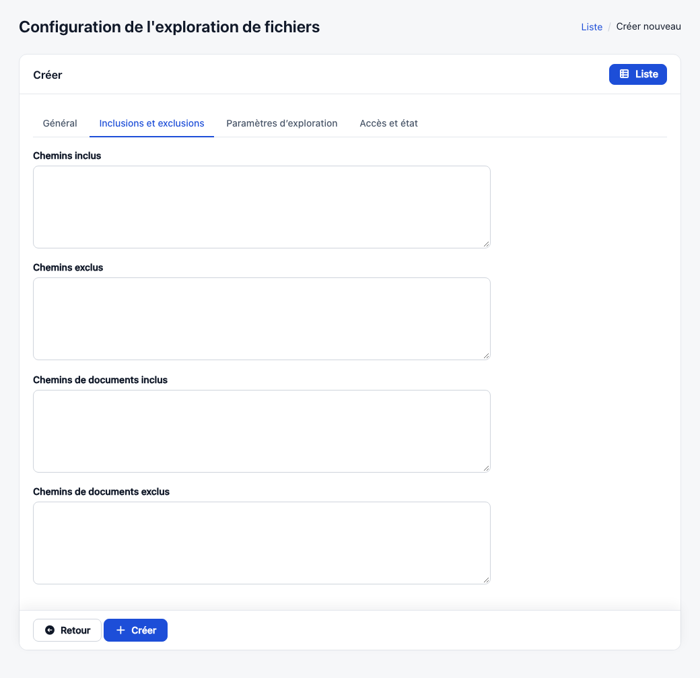
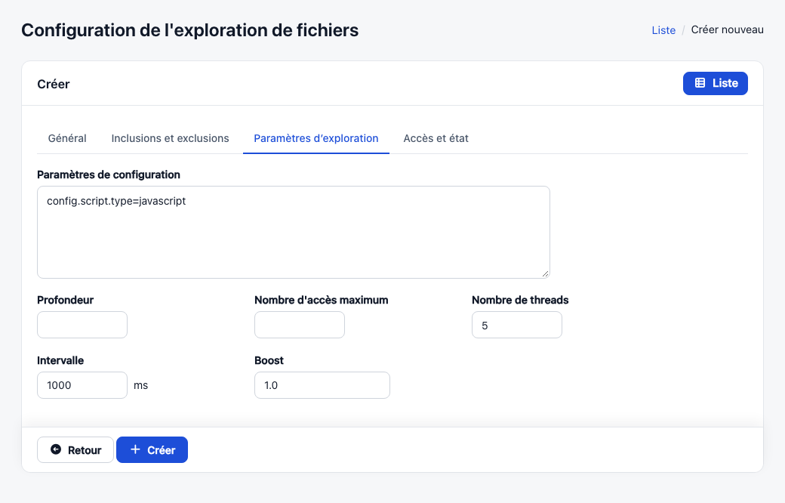
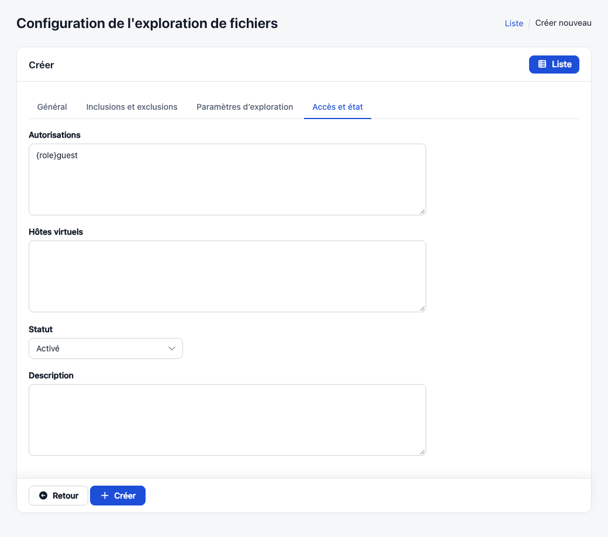

================================================================
Crawl de système de fichiers (recherche sur serveur de fichiers)
================================================================

Présentation
============

Le crawl de fichiers permet d'enregistrer dans l'index de |Fess| les documents présents sur les serveurs de fichiers internes, les dossiers partagés Windows ou le stockage cloud, afin de les rendre disponibles pour une recherche en texte intégral (recherche sur serveur de fichiers). De nombreux formats de fichiers sont pris en charge, tels que Word, Excel, PowerPoint et PDF.

La page de configuration de crawl de fichiers permet de gérer la configuration pour crawler les fichiers sur le système de fichiers ou les dossiers partagés sur le réseau.

Le crawl cible est déterminé par le protocole spécifié dans le « chemin » :

- ``file:/`` … système de fichiers local ou monté
- ``smb://`` … serveur de fichiers/dossier partagé Windows (SMB/CIFS)
- ``smb1://`` … serveur de fichiers/dossier partagé Windows utilisant l'ancien protocole SMB1
- ``ftp://`` … serveur FTP
- ``s3://`` … bucket Amazon S3 (nécessite le plugin ``fess-storage-s3``)
- ``gcs://`` … bucket Google Cloud Storage (nécessite le plugin ``fess-storage-gcs``)

Gestion
=======

Affichage
---------

Pour ouvrir la page de liste pour configurer le crawl de fichiers illustrée ci-dessous, cliquez sur [Robot d'exploration > Système de fichiers] dans le menu de gauche.

|image0|

Cliquez sur le nom de la configuration pour la modifier.

Création de configuration
-------------------------

Cliquez sur le bouton Créer nouveau pour ouvrir la page de configuration de crawl de fichiers.
La page est divisée en quatre onglets : « Général », « Inclusions et exclusions », « Paramètres d’exploration » et « Accès et état ». Cliquez sur le nom d'un onglet pour changer d'onglet. Si une saisie comporte une erreur, l'onglet qui la contient s'ouvre automatiquement. Les champs de chaque onglet sont décrits ci-dessous.

Onglet Général
--------------

|image1|

Nom
::::

Nom de la configuration.

Chemins
:::::::

Ces chemins spécifient les emplacements de départ du crawl (ex. : file:/, smb://, s3://, gcs://). Spécifiez un chemin par ligne.

Onglet Inclusions et exclusions
-------------------------------

|image2|

Chemins à crawler
:::::::::::::::::

Les chemins correspondant à l'expression régulière (format Java) spécifiée dans cet élément seront ciblés par le crawler |Fess|.

.. note::
   Le motif est appliqué au chemin complet de chaque chemin visité par le crawler, y compris le chemin de départ et les sous-répertoires. Si vous ne spécifiez que des extensions de fichier comme ``.*\.(md|rst|adoc)$``, le chemin de départ et les sous-répertoires ne correspondent pas au motif, le crawler n'atteint pas les fichiers et rien n'est crawlé. Pour limiter les documents par extension, spécifiez le même motif dans « Chemins à indexer » (les répertoires sont toujours parcourus et seuls les fichiers correspondants sont ciblés pour la recherche). N'utilisez « Chemins à crawler » qu'avec des motifs qui correspondent aussi au chemin de départ et aux sous-répertoires.

Chemins exclus du crawl
:::::::::::::::::::::::

Les chemins correspondant à l'expression régulière (format Java) spécifiée dans cet élément ne seront pas ciblés par le crawler |Fess|.

Chemins à indexer
:::::::::::::::::

Les chemins correspondant à l'expression régulière (format Java) spécifiée dans cet élément seront ciblés pour la recherche.

Chemins exclus de l'indexation
:::::::::::::::::::::::::::::::

Les chemins correspondant à l'expression régulière (format Java) spécifiée dans cet élément ne seront pas ciblés pour la recherche.

.. note::
   Cette spécification ne s'applique qu'aux documents indexés lors des crawls suivants (les documents correspondants ne sont pas indexés). Les documents déjà indexés ne sont pas supprimés lorsque vous ajoutez cette spécification et restent dans les résultats de recherche. Lorsque « Vérifier la dernière modification » est activé dans les paramètres généraux (valeur par défaut), la date d'expiration d'un document non modifié est prolongée à chaque crawl (voir « Vérifier la dernière modification » dans :doc:`general-guide`) ; un tel document ne disparaît donc pas forcément à l'échéance définie par « Supprimer les anciens documents ». Pour retirer à coup sûr un document des résultats de recherche, supprimez-le dans la liste de recherche (interface d'administration). Un document supprimé n'est plus indexé lors des crawls suivants tant qu'il correspond à cette spécification.

Onglet Paramètres d’exploration
-------------------------------

|image3|

Paramètres de configuration
:::::::::::::::::::::::::::

Vous pouvez spécifier les informations de configuration du crawl.

Lors du crawl de chemins commençant par ``file:`` (système de fichiers local ou monté), ``client.followSymlink`` indique si les liens symboliques sont suivis. La valeur par défaut est ``true`` (les liens sont suivis). Avec ``false``, les liens symboliques sont ignorés et les fichiers vers lesquels ils pointent ne sont pas crawlés via le lien (chaque lien ignoré est consigné au niveau INFO dans ``fess-crawler.log``). Suivre un lien enregistre le fichier cible une seconde fois avec les permissions de la configuration qui contient le lien ; envisagez donc ``false`` si vous crawlez un partage lisible par plus d'utilisateurs que l'arborescence vers laquelle pointent ses liens.

::

    client.followSymlink=false

Profondeur
::::::::::

Spécifie la profondeur de la structure du système de fichiers à crawler.

Nombre maximum d'accès
::::::::::::::::::::::

Spécifie le nombre de chemins à indexer.

Nombre de threads
:::::::::::::::::

Spécifie le nombre de threads à utiliser pour cette configuration.

Intervalle
::::::::::

Spécifie le temps d'attente pour chaque thread lors du crawl des chemins, en millisecondes.

Boost
:::::

La valeur de boost est la priorité des documents indexés par cette configuration.

Onglet Accès et état
--------------------

|image4|

Autorisations
:::::::::::::

Spécifie la permission pour cette configuration.
Pour la méthode de spécification de permission, par exemple, pour afficher les résultats de recherche aux utilisateurs appartenant au groupe developer, spécifiez {group}developer.
La spécification par utilisateur est {user}nom_utilisateur, par rôle {role}nom_rôle, par groupe {group}nom_groupe.
Faites précéder une entrée de ``(deny)``, par exemple ``(deny){role}nom_rôle``, pour refuser l'accès. En 15.10, les entrées suivantes sont rejetées avec une erreur lors de l'enregistrement : un espace (y compris une espace pleine chasse ou une espace insécable) juste après ``(allow)`` / ``(deny)``, ou en début de ligne avant ``{user}``, ``{group}`` ou ``{role}`` ; ``(deny)``, ``{role}`` et similaires saisis en caractères pleine chasse ; et un caractère invisible (par exemple une espace de largeur nulle ou une marque d'ordre des octets) au début d'une entrée ou juste après ``(allow)`` / ``(deny)``. Si une valeur enregistrée par une version antérieure a l'une de ces formes, saisissez-la de nouveau. Voir :doc:`../config/security-role` pour plus de détails.

Hôtes virtuels
::::::::::::::

Spécifie les noms d'hôte des hôtes virtuels, un par ligne.
Pour plus de détails, consultez :doc:`Configuration de l'hôte virtuel dans le guide de configuration <../config/security-virtual-host>`.

État
::::

Lorsque cette configuration est active, la tâche du crawler par défaut effectue le crawl en incluant cette configuration.

Description
:::::::::::

Vous pouvez saisir une description.

Suppression de configuration
----------------------------

Cliquez sur le nom de la configuration dans la page de liste, puis cliquez sur le bouton Supprimer pour afficher la boîte de dialogue de confirmation. Appuyer sur le bouton Supprimer supprimera la configuration.

.. note::

   La suppression d'une configuration ne supprime pas les documents qu'elle a déjà enregistrés dans l'index. Ils restent consultables jusqu'à leur expiration. Un document expire après le nombre de jours indiqué par « Supprimer les anciens documents » dans :doc:`general-guide` (``day.for.cleanup``, ``3`` par défaut), compté à partir du début du dernier crawl qui l'a enregistré ou mis à jour ; le travail Doc Purger le supprime alors de l'index. Avec ``-1``, les documents enregistrés sans expiration ne sont jamais supprimés de cette façon.

   Pour supprimer les documents immédiatement, supprimez-les vous-même de l'index. Dans l'écran Recherche (:doc:`searchlist-guide`), recherchez les documents de la configuration (par exemple avec ``url:`` ou ``host:``), vérifiez les résultats, puis cliquez sur le bouton « Tout supprimer par cette requête ». Vous pouvez faire de même avec ``DELETE /api/admin/searchlist/query`` (voir :doc:`../api/admin/api-admin-searchlist`).

   Il en va autrement lorsque vous modifiez les autorisations d'une configuration et relancez le crawl : l'ID du document dépend des autorisations, et lorsque le crawler enregistre un document, il supprime les documents de même URL et d'ID différent que la même configuration avait enregistrés auparavant .

Exemples
========

Crawler les fichiers locaux
---------------------------

Pour crawler les fichiers sous /home/share, la configuration serait la suivante.

.. tabularcolumns:: |p{4cm}|p{8cm}|
.. list-table::
   :header-rows: 1

   * - Nom
     - Valeur
   * - Nom
     - Répertoire partagé
   * - Chemins
     - file:/home/share

Les autres paramètres peuvent utiliser la configuration par défaut.

Crawler les dossiers partagés Windows
-------------------------------------

Pour crawler les fichiers sous \\SERVER\SharedFolder, la configuration serait la suivante.

.. tabularcolumns:: |p{4cm}|p{8cm}|
.. list-table::
   :header-rows: 1

   * - Nom
     - Valeur
   * - Nom
     - Dossier partagé
   * - Chemins
     - smb://SERVER/SharedFolder/

Si l'accès au dossier partagé nécessite un nom d'utilisateur/mot de passe, vous devez créer une configuration d'authentification de fichier depuis [Robot d'exploration > Authentification de fichier] dans le menu de gauche.
La configuration serait alors la suivante.

.. tabularcolumns:: |p{4cm}|p{8cm}|
.. list-table::
   :header-rows: 1

   * - Nom
     - Valeur
   * - Nom d'hôte
     - SERVER
   * - Schéma
     - Samba
   * - Nom d'utilisateur
     - (Veuillez saisir)
   * - Mot de passe
     - (Veuillez saisir)

Crawler les buckets Amazon S3
-----------------------------

Pour crawler les fichiers dans le bucket my-bucket, la configuration serait la suivante.

.. tabularcolumns:: |p{4cm}|p{8cm}|
.. list-table::
   :header-rows: 1

   * - Nom
     - Valeur
   * - Nom
     - Bucket S3
   * - Chemins
     - s3://my-bucket/

L'accès à S3 nécessite des identifiants d'authentification. Ajoutez ce qui suit aux « Paramètres de configuration » :

::

    client.endpoint=https://s3.ap-northeast-1.amazonaws.com
    client.accessKey=VOTRE_CLE_ACCES
    client.secretKey=VOTRE_CLE_SECRETE
    client.region=ap-northeast-1

.. note::
   La prise en charge d'Amazon S3 et des stockages compatibles S3 provient du plugin
   ``fess-storage-s3``, qui ne fait pas partie de la distribution. Installez-le depuis la page
   **Système > Plugin** de l'écran d'administration ou avec
   ``bin/fess-setup install plugin fess-storage-s3``.

Crawler les buckets Google Cloud Storage
-----------------------------------------

Pour crawler les fichiers dans le bucket my-gcs-bucket, la configuration serait la suivante.

.. tabularcolumns:: |p{4cm}|p{8cm}|
.. list-table::
   :header-rows: 1

   * - Nom
     - Valeur
   * - Nom
     - Bucket GCS
   * - Chemins
     - gcs://my-gcs-bucket/

L'accès à GCS nécessite des identifiants d'authentification. Ajoutez ce qui suit aux « Paramètres de configuration » :

::

    client.projectId=votre-id-projet
    client.credentialsFile=/chemin/vers/service-account.json

.. note::
   La prise en charge de Google Cloud Storage provient du plugin ``fess-storage-gcs``, qui ne
   fait pas partie de la distribution. Installez-le depuis la page **Système > Plugin** de
   l'écran d'administration ou avec ``bin/fess-setup install plugin fess-storage-gcs``.

Pages associées
===============

- :doc:`../config/crawler-basic`
- :doc:`fileauth-guide`
- :doc:`../config/datastore/ds-overview`
- :doc:`../config/search-basic`
- :doc:`../user/index`

.. pdf            :height: 940 px
