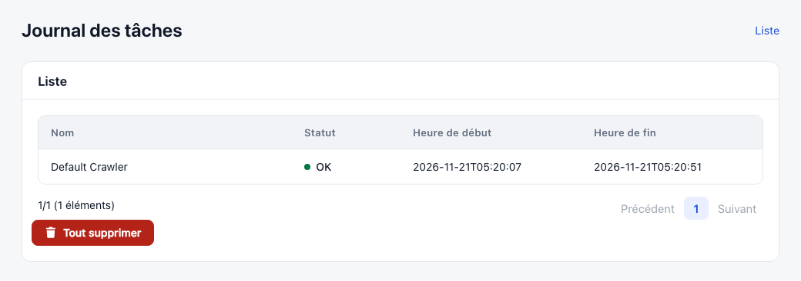
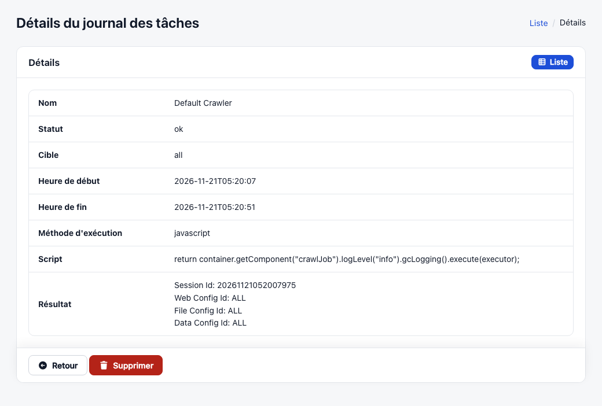

==================
Journal des tâches
==================

Présentation
============

Affiche les résultats des tâches exécutées sous forme de liste.

Gestion
=======

Affichage
---------

Pour ouvrir la page de vérification du journal des tâches illustrée ci-dessous, cliquez sur [Informations système > Journal des tâches] dans le menu de gauche.

|image0|

La liste affiche le nom de la tâche, l'état d'exécution et les heures de début et de fin.
Cliquez sur le bouton Tout supprimer sous la liste pour supprimer tous les journaux de tâches. Une boîte de dialogue de confirmation s'affiche.

Détails du journal des tâches
-----------------------------

Vous pouvez vérifier le contenu du journal des tâches. Affiche le nom de la tâche, l'état, les heures de début et de fin, les résultats, etc.

|image1|

Nom
::::

Nom de la tâche exécutée.

État
::::

Résultat de l'exécution de la tâche.

.. note::
   Une tâche d'exploration à l'état OK (``ok``) n'a pas forcément ajouté tous les documents à l'index. L'état indique si le processus du robot d'exploration s'est terminé normalement. Un document dont le moteur de recherche refuse l'écriture n'est pas indexé, et la tâche peut tout de même se terminer avec OK. Un document refusé est consigné dans ``fess-crawler.log`` avec un avertissement tel que ``Failed to index a document``. Pour les explorations Web et de fichiers, il n'est pas enregistré comme URL en échec. Vérifiez aussi le nombre de documents de l'index (voir « Nombre de documents de l'index et fraîcheur du crawl » dans :doc:`../config/admin-logging`).

Cible
:::::

Cible d'exécution de la tâche.

Heure de début
::::::::::::::

Date et heure de début de la tâche.

Heure de fin
::::::::::::

Date et heure de fin de la tâche.

Méthode d'exécution
:::::::::::::::::::

Environnement d'exécution dans lequel la tâche a été exécutée.

Script
::::::

Contenu d'exécution de la tâche.

Résultat
::::::::

Résultat de l'exécution de la tâche.

Cliquez sur le bouton Supprimer de la page de détails pour supprimer le journal de tâche. Une boîte de dialogue de confirmation s'affiche.

