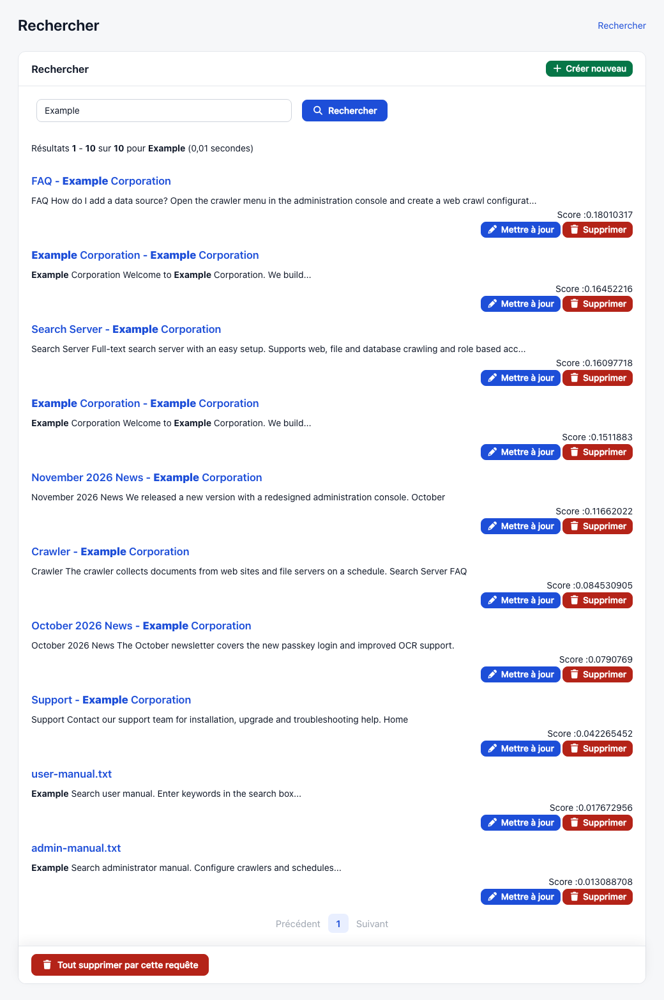
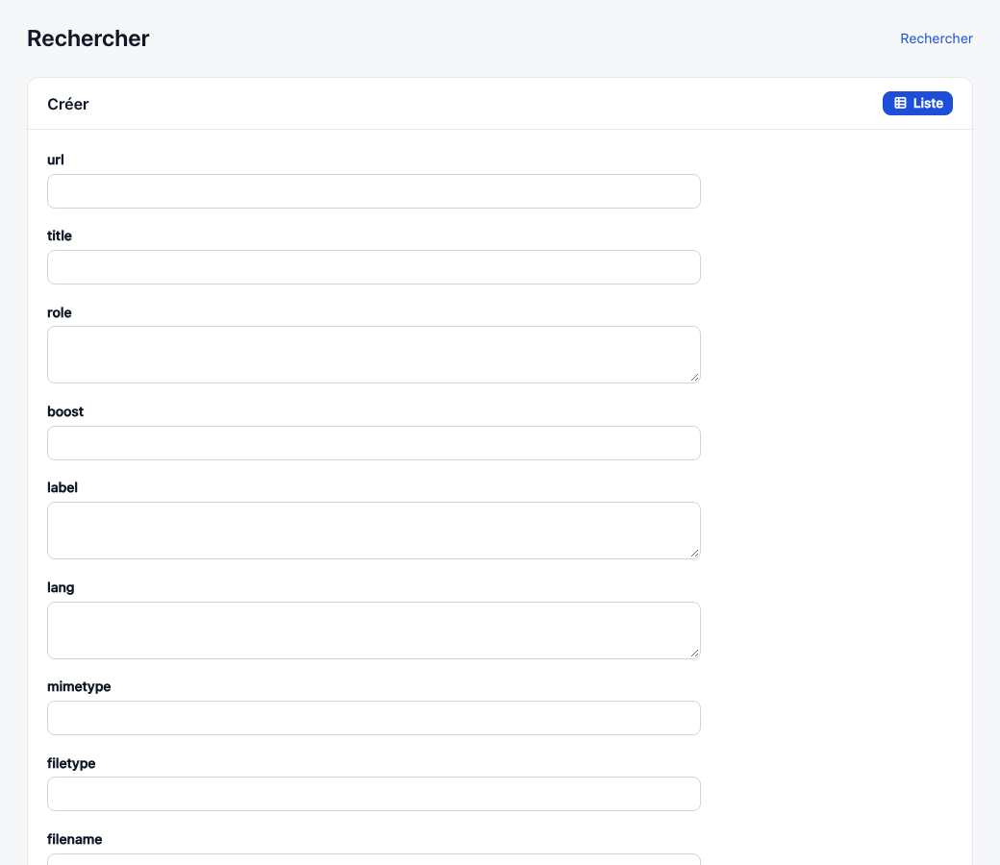

=========
Recherche
=========

Présentation
============

Cette section explique la recherche d'administration.

Gestion
=======

Affichage
---------

Pour ouvrir la page de recherche illustrée ci-dessous, cliquez sur [Informations système > Rechercher] dans le menu de gauche.

Saisissez un mot-clé dans le formulaire de recherche, puis cliquez sur le bouton Rechercher. Les résultats de recherche s'affichent comme ci-dessous.

|image0|

Liste de recherche
------------------

Vous pouvez effectuer une recherche avec les conditions spécifiées.
Dans l'écran de recherche normal, les conditions de rôle et de navigateur sont ajoutées implicitement, mais elles ne le sont pas dans cette recherche d'administration.
Vous pouvez également supprimer des documents spécifiques de l'index à partir des résultats de recherche affichés.

Pour modifier un document des résultats, cliquez sur le bouton Mettre à jour du document.
Pour supprimer un document de l'index, cliquez sur le bouton Supprimer du document, puis sur le bouton Supprimer dans la boîte de dialogue de confirmation.

Suppression en masse
--------------------

Si vous souhaitez supprimer tous les documents de l'index, cliquez sur le bouton « Tout supprimer par cette requête » en bas de la page avec « \*:\* » pour les supprimer. Une boîte de dialogue de confirmation s'affiche.
Il est également possible de supprimer uniquement les documents cibles en spécifiant les conditions de recherche.

Création d'un document
----------------------

Cliquez sur le bouton Créer nouveau en haut à droite de la page pour afficher un formulaire d'ajout d'un document à l'index.

|image1|

Le formulaire liste les champs du document par leur nom, comme ``url``, ``title`` et ``role``. ``url`` et ``title`` sont obligatoires.

- Un champ qui peut contenir plusieurs valeurs, comme ``role``, ``label``, ``lang`` et ``virtual_host``, est une zone de texte ; saisissez une valeur par ligne.
- ``boost`` est un nombre, et ``content_length``, ``favorite_count`` et ``click_count`` sont des entiers.
- Un champ de date (``created``, ``timestamp``, ``last_modified`` et ``expires``) se saisit sous la forme ``yyyy-MM-ddTHH:mm:ss.SSSZ``, par exemple ``2026-01-01T00:00:00.000Z``.

Le navigateur vérifie le format de ces valeurs lors de l'envoi du formulaire. Cliquez sur le bouton Créer pour ajouter le document.
Le formulaire de mise à jour d'un document comporte les mêmes champs.

