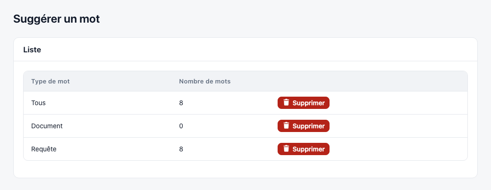

==================
Mots de suggestion
==================

Présentation
============

La page Mots de suggestion gère les mots à afficher dans les suggestions de mots-clés.

Gestion
=======

Affichage
---------

Pour ouvrir la page de liste des mots de suggestion illustrée ci-dessous, cliquez sur [Suggérer > Suggérer un mot] dans le menu de gauche.

|image0|

Cliquez sur le bouton Supprimer d'un type de mot si vous souhaitez supprimer ses mots. Une boîte de dialogue de confirmation s'affiche.

Type de mot
:::::::::::

- Tous : Tous les mots enregistrés
- Document : Mots générés à partir de documents indexés
- Terme de recherche : Mots générés à partir des journaux de recherche

Nombre de mots
::::::::::::::

Nombre de mots enregistrés

