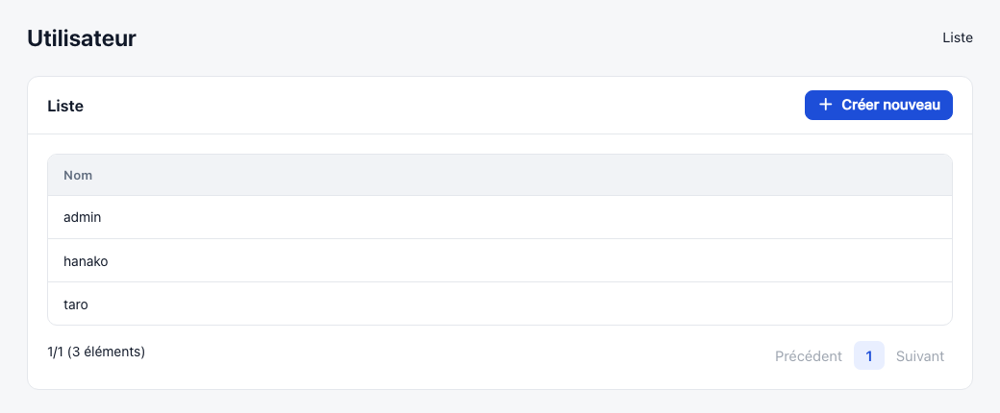
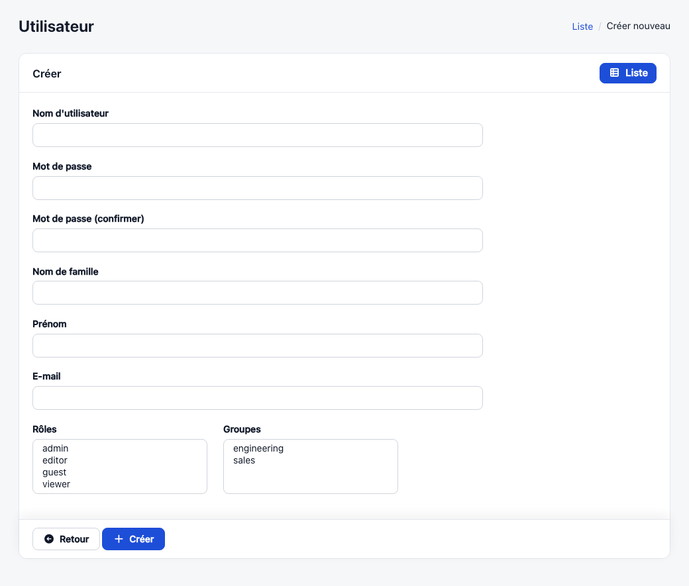

===========
Utilisateur
===========

Présentation
============

Vous pouvez gérer les utilisateurs qui se connectent à |Fess|.

Gestion
=======

Affichage
---------

Pour ouvrir la page de liste de configuration des utilisateurs illustrée ci-dessous, cliquez sur [Utilisateur > Utilisateur] dans le menu de gauche.

|image0|

Cliquez sur le nom de la configuration pour la modifier.

Création de configuration
-------------------------

Cliquez sur le bouton Créer nouveau pour ouvrir la page de configuration des utilisateurs.

|image1|

Paramètres de configuration
---------------------------

Nom d'utilisateur
:::::::::::::::::

Nom d'utilisateur. Il ne peut pas être modifié après la création de l'utilisateur.

Mot de passe, Mot de passe (confirmer)
::::::::::::::::::::::::::::::::::::::

Spécifie le mot de passe de l'utilisateur, puis saisissez-le à nouveau dans Mot de passe (confirmer). Le mot de passe est obligatoire lors de la création d'un utilisateur. Lors de la modification d'un utilisateur, laissez les deux champs vides pour conserver le mot de passe actuel.

Nom de famille, Prénom, E-mail
::::::::::::::::::::::::::::::

Spécifie le nom de famille, le prénom et l'adresse e-mail de l'utilisateur. Ces champs sont facultatifs.

Rôle
::::

Spécifie les rôles auxquels l'utilisateur appartient.

.. note::

   Un utilisateur disposant du rôle ``admin-user`` peut attribuer n'importe quel rôle existant, y compris le rôle administrateur, à n'importe quel utilisateur. Traitez les rôles ``admin-*`` comme équivalents au rôle administrateur ; voir :doc:`../install/security`.

Groupe
::::::

Spécifie les groupes auxquels l'utilisateur appartient.

.. note::

   Lorsque le mot de passe, les rôles ou les groupes d'un utilisateur sont modifiés, les sessions de connexion de cet utilisateur prennent fin au bout de 60 secondes au plus (valeur par défaut de ``password.changed.check.interval``), et l'utilisateur doit se reconnecter. Lorsqu'un mot de passe est modifié, la session qui a effectué la modification est conservée. Lorsque des rôles ou des groupes sont modifiés, la session qui a effectué la modification prend fin elle aussi. Voir :doc:`../install/security`.

Suppression de configuration
----------------------------

Cliquez sur le nom de la configuration dans la page de liste, puis cliquez sur le bouton Supprimer pour afficher la boîte de dialogue de confirmation.
Cliquez sur le bouton Supprimer dans la boîte de dialogue pour supprimer la configuration.

