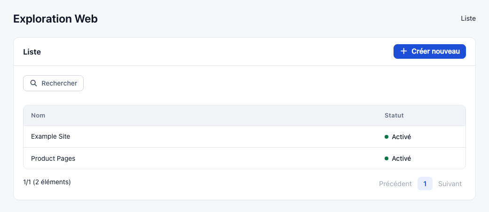
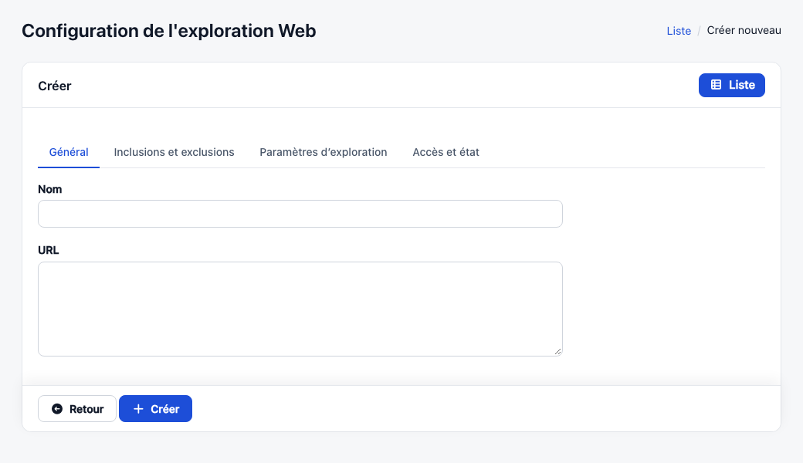
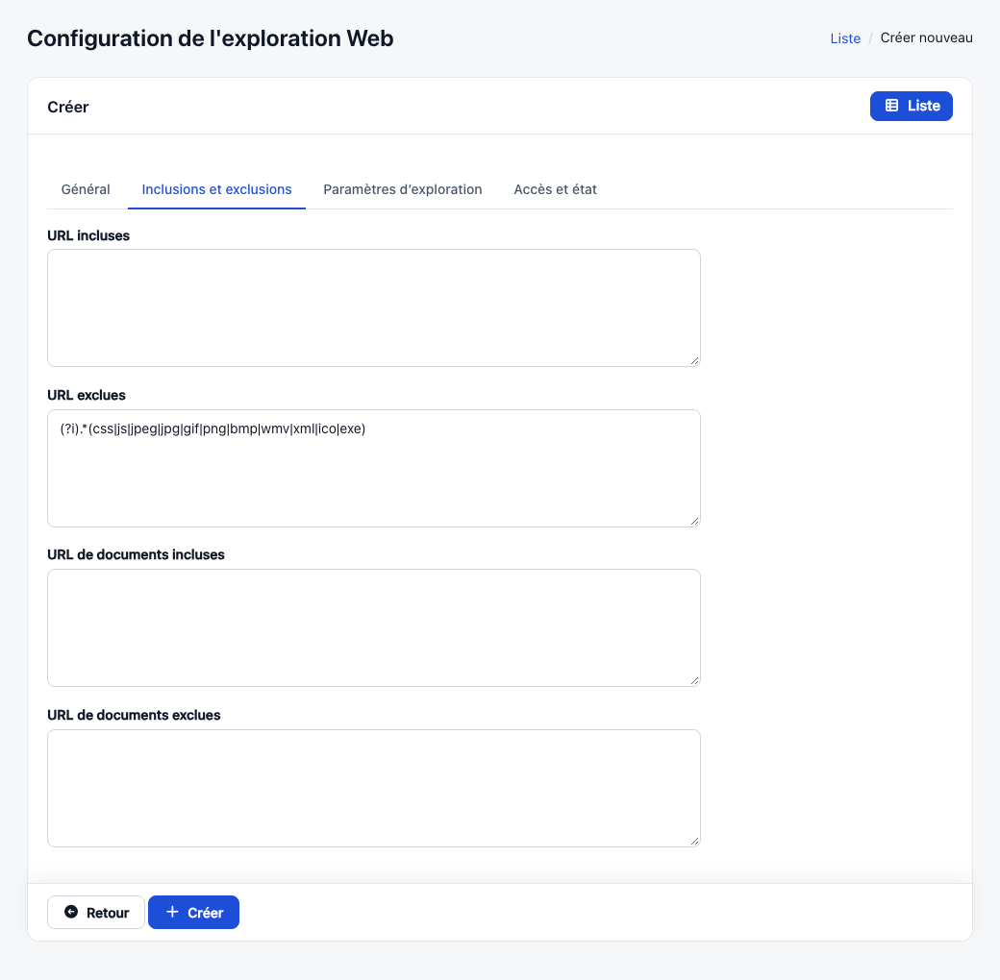
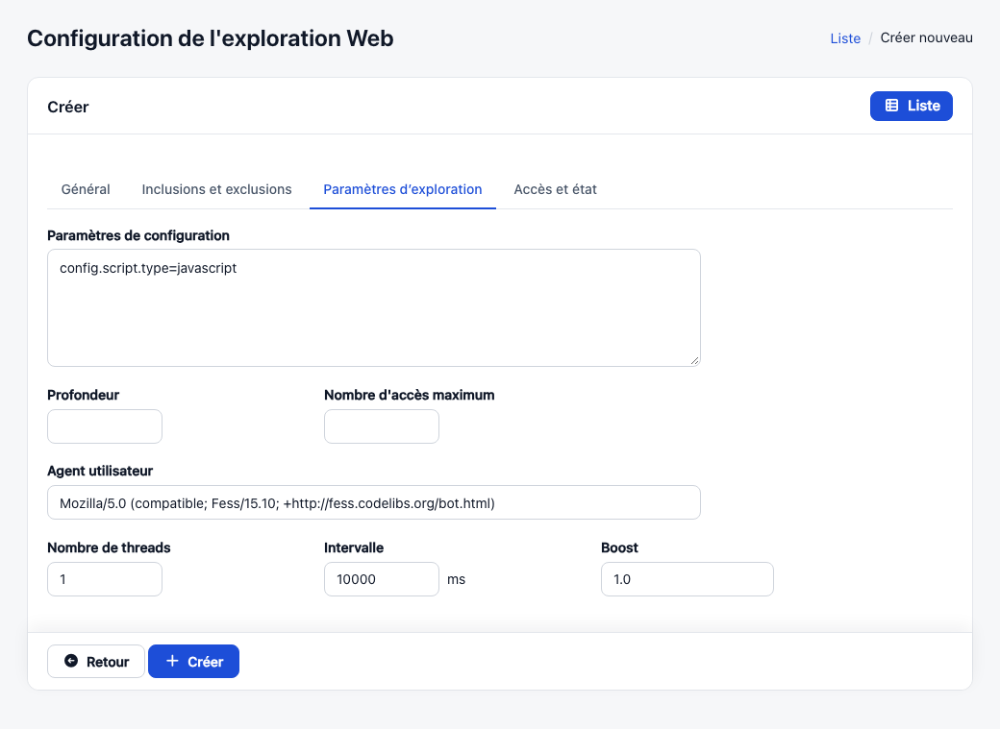
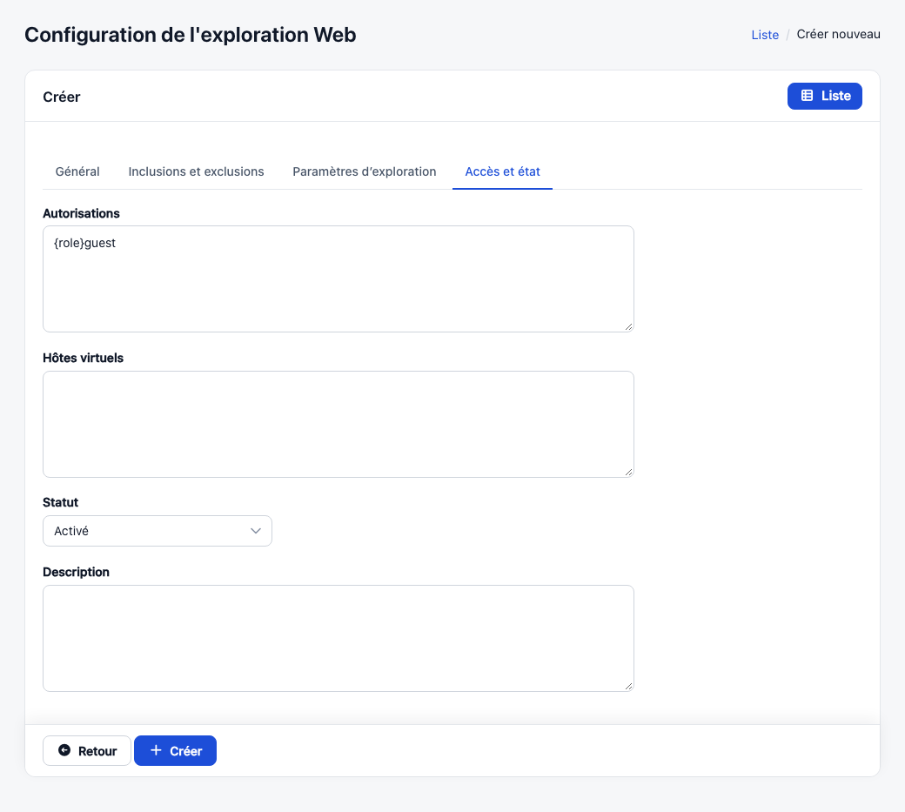

=================================
Crawl Web (recherche de site Web)
=================================

Présentation
============

Le crawl Web permet de parcourir les sites Web publics ou les sites Web de l'intranet à l'aide du crawler Web, puis d'enregistrer les pages collectées dans l'index de |Fess| afin de les rendre disponibles pour une recherche en texte intégral (recherche de site Web). Le crawl de sites protégés par une authentification BASIC, DIGEST, NTLM ou par formulaire est également pris en charge.

La page de configuration de crawl Web configure le crawl Web.

Gestion
=======

Affichage
---------

Pour ouvrir la page de liste de configuration de crawl Web illustrée ci-dessous, cliquez sur [Robot d'exploration > Web] dans le menu de gauche.

|image0|

Cliquez sur le nom de la configuration pour la modifier.

Création de configuration
-------------------------

Cliquez sur le bouton Créer nouveau pour ouvrir la page de configuration de crawl Web.
La page est divisée en quatre onglets : « Général », « Inclusions et exclusions », « Paramètres d’exploration » et « Accès et état ». Cliquez sur le nom d'un onglet pour changer d'onglet. Si une saisie comporte une erreur, l'onglet qui la contient s'ouvre automatiquement. Les champs de chaque onglet sont décrits ci-dessous.

Onglet Général
--------------

|image1|

Nom
::::

Nom de la configuration.

URL
::::

URL de départ du crawl. Spécifiez une URL par ligne.

Onglet Inclusions et exclusions
-------------------------------

|image2|

URL à crawler
:::::::::::::

Les URL correspondant à l'expression régulière (format Java) spécifiée dans cet élément seront ciblées par le crawler |Fess|.

URL exclues du crawl
::::::::::::::::::::

Les URL correspondant à l'expression régulière (format Java) spécifiée dans cet élément ne seront pas ciblées par le crawler |Fess|.

URL à indexer
:::::::::::::

Les URL correspondant à l'expression régulière (format Java) spécifiée dans cet élément seront ciblées pour la recherche.

URL exclues de l'indexation
::::::::::::::::::::::::::::

Les URL correspondant à l'expression régulière (format Java) spécifiée dans cet élément ne seront pas ciblées pour la recherche.

.. note::
   Cette spécification ne s'applique qu'aux documents indexés lors des crawls suivants (les documents correspondants ne sont pas indexés). Les documents déjà indexés ne sont pas supprimés lorsque vous ajoutez cette spécification et restent dans les résultats de recherche. Lorsque « Vérifier la dernière modification » est activé dans les paramètres généraux (valeur par défaut), la date d'expiration d'un document non modifié est prolongée à chaque crawl (voir « Vérifier la dernière modification » dans :doc:`general-guide`) ; un tel document ne disparaît donc pas forcément à l'échéance définie par « Supprimer les anciens documents ». Pour retirer à coup sûr un document des résultats de recherche, supprimez-le dans la liste de recherche (interface d'administration). Un document supprimé n'est plus indexé lors des crawls suivants tant qu'il correspond à cette spécification.

Onglet Paramètres d’exploration
-------------------------------

|image3|

Paramètres de configuration
:::::::::::::::::::::::::::

Vous pouvez spécifier les informations de configuration du crawl.

Profondeur
::::::::::

Vous pouvez spécifier la profondeur lors du suivi des liens contenus dans les documents crawlés.

Nombre maximum d'accès
::::::::::::::::::::::

Nombre d'URL à indexer.

Agent utilisateur
:::::::::::::::::

Nom du crawler |Fess|.

Nombre de threads
:::::::::::::::::

Nombre de threads pour crawler dans cette configuration.

Intervalle
::::::::::

Intervalle de temps pour chaque thread lors du crawl d'URL, en millisecondes.

Boost
:::::

Poids des documents indexés dans cette configuration.

Onglet Accès et état
--------------------

|image4|

Autorisations
:::::::::::::

Spécifie la permission pour cette configuration.
Pour la méthode de spécification de permission, par exemple, pour afficher les résultats de recherche aux utilisateurs appartenant au groupe developer, spécifiez {group}developer.
La spécification par utilisateur est {user}nom_utilisateur, par rôle {role}nom_rôle, par groupe {group}nom_groupe.

Hôtes virtuels
::::::::::::::

Spécifie les noms d'hôte des hôtes virtuels, un par ligne.
Pour plus de détails, consultez :doc:`../config/security-virtual-host`.

État
::::

Si activé, la tâche planifiée du crawler par défaut inclura cette configuration.

Description
:::::::::::

Vous pouvez saisir une description.

Suppression de configuration
----------------------------

Cliquez sur le nom de la configuration dans la page de liste, puis cliquez sur le bouton Supprimer pour afficher la boîte de dialogue de confirmation. Appuyer sur le bouton Supprimer supprimera la configuration.

.. note::

   La suppression d'une configuration ne supprime pas les documents qu'elle a déjà enregistrés dans l'index. Ils restent consultables jusqu'à leur expiration. Un document expire après le nombre de jours indiqué par « Supprimer les anciens documents » dans :doc:`general-guide` (``day.for.cleanup``, ``3`` par défaut), compté à partir du début du dernier crawl qui l'a enregistré ou mis à jour ; le travail Doc Purger le supprime alors de l'index. Avec ``-1``, les documents enregistrés sans expiration ne sont jamais supprimés de cette façon.

   Pour supprimer les documents immédiatement, supprimez-les vous-même de l'index. Dans l'écran Recherche (:doc:`searchlist-guide`), recherchez les documents de la configuration (par exemple avec ``url:`` ou ``host:``), vérifiez les résultats, puis cliquez sur le bouton « Tout supprimer par cette requête ». Vous pouvez faire de même avec ``DELETE /api/admin/searchlist/query`` (voir :doc:`../api/admin/api-admin-searchlist`).

   Il en va autrement lorsque vous modifiez les autorisations d'une configuration et relancez le crawl : l'ID du document dépend des autorisations, et lorsque le crawler enregistre un document, il supprime les documents de même URL et d'ID différent que la même configuration avait enregistrés auparavant .

Exemples
========

Crawler fess.codelibs.org
-------------------------

Pour créer une configuration de crawl Web qui crawle les pages sous https://fess.codelibs.org/, les valeurs de configuration seraient les suivantes.

.. tabularcolumns:: |p{4cm}|p{8cm}|
.. list-table::
   :header-rows: 1

   * - Élément de configuration
     - Valeur de configuration
   * - Nom
     - Fess
   * - URL
     - https://fess.codelibs.org/
   * - URL à crawler
     - https://fess.codelibs.org/.\*

Les autres valeurs de configuration utilisent les valeurs par défaut.

Crawl Web de site avec authentification Web
-------------------------------------------

Fess prend en charge le crawl pour l'authentification BASIC, DIGEST et NTLM.
Pour plus de détails sur l'authentification Web, consultez la page d'authentification Web.

Redmine
:::::::

Pour créer une configuration de crawl Web qui crawle les pages de Redmine protégées par mot de passe (ex. https://<serveur>/), les valeurs de configuration seraient les suivantes.

.. tabularcolumns:: |p{4cm}|p{8cm}|
.. list-table::
   :header-rows: 1

   * - Élément de configuration
     - Valeur de configuration
   * - Nom
     - Redmine
   * - URL
     - https://<serveur>/my/page
   * - URL à crawler
     - https://<serveur>/.\*
   * - Paramètres de configuration
     - client.robotsTxtEnabled=false (Optionnel)

Ensuite, créez la configuration d'authentification Web avec les valeurs suivantes.

.. tabularcolumns:: |p{4cm}|p{8cm}|
.. list-table::
   :header-rows: 1

   * - Élément de configuration
     - Valeur de configuration
   * - Schéma
     - Form
   * - Nom d'utilisateur
     - (Compte pour le crawl)
   * - Mot de passe
     - (Mot de passe du compte)
   * - Paramètres
     - | encoding=UTF-8
       | token_method=GET
       | token_url=https://<serveur>/login
       | token_pattern=name="authenticity_token"[^>]+value="([^"]+)"
       | token_name=authenticity_token
       | login_method=POST
       | login_url=https://<serveur>/login
       | login_parameters=username=${username}&password=${password}
   * - Configuration Web
     - Redmine

XWiki
:::::

Pour créer une configuration de crawl Web qui crawle les pages de XWiki (ex. https://<serveur>/xwiki/), les valeurs de configuration seraient les suivantes.

.. tabularcolumns:: |p{4cm}|p{8cm}|
.. list-table::
   :header-rows: 1

   * - Élément de configuration
     - Valeur de configuration
   * - Nom
     - XWiki
   * - URL
     - https://<serveur>/xwiki/bin/view/Main/
   * - URL à crawler
     - https://<serveur>/.\*
   * - Paramètres de configuration
     - client.robotsTxtEnabled=false (Optionnel)

Ensuite, créez la configuration d'authentification Web avec les valeurs suivantes.

.. tabularcolumns:: |p{4cm}|p{8cm}|
.. list-table::
   :header-rows: 1

   * - Élément de configuration
     - Valeur de configuration
   * - Schéma
     - Form
   * - Nom d'utilisateur
     - (Compte pour le crawl)
   * - Mot de passe
     - (Mot de passe du compte)
   * - Paramètres
     - | encoding=UTF-8
       | token_method=GET
       | token_url=http://<serveur>/xwiki/bin/login/XWiki/XWikiLogin
       | token_pattern=name="form_token" +value="([^"]+)"
       | token_name=form_token
       | login_method=POST
       | login_url=http://<serveur>/xwiki/bin/loginsubmit/XWiki/XWikiLogin
       | login_parameters=j_username=${username}&j_password=${password}
   * - Configuration Web
     - XWiki

Pages associées
===============

- :doc:`../config/crawler-basic`
- :doc:`webauth-guide`
- :doc:`fileconfig-guide`
- :doc:`../config/search-basic`

.. pdf            :height: 940 px
