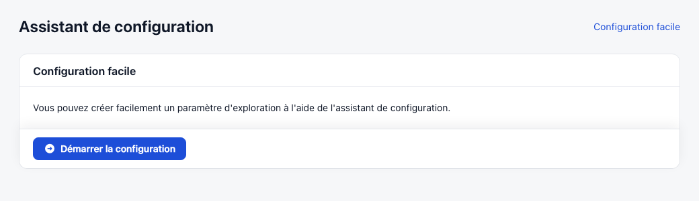
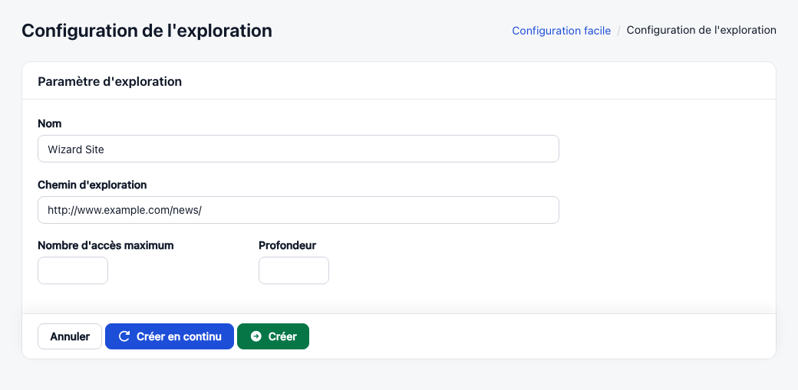
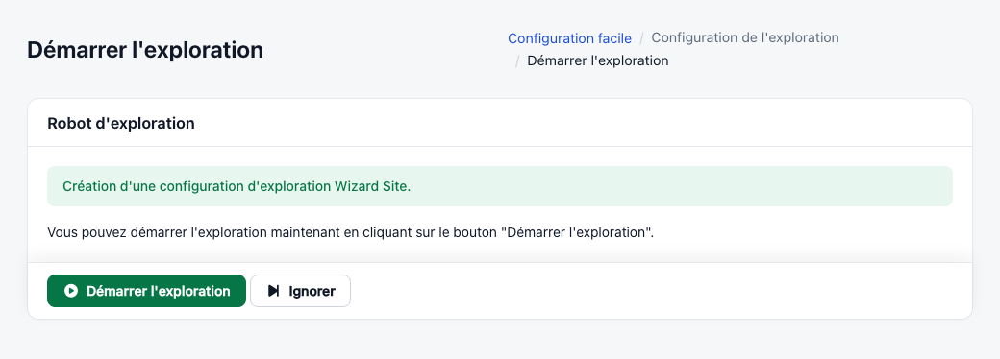

==========================
Assistant de configuration
==========================

Présentation
============

La page Assistant fournit un outil de configuration simplifié pour enregistrer les configurations de crawl.

Configuration facile
--------------------

Cette page est une page de démarrage pour enregistrer la configuration de crawl. Cliquez sur le bouton Démarrer la configuration pour ouvrir la page de configuration du crawl.

|image0|

Configuration de l'exploration
------------------------------

Cette page vous permet de créer une configuration de crawl.

|image1|

Paramètres de configuration
---------------------------

Nom
::::

Spécifiez le nom de la configuration (par exemple : Site Fess).

Chemin d'exploration
::::::::::::::::::::

Spécifiez l'URL ou le chemin du fichier du point de départ du crawl (par exemple : https://fess.codelibs.org/).

Nombre maximum d'accès
::::::::::::::::::::::

Définit la limite supérieure du nombre de pages à crawler.

Profondeur
::::::::::

Définit la profondeur lors du suivi des liens contenus dans les documents crawlés.

Boutons
:::::::

- **Créer** : enregistre la configuration de crawl et passe à la page Démarrer l'exploration.
- **Créer en continu** : enregistre la configuration de crawl et revient à ce formulaire pour que vous puissiez en enregistrer une autre.
- **Annuler** : revient à la page Configuration facile sans enregistrer.

Crawler
-------

Pour démarrer le crawler |Fess|, cliquez sur le bouton Démarrer le crawl. Si vous ne souhaitez pas encore crawler, cliquez sur le bouton Ignorer.

|image2|

