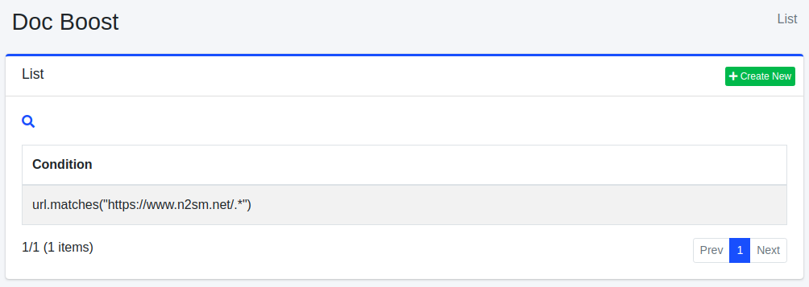
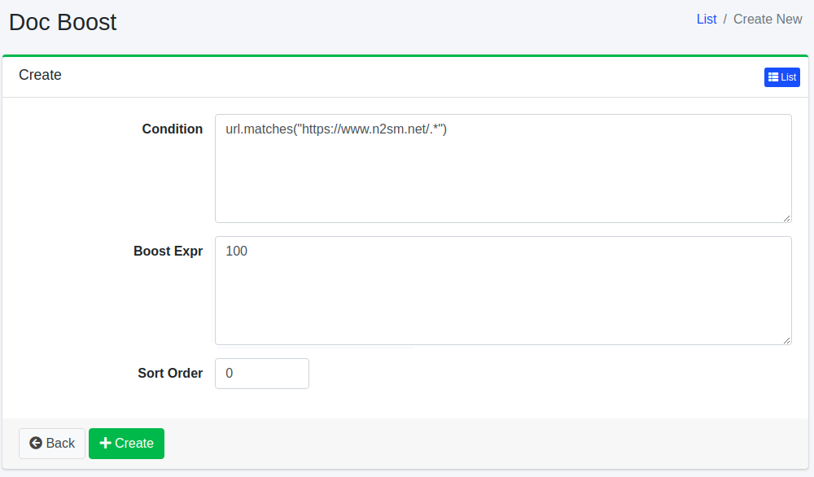

=================
Boost de document
=================

Présentation
============

Cette section explique la configuration du boost de document.
En configurant le boost de document, vous pouvez positionner des documents en haut des résultats de recherche indépendamment du terme de recherche.

Gestion
=======

Affichage
---------

Pour ouvrir la page de liste de configuration du boost de document illustrée ci-dessous, cliquez sur [Robot d'exploration > Boost de document] dans le menu de gauche.

|image0|

Cliquez sur le nom de la configuration pour la modifier.

Création de configuration
-------------------------

Cliquez sur le bouton Nouvelle création pour ouvrir la page de configuration du boost de document.

|image1|

Paramètres de configuration
---------------------------

Condition
:::::::::

Spécifie la condition des documents que vous souhaitez positionner en haut.
Par exemple, pour afficher en haut les URL contenant https://www.n2sm.net/, décrivez url.matches("https://www.n2sm.net/.\*").
Les conditions sont écrites dans la syntaxe du moteur de script spécifié dans « Type de Script » ci-dessous.

Expression de boost
:::::::::::::::::::

Spécifie la valeur de pondération du document.
L'expression est écrite dans la syntaxe du moteur de script spécifié dans « Type de Script » ci-dessous.

Type de Script
::::::::::::::

Spécifie le moteur de script utilisé pour évaluer la condition et l'expression de boost.
Les nouvelles configurations sont préremplies avec ``javascript``. Sélectionner ``groovy`` nécessite
le plugin ``fess-script-groovy``. Si le champ est laissé vide, les expressions sont évaluées en tant que Groovy.

.. warning::

   Avec JavaScript, écrivez la condition et l'expression de boost comme des expressions pures
   sans point-virgule final. Un texte qui ne peut être analysé qu'en tant que bloc
   d'instructions est évalué à ``null`` sauf s'il contient un ``return`` explicite. Voir
   :ref:`javascript-statement-null` (dans :doc:`../config/scripting-javascript`).

Ordre de tri
::::::::::::

Configure l'ordre de tri du boost de document.

Moment d'application des règles
-------------------------------

Les règles de boost de document sont évaluées lorsqu'une exploration Web ou une exploration de fichiers enregistre un document dans l'index. Elles ne s'appliquent pas aux explorations de magasins de données.
Ajouter, modifier ou supprimer une règle ne change pas le boost des documents déjà présents dans l'index.

Lorsque « Vérifier la dernière modification » dans [Système > Général] est activé (valeur par défaut), un document dont le contenu n'a pas changé n'est pas enregistré à nouveau dans l'index lors d'une nouvelle exploration, de sorte que son boost n'est pas réévalué.
Pour appliquer une règle nouvelle ou modifiée aux documents existants, supprimez ces documents de l'index (voir :doc:`searchlist-guide`), puis relancez l'exploration.
Un document enregistré à nouveau, par exemple parce que son contenu a été mis à jour, est évalué à ce moment-là.
Si « Vérifier la dernière modification » est désactivé, chaque document est enregistré à nouveau à chaque exploration, et les règles sont donc évaluées à chaque fois.

Suppression de configuration
----------------------------

Cliquez sur le nom de la configuration dans la page de liste, puis cliquez sur le bouton Supprimer pour afficher l'écran de confirmation. Appuyer sur le bouton Supprimer supprimera la configuration.

