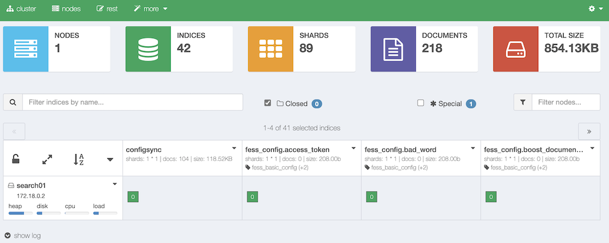
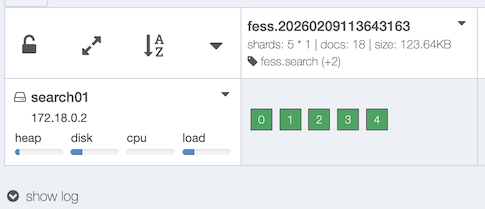

===============
Tableau de bord
===============

Présentation
============

Le tableau de bord fournit un outil d'administration Web pour gérer les clusters et les index OpenSearch auxquels |Fess| accède.

|image0|

.. tabularcolumns:: |p{4cm}|p{8cm}|
.. list-table:: Index gérés par |Fess|
   :header-rows: 1

   * - Nom de l'index
     - Description
   * - fess.yyyyMMddHHmmssSSS
     - Documents indexés
   * - fess_log
     - Journaux d'accès
   * - fess.suggest.yyyyMMddHHmmssSSS
     - Mots suggérés
   * - fess_config
     - Configuration de |Fess|
   * - fess_user
     - Données utilisateur/rôle/groupe
   * - configsync
     - Configuration du dictionnaire
   * - fess_suggest
     - Métadonnées de suggestion
   * - fess_suggest_array
     - Métadonnées de suggestion
   * - fess_suggest_badword
     - Liste de mots interdits pour la suggestion
   * - fess_suggest_analyzer
     - Métadonnées de suggestion
   * - fess_crawler
     - Informations de crawl

La partie qui suit ``fess.`` et ``fess.suggest.`` correspond à la date et à l'heure de création de l'index (17 chiffres, ``yyyyMMddHHmmssSSS``).

Les index dont le nom commence par un point (.) sont des index système et ne sont donc pas affichés.
Pour afficher également les index système, cochez la case « Special ».

Vérification du nombre de documents indexés
===========================================

Le nombre de documents indexés est affiché dans l'index fess comme illustré ci-dessous.

|image1|

Cliquer sur l'icône en haut à droite de chaque index affiche un menu d'opérations pour cet index.
Pour supprimer des documents indexés, utilisez l'écran de recherche d'administration. Veillez à ne pas supprimer avec « supprimer l'index ».

.. pdf            :width: 400 px
