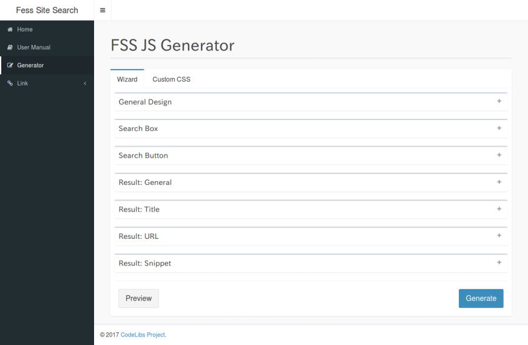
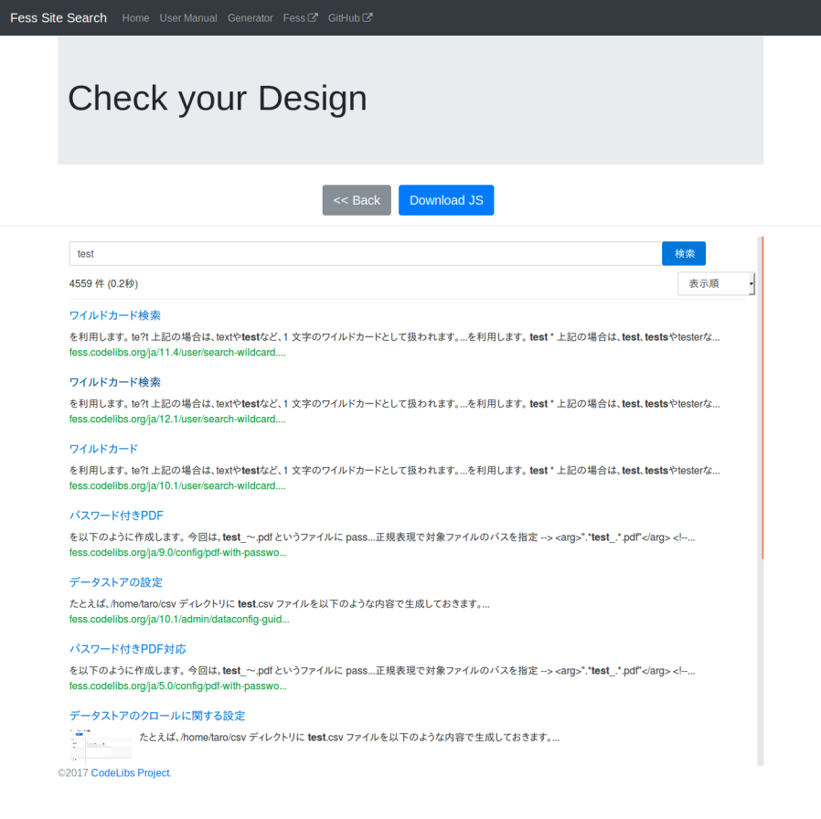
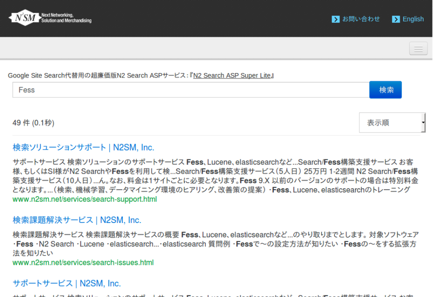

=====================================================================
Construire un serveur de recherche basé sur Elasticsearch avec Fess ~ FSS
=====================================================================

Introduction
============

Nous allons vous montrer comment intégrer un service de recherche dans votre site Web en utilisant un serveur Fess que vous avez mis en place.
En utilisant les balises et les fichiers JavaScript fournis par Fess Site Search (FSS), vous pouvez afficher une zone de recherche et des résultats de recherche sur un site Web existant.

Public cible
============

- Ceux qui souhaitent ajouter une fonction de recherche à un site Web existant

- Ceux qui souhaitent migrer depuis Google Site Search ou Google Custom Search.

Qu'est-ce que Fess Site Search (FSS) ?
=======================================

FSS est une fonctionnalité qui permet d'intégrer le serveur de recherche Fess dans un site Web existant. Elle est proposée par le projet CodeLibs sur le site FSS. De la même manière que la recherche interne de site comme Google Site Search (GSS), il suffit d'intégrer une balise JavaScript dans la page où vous souhaitez utiliser le service de recherche, ce qui facilite également la migration depuis GSS.

FSS JS
======

FSS JS est un fichier JavaScript qui affiche les résultats de recherche de Fess. En plaçant ce fichier JavaScript sur votre site Web, vous pourrez afficher les résultats de recherche.
FSS JS peut être obtenu en le générant avec le FSS JS Generator disponible à l'adresse ``https://fss-generator.codelibs.org/``.
FSS JS est compatible avec Fess version 11.3 et supérieure. Veuillez donc installer Fess 11.3 ou une version ultérieure lors de la mise en place de Fess. Pour la méthode de mise en place de Fess, veuillez consulter le \ `guide d'introduction <https://fess.codelibs.org/ja/articles/article-1.html>`__\ .

Le FSS JS Generator vous permet de spécifier les couleurs du formulaire de recherche et la police des caractères.
En cliquant sur le bouton "Generate", vous pouvez générer un fichier JavaScript avec les paramètres spécifiés.

|image0|

Si l'aperçu ne pose pas de problème, cliquez sur le bouton "Download JS" pour télécharger le fichier JavaScript.

|image1|

Intégration dans le site
=========================

Dans cet exemple, nous allons intégrer une recherche interne dans le site ``www.n2sm.net``, composé de pages HTML statiques.

Les résultats de recherche seront affichés sur la page search.html du site, et le serveur Fess sera mis en place séparément sur ``nss833024.n2search.net``.

Le fichier JavaScript FSS JS téléchargé sera placé sur le site à l'emplacement /js/fess-ss.min.js.

Les informations ci-dessus sont résumées dans le tableau suivant.

.. tabularcolumns:: |p{4cm}|p{8cm}|
.. list-table::

   * - Nom
     - URL
   * - Site cible de la recherche
     - https://www.n2sm.net/
   * - Page des résultats de recherche
     - https://www.n2sm.net/search.html
   * - FSS JS
     - https://www.n2sm.net/js/fess-ss.min.js
   * - Serveur Fess
     - https://nss833024.n2search.net/

Pour intégrer la balise JavaScript, placez le code suivant à l'endroit où vous souhaitez afficher les résultats de recherche dans search.html.

..
  
  <fess:search></fess:search>

En accédant à search.html, le formulaire de recherche s'affiche.

Lorsque vous saisissez un terme de recherche, les résultats de recherche s'affichent comme suit.

|image2|

Pour placer un formulaire de recherche sur d'autres pages et afficher les résultats de recherche, placez un formulaire de recherche comme celui ci-dessous sur chaque page et configurez-le pour rediriger vers ``https://www.n2sm.net/search.html?q=terme+de+recherche``.

..
  <form action="https://www.n2sm.net/search.html" method="get">
    <input type="text" name="q">
    <input type="submit" value="Rechercher">
  </form>

Conclusion
==========

Nous avons présenté comment intégrer les résultats de recherche de Fess dans un site en plaçant simplement une balise JavaScript.
Grâce à FSS, la migration depuis GSS peut également être réalisée en remplaçant simplement les balises JavaScript existantes.
FSS JS offre également d'autres méthodes d'affichage et des fonctionnalités d'intégration des journaux de recherche avec Google Analytics. Pour les autres méthodes de configuration, veuillez consulter le `[manuel] de FSS <https://fss-generator.codelibs.org/ja/docs/manual>`__.

Références
==========
- `Fess Site Search <https://fss-generator.codelibs.org/ja/>`__

