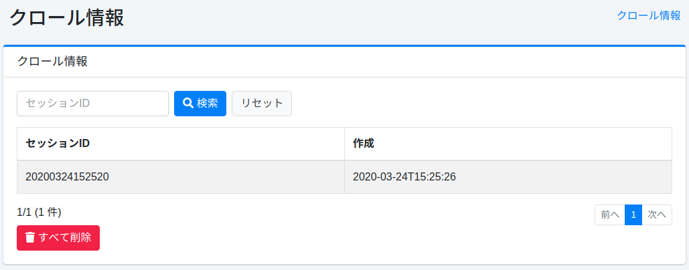
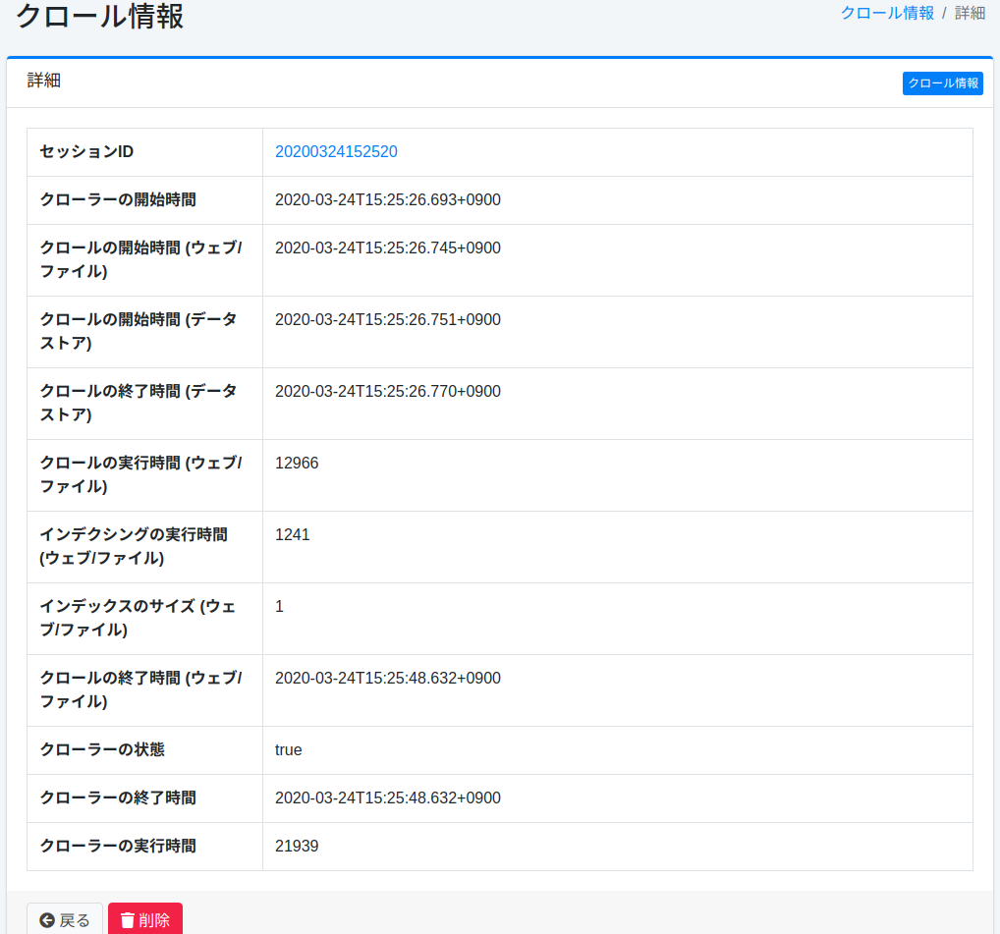

=========
クロール情報
=========

概要
====

クロールの実行結果は記録され、クロール情報はこの管理画面で確認することができます。

管理方法
======

一覧
====

クロールが実行されるごとにクロール情報として記録されます。
一覧では実行したクロールのセッション名と実行した時間を確認することができます。
クロール情報の詳細を確認したい場合は対象のクロール情報をクリックします。

|image0|

実行中のクロール
================

実行中のクロールがあるときは、一覧の上に「実行中のクロール」が表示されます。ウェブ・ファイルシステム・データストアのクロール設定ごとに1行で、次の項目を確認できます。

- クロール設定: クロール設定の名前。
- 処理済みドキュメント数: 実行中のクロールがこれまでに処理したドキュメント数。ウェブとファイルシステムのクロールではアクセス結果の件数、データストアのクロールではそのクロール設定で索引登録したドキュメント数です。
- 進捗: 直前に完了したクロールのドキュメント数に対する、処理済みドキュメント数の割合（%）。クロールが完了するまでは最大 99% で、直前に完了したクロールがない場合（最初のクロールなど）は割合を求められないため、 ``-`` を表示して件数だけを示します。

補足:

- 表示はページを開いたときの内容です。最新の値を見るにはページを再読み込みしてください。
- 完了したクロールは、次にページを開いたときには一覧から消えます。停止したクロール（およびクローラーが記録できずに止まった場合。プロセスが強制終了された場合など）は、最後の更新から約30秒（既定）以内に消えるため、停止した直後はしばらく表示されたままになることがあります。停止または失敗したクロールは、直前に完了したクロールのドキュメント数を変更しません。ドキュメントを1件も処理せずに完了したクロールも、その数を直前の件数として置き換えません。
- 進捗の状態は、クロール設定の ``metadata`` フィールドにシステムが保存します。管理画面や管理 API からは編集できません。
- 同じ内容は管理 API でも取得できます（ :doc:`../api/admin/api-admin-crawlinginfo` を参照）。

詳細
====

一覧のクロール情報のセッションIDをクリックすることで、対象のクロール情報詳細が表示されます。

|image1|

項目一覧
------

セッションID
::::::::::

クロール実行時のセッションID。

クローラーの開始時間
:::::::::::::::

クロール全体が開始した時刻。

クロールの開始時間 (ウェブ/ファイル)
::::::::::::::::::::::::::::

ウェブおよびファイルシステムクロールが開始された時刻。

クロールの開始時間 (データストア)
::::::::::::::::::::::::::

データストアクロールが開始した時刻。

クロールの終了時間 (ウェブ/ファイル)
::::::::::::::::::::::::::::

ウェブおよびファイルシステムクロールが終了した時刻。

クロールの実行時間 (データストア)
::::::::::::::::::::::::::

データストアクロールの実行時間(ミリ秒)。

インデクシングの実行時間 (データストア)
::::::::::::::::::::::::::::::

ウェブおよびファイルシステムクロールの結果をインデクシングするためにかかった時間(ミリ秒)。

インデックスのサイズ (データストア)
:::::::::::::::::::::::::::

インデクシングされたドキュメントの数。

クロールの終了時間 (データストア)
::::::::::::::::::::::::::

データストアクロールが終了した時刻。

クローラーの状態
::::::::::::

クロールが成功したかどうか。

クローラーの終了時間
:::::::::::::::

クロール全体が終了した時刻。

クローラーの実行時間
:::::::::::::::

クロール全体の実行時間(ミリ秒)。

