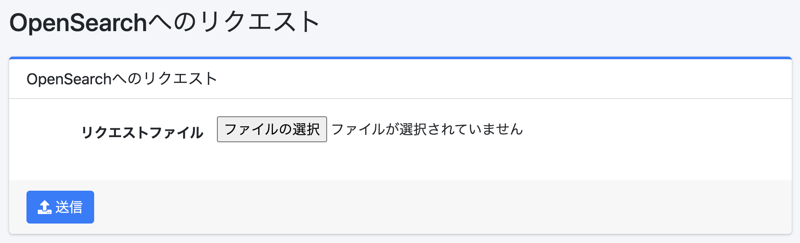

==========================
OpenSearchへのリクエスト
==========================

概要
====

このページでは、JSONファイルに記述したリクエストをOpenSearchに送信します。

|image0|

この画面は左メニューにありません。表示するには、管理者としてログインした後、 ``/admin/sereq/`` をURLのパスとして入力してください。
送信するには、管理者（ ``admin`` ロール）または ``admin-sereq`` ロールが必要です。

操作方法
========

リクエストの送信
----------------

OpenSearchに送信したいリクエストをJSONファイルとして作成し、「リクエストファイル」としてそのファイルを選択して「送信」ボタンをクリックすると、OpenSearchにリクエストが送信されます。
レスポンスはファイルとしてダウンロードされます。

設定項目
--------

リクエストファイル
::::::::::::::::::

リクエストを記述したファイルを指定します。

1行目に ``<メソッド> <パス>`` を半角スペース1つで区切って記述し、2行目以降にリクエストボディ（クエリーDSLなど）を記述します。
メソッドには GET、POST、PUT、DELETE を指定できます。パスはOpenSearchに対するパスで、先頭の ``/`` は省略できます。
たとえば、ファイルの内容は以下のようになります。

::

    POST /_search
    {
      "query": {
        "match_all": {}
      }
    }

ボディの改行は取り除かれ、各行が連結されて送信されます。このため、1行に1つのJSONを並べる形式（ ``_bulk`` など）のリクエストは送信できません。

.. warning::

   メソッドが PUT や DELETE の場合も、リクエストはそのままOpenSearchに送信されます。
   ファイルの内容によっては、 |Fess| が使用するインデックスの変更や削除など、データを失う操作になります。送信する前に内容を十分に確認してください。

