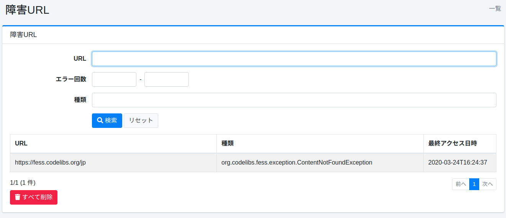
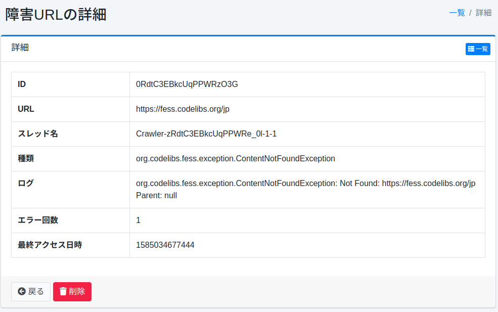

======
障害URL
======

概要
====

ここでは、障害 URL について説明します。
クロール時に取得できなかった URL が記録され、障害 URL として確認することができます。

管理方法
======

表示方法
------

障害 URL を確認するための一覧ページを開くには、左メニューの [システム情報 > 障害URL] をクリックします。

|image0|

障害 URL の確認リンクをクリックすると、詳細が表示されます。

一覧の項目
----------

一覧には、URL・種別・MIMEタイプ・HTTPステータス・サイズ（バイト）・最終アクセス日時が表示されます。

MIMEタイプ・HTTPステータス・サイズは、クローラーが把握できた場合にだけ記録され、把握できなかった場合は空欄になります。

- 記録される場合: ドキュメントを取得したあとに処理が失敗したとき（テキスト抽出の失敗、サイズ上限の超過など）と、 ``crawler.failure.url.status.codes`` に含まれる HTTP ステータスが返されたとき。取得する前にサイズ上限を超えると判断されて拒否された場合は、サイズだけが記録されます。
- 記録されない場合: タイムアウトや接続エラーなど、応答を取得できなかったとき、およびデータストアのクロールの失敗。
- HTTP ステータスは、 ``http`` / ``https`` の URL にだけ記録されます。ファイルや SMB などでは空欄です。
- |Fess| 15.10 より前に記録された障害 URL では、その URL が再び失敗するまで、これらの項目は空欄です。

CSVダウンロード
---------------

一覧の [CSVをダウンロード] ボタンで、検索フォームに入力した条件（URL・エラー回数・種別）に一致する障害 URL を CSV ファイルでダウンロードできます。ファイル名は ``failureurl_yyyyMMddHHmmss.csv`` です。

- 先頭行は列名で、 ``url`` ・ ``errorName`` ・ ``errorCount`` ・ ``lastAccessTime`` ・ ``httpStatusCode`` ・ ``mimeType`` ・ ``contentLength`` の順に並びます。ログ（スタックトレース）は含まれません。
- 条件に一致するすべての行が、最終アクセス日時の新しいものから順に出力されます。ページングの影響や行数の上限はありません。
- ``lastAccessTime`` は UTC の ISO 8601 形式（例: ``2026-01-01T00:00:00.000Z`` ）です。
- 文字コードは [システム > 全般] の「CSVファイルのエンコード」に従い、UTF-8 の場合は BOM が付きます。
- 表計算ソフトが式として実行しないように、 ``=`` ・ ``+`` ・ ``-`` ・ ``@`` ・ タブ・復帰のいずれかで始まる文字列の先頭には ``'`` が付きます。

障害URLの詳細
===========

障害URLの詳細ではクロール時に発生した例外が記録されます。

|image1|

詳細の内容
--------

URL
::::

例外が発生したURL。

スレッド名
::::::::

クロールを実行していたスレッド名。
ログファイルを確認するときに利用できます。

種別
::::

例外の種別。

HTTPステータス
::::::::::::::

ドキュメントを取得したときの HTTP ステータス。 ``http`` / ``https`` の URL で、クローラーが把握できた場合にのみ記録されます。

MIMEタイプ
::::::::::

ドキュメントの MIME タイプ。クローラーが把握できた場合にのみ記録されます。

サイズ (バイト)
:::::::::::::::

ドキュメントのサイズ。クローラーが把握できた場合にのみ記録されます。

ログ
::::

例外の内容。

エラー回数
::::::::

この例外が発生した回数。

最終アクセス日時
::::::::::::

この例外が発生した時刻。

